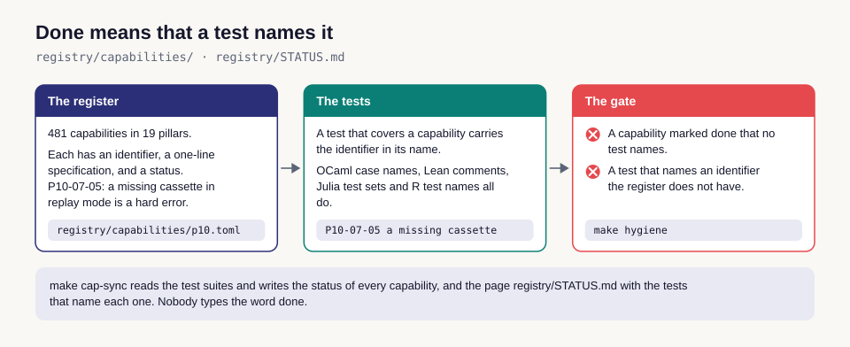

# Contributing

Thank you for considering a contribution. This page describes how the repository works.

## Before you start

- `make setup` checks the toolchains. `make ci` runs everything the required workflow runs; a change that passes
  locally passes there.
- No test needs an API key or a network connection. If yours does, it belongs behind `--mode record`, not in the
  suite.

## The capability register

Every planned capability has an identifier such as `P10-07-05` and an entry in `registry/capabilities/`. To
implement one:

  

1. Write the code in the directory its group names.
2. Write a test whose name starts with the identifier. The conventions:

   | Language | Convention |
   |---|---|
   | OCaml | `case "P10-07-05 a missing cassette ..." (fun () -> ...)` |
   | Lean | a comment line `-- cap: P01-04-01` directly above the test |
   | Julia | `@testset "P08-03-02 interval propagation ..." begin ... end` |
   | R | `test_that("P15-02-01 Wilson interval ...", { ... })` |

3. Run `make cap-sync`. It marks the capability done, lists the test files and rewrites `registry/STATUS.md`.

Tag a test only when the capability is implemented as its register entry describes it. A test for part of a
capability is welcome without a tag.

## Conventions

- **Status words.** Use only the eight words of the status vocabulary. Never describe a result as proved or
  verified unless `Trust_policy.decide` said so.
- **Errors.** A user-visible error has a code `MTH-AREA-NNNN`, a message and, where possible, a hint. New codes go
  into `docs/reference/errors.md`.
- **Lean.** The libraries under `lean/Maithic`, `lean/MaithicBridge` and `lean/MaithicBench` contain no `sorry`,
  no added axiom and no native evaluation, and build without warnings.
- **Secrets.** Nothing shaped like an API key may appear in any file, fixtures included. Tests that need such a
  string assemble it at run time.
- **Neutral authorship.** Repository content does not state which tools were used to write it.
- **Language share.** New logic goes into the language whose role it is: orchestration in OCaml, proofs in Lean,
  numerics in Julia, statistics in R.
- **Headers.** Source files start with the copyright notice used throughout the repository.

`make hygiene` checks all of the above that a machine can check.

## Generated and mirrored files

`config/models.toml`, `config/prompts/*` and `docs/reference/configuration-table.md` mirror data compiled into the
command; change the source and run `make sync`. `fixtures/bridge/transcripts/` comes from `make transcripts`,
`fixtures/cassettes/*.json` from `make cassettes`, `bench/suites/manifest.json` from `make manifest`. What Lean
says about the demonstration sources, under `fixtures/intel`, `fixtures/corpus`, `fixtures/review` and
`fixtures/refute`, comes from `make lean-fixtures`, and the schemas under `schemas/corpus` from `make sync`.

  

The figures under `assets/readme` are drawn by `make figures`, and the pictures of terminal sessions, the files
named `term-*.svg`, by `make shots` from what the built command prints. Neither is edited by hand. The text
of every picture states its length, in the SVG attribute `textLength`, so that the layout does not depend on
the fonts of the reader's system; a diagram that is added by hand should do the same.

## Pull requests

Keep a pull request to one topic. Describe what changed and how you tested it. By contributing you agree that
your contribution is licensed under the Apache License 2.0. The [code of conduct](CODE_OF_CONDUCT.md) applies
to everything in the repository, and [`GOVERNANCE.md`](GOVERNANCE.md) says how decisions are made.
