<p align="center">
  
</p>

**Maithic** is a toolkit for AI-assisted mathematics and formal verification on [Lean 4](https://lean-lang.org).
A model, or plain automation, proposes a proof. Lean's kernel checks it. A trust policy and a re-check in a fresh
process decide whether the result may be called *verified*. Nothing else in the system can produce that word.

It works with the model provider you choose, **Anthropic, OpenAI or xAI**, with your own API key, and it works
with **no key at all**: the built-in automation proves what it can, and every test and demonstration in this
repository runs from stored answers with no network.

Nineteen parts make up the toolkit. Each has a command, and all of them answer to the same judge:

<p align="center">
  
</p>

> **Status: in development, version 0.1.0.** Maithic is nineteen parts that work together, from the proving loop
> to the trust ledger. Each part is a set of capabilities, and a capability counts as done only when a test names
> it. All 481 capabilities of this release are done; [`registry/STATUS.md`](registry/STATUS.md) lists every one
> with the tests that name it, and [`ROADMAP.md`](ROADMAP.md) says what comes next.

## Contents

- [Try it](#try-it)
- [How a result becomes verified](#how-a-result-becomes-verified)
- [Searching one tactic at a time](#searching-one-tactic-at-a-time)
- [Testing a statement before proving it](#testing-a-statement-before-proving-it)
- [Refuting a statement, with Lean as the judge](#refuting-a-statement-with-lean-as-the-judge)
- [From a problem in words to a statement in Lean](#from-a-problem-in-words-to-a-statement-in-lean)
- [A council: several roles, one judge](#a-council-several-roles-one-judge)
- [Reading a codebase as a graph](#reading-a-codebase-as-a-graph)
- [Datasets from proofs](#datasets-from-proofs)
- [Guiding the search with a small model](#guiding-the-search-with-a-small-model)
- [Review that Lean checks](#review-that-lean-checks)
- [Repairing proofs that stopped compiling](#repairing-proofs-that-stopped-compiling)
- [Planning a formalization and tracking it](#planning-a-formalization-and-tracking-it)
- [Finding what is already there](#finding-what-is-already-there)
- [Oracles and certificates](#oracles-and-certificates)
- [Checkers with proofs](#checkers-with-proofs)
- [A neural network, with the kernel as judge](#a-neural-network-with-the-kernel-as-judge)
- [Algorithms: drafted, tested, proved, measured](#algorithms-drafted-tested-proved-measured)
- [Model providers and keys](#model-providers-and-keys)
- [Commands](#commands)
- [The Bridge: one Lean process behind every command](#the-bridge-one-lean-process-behind-every-command)
- [What is in the repository](#what-is-in-the-repository)
- [Verified libraries](#verified-libraries)
- [Benchmark](#benchmark)
- [What the kernel says about this repository](#what-the-kernel-says-about-this-repository)
- [Development](#development)
- [Documentation](#documentation)
- [License](#license)

## Try it

Four steps take you from a clone to a proof that Lean's kernel has checked, and none of them needs a key:

<p align="center">
  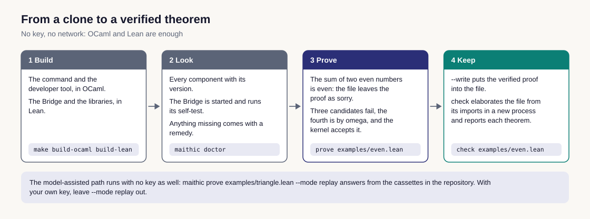
</p>

The command and the Lean libraries need OCaml with dune, and Lean 4 through
[elan](https://lean-lang.org/install/). Julia and R are needed only for the parts that compute and measure:

<p align="center">
  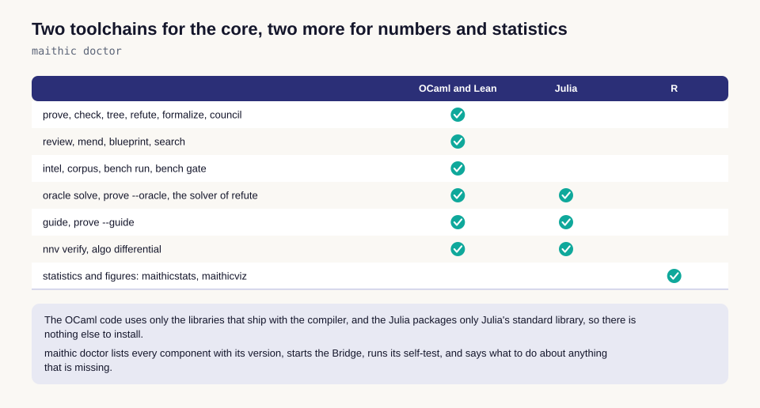
</p>

This release is built and tested with OCaml 5.5, Lean 4.36, Julia 1.13 and R 4.5, the versions that the workflow
pins. [`docs/install.md`](docs/install.md) has the details.

```sh
make build-ocaml build-lean
alias maithic="$PWD/ocaml/_build/default/bin/maithic/main.exe"
maithic doctor
```

`doctor` checks each toolchain, starts the Bridge and runs its self-test, and says what to do about anything that
is missing:

<p align="center">
  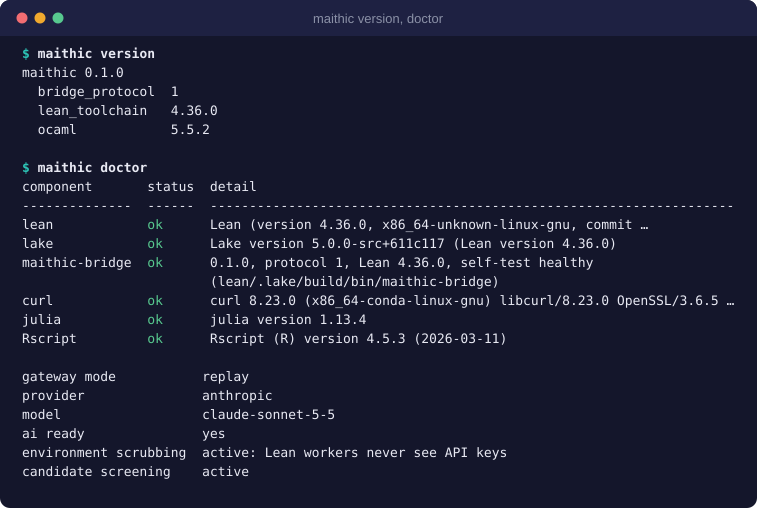
</p>

**Prove a theorem with no key.** [`examples/even.lean`](examples/even.lean) states that the sum of two even
numbers is even and leaves the proof as `sorry`:

```sh
maithic prove examples/even.lean
```

<p align="center">
  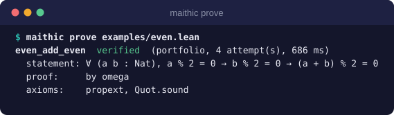
</p>

Three candidates failed, the fourth was accepted by the kernel, the axioms it rests on were audited, and a second
Lean process re-checked the finished text before the word *verified* was printed. Add `--write` to put the proof
into the file.

**See the model-assisted path, still with no key.** [`examples/triangle.lean`](examples/triangle.lean) needs
induction, which the automation portfolio does not find. In replay mode the model's answers come from the
cassettes in [`fixtures/cassettes/`](fixtures/cassettes), and `--verbose` lists every candidate that was tried:

```sh
maithic prove examples/triangle.lean --mode replay --provider anthropic --verbose
```

<p align="center">
  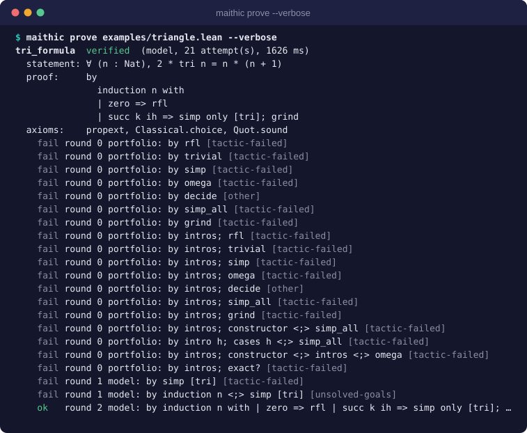
</p>

The eighteen candidates of the automation failed, and so did the model's first two. Lean's error for each went
back to the model, and the proof of the second round was accepted. This is the whole run, with who said what to
whom:

<p align="center">
  
</p>

The same command works with `--provider openai` and `--provider xai`. The cassettes are test fixtures written by
hand, not recordings of a model; they exist so that this path can be run and tested anywhere.

**Use your own key.** Export the key of the provider you want and drop `--mode replay`:

```sh
export ANTHROPIC_API_KEY=...        # or OPENAI_API_KEY, or XAI_API_KEY
maithic prove examples/triangle.lean --provider anthropic
```

Nothing else changes between the two ways of running: the same commands, the same checks by Lean, and a different
source for the model's words.

<p align="center">
  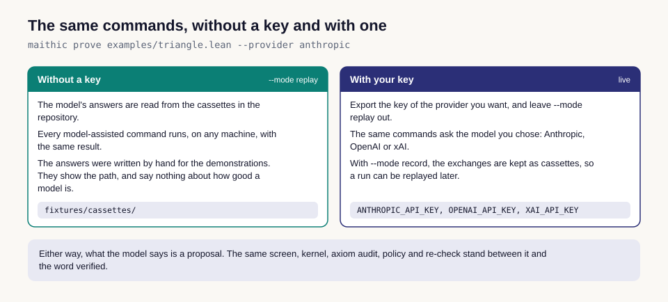
</p>

**State it, argue about it, repair it.** Proving is one of the things the command does. These three also run
from the cassettes, with no key:

```sh
export MAITHIC_GATEWAY_MODE=replay
maithic formalize "Show that the square of a negative integer is positive." --candidates 4
maithic council examples/council.lean
maithic mend repair fixtures/mend/lean/Upgrade.lean --renames fixtures/mend/renames.toml
```

The first turns a sentence into a Lean statement and lets Lean throw out the candidates that are vacuous or
false. The second puts four roles to work on a theorem, with Lean as the only judge. The third repairs a file
that an upgrade broke, and keeps no edit that Lean does not accept. Each has a section below.

## How a result becomes verified

<p align="center">
  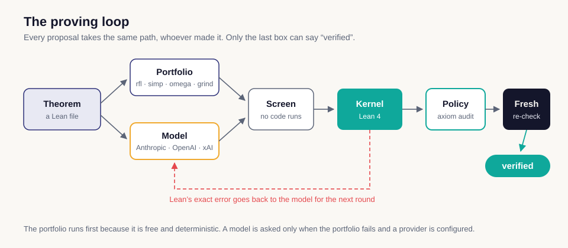
</p>

Every proposal takes the same path, whether it came from `omega` or from a model. Proposals have four sources,
and they are tried in the order of what they cost:

<p align="center">
  
</p>

Five layers stand between a proposal and the status `verified`:

<p align="center">
  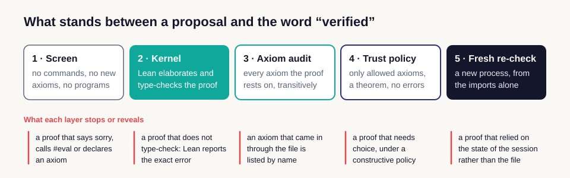
</p>

**The screen.** A candidate from a model is text from outside, and it is read before Lean sees it. A proof has no
need to declare an axiom, set an option or run a program, so a text that tries is refused without being
elaborated:

<p align="center">
  
</p>

**The axiom audit.** When the kernel has accepted a proof, Lean is asked which axioms the proof rests on, through
everything it uses. The answer decides more than any reading of the proof could:

<p align="center">
  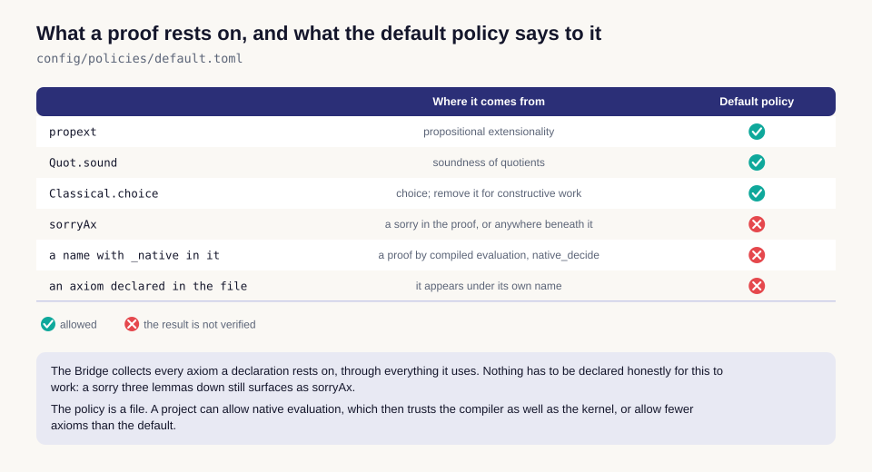
</p>

**The fresh re-check.** A session that has tried a hundred candidates is not the place to judge a result. The
finished text is elaborated once more, from its imports, in a process that has seen nothing else:

<p align="center">
  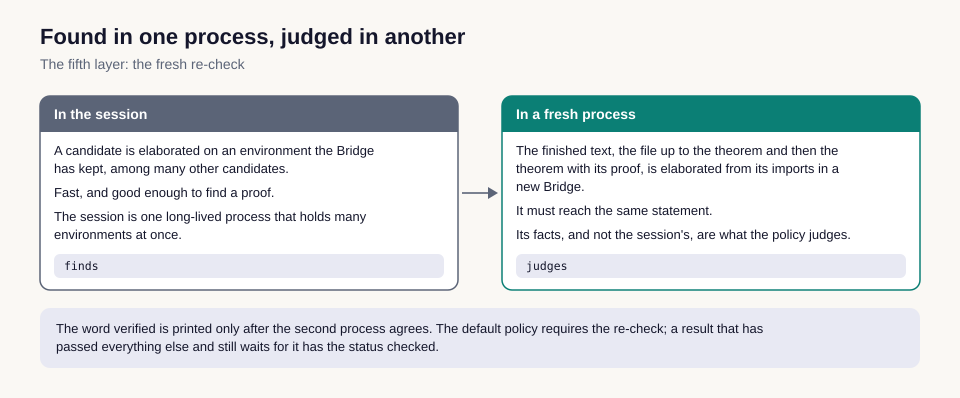
</p>

The policy is a file. The default, [`config/policies/default.toml`](config/policies/default.toml), allows the
three standard axioms, rejects proofs that trust compiled evaluation and requires the re-check. Maithic uses a
fixed vocabulary of eight status words; `maithic help status` prints it, and only `verified` is ever presented as
an established result.

<p align="center">
  
</p>

`maithic check` applies the same layers to a file that is already written. It reports every theorem with its
status and the axioms it rests on, and a proof that is not finished is reported as failed, whatever else is true
of it:

<p align="center">
  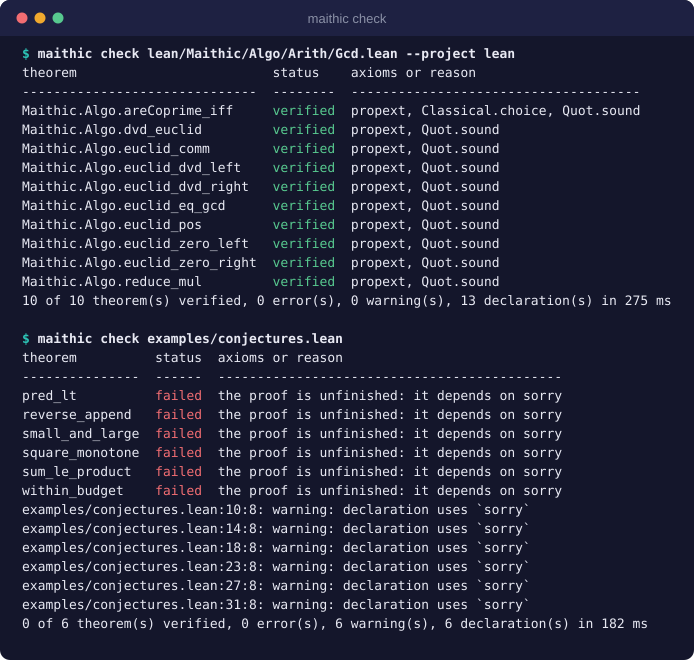
</p>

What the word *verified* does not cover is said as plainly as what it does:

<p align="center">
  
</p>

## Searching one tactic at a time

Proposing whole proofs is one way to search. The other is to take a proof apart: open the goal, try a tactic,
look at what is left, and try again from there. The Bridge holds every proof state it has reached, so a search
can branch from any of them without redoing the steps that led there.

<p align="center">
  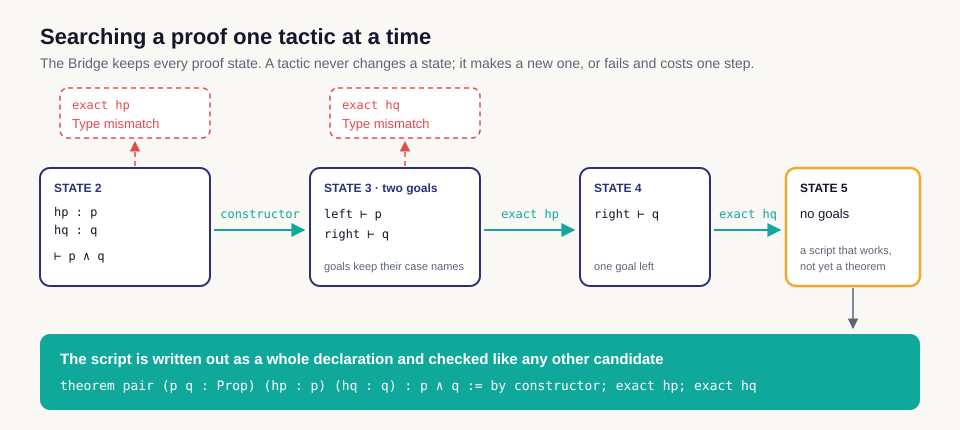
</p>

```json
{"method": "startProof", "params": {"env": 1, "statement": "theorem pair (p q : Prop) (hp : p) (hq : q) : p ∧ q"}}
{"method": "tryTactics", "params": {"state": 2, "tactics": ["exact hp", "exact hq", "constructor", "rfl"]}}
```

`maithic prove --search` runs such a search when the automation portfolio has failed and before any model is
asked. Every goal is searched on its own: a tactic that leaves two goals makes two problems, a goal met twice is
searched once, and a tactic that leads back to a goal above it is blocked. With no model, the tactics come from
the shape of the goal. The theorem of [`examples/double.lean`](examples/double.lean) needs an induction that no
single call of automation finds:

```console
$ maithic prove examples/double.lean --no-ai
double_eq  failed  (-, 18 attempt(s), 1170 ms)
  statement: theorem double_eq (n : Nat) : double n = 2 * n
  reason:    no proof was found in 18 attempt(s)
  note:      the model was not asked (prove.use_ai is false)
```

With `--search` the same command finds the induction, and the proof it builds goes through the same five layers:

<p align="center">
  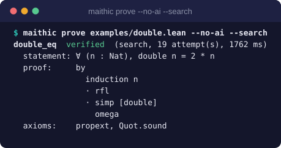
</p>

`--search-trees DIR` writes the record of each search with a drawing of it. The picture below is drawn by the
command, from what happened:

<p align="center">
  
</p>

`maithic tree` reads a record back, with neither Lean nor the file the search was about: every goal that was
expanded, what each tactic did on it, and how long it took.

<p align="center">
  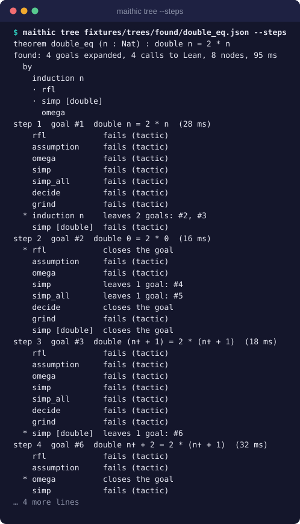
</p>

A state with no goals left is a script that works, not a theorem. The script goes back through the five layers
above as a whole declaration; [`docs/adr/0006`](docs/adr/0006-proof-states-are-not-evidence.md) explains why
nothing less counts. [`docs/guides/search.md`](docs/guides/search.md) describes the strategies, the budgets and
the limits of the search, and
[`docs/reference/bridge-protocol.md`](docs/reference/bridge-protocol.md#proof-states) the requests.

## Testing a statement before proving it

A proof attempt on a false statement spends its whole budget and proves nothing. A proof of a vacuous statement
proves nothing worth having. Three commands of the Lean library examine a statement before anyone tries to
prove it.

<p align="center">
  
</p>

```lean
import Maithic.Refute.Testing
import Maithic.Refute.Vacuity

#maithic_test ∀ l : List Nat, l.reverse.reverse = l
-- passed 100 cases

#maithic_test ∀ x y : Int, x * y ≥ 0
-- error: falsified at case 12, shrunk 2 times
--   x := 1
--   y := -1

#maithic_vacuous ∀ (x : Nat) (h₁ : x < 3) (h₂ : x > 5), x = 4
-- warning: vacuous: the hypotheses are contradictory (found by omega, from h₁ and h₂)
```

A test run is determined by its options: the random stream is SplitMix64 from a seed, the same stream as in the
Julia packages, so a failure is found again by running the same line. A finding of vacuity rests on a derivation
that the kernel accepted, and it names the hypotheses the derivation used. Passing a hundred cases is reported
as that and as nothing more. [`docs/guides/testing-statements.md`](docs/guides/testing-statements.md) has the
options, the tactic and the types that can be generated.

## Refuting a statement, with Lean as the judge

`maithic refute` brings those checks to the command line and adds a solver. It examines the unproved theorems
of a file by three methods, and it reports a counterexample only when Lean has accepted a proof that the
statement is false there. The proof is printed, and anyone can check it again.

<p align="center">
  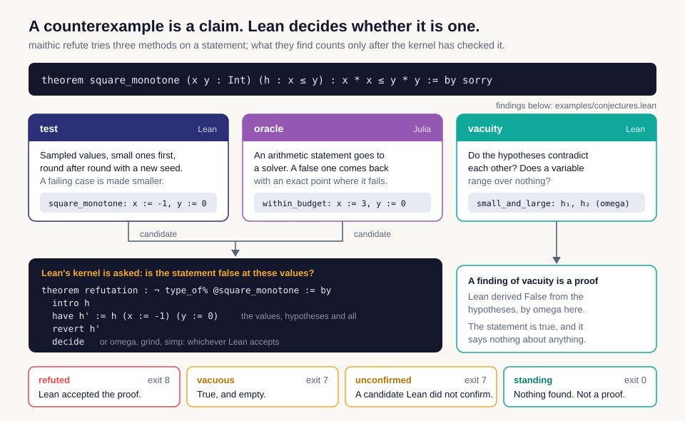
</p>

Three statements, and the three answers:

<p align="center">
  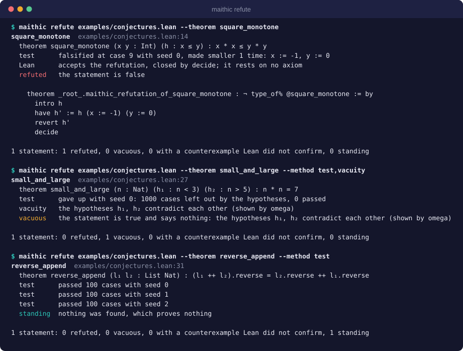
</p>

A test that fails and a solver that names a point are both claims. The values are put into the statement,
hypotheses and all, and a decision procedure of Lean settles what is left; a point that the hypotheses exclude
can never confirm anything. A statement that is false by a slip of the key is caught the same way:

```lean
theorem pred_lt (n : Nat) (h : 0 < n) : n - 1 < m := by sorry   -- `m` was meant to be `n`
```

Lean takes a name it does not know for a new variable, so this elaborates and says something else. `refute`
answers with `m := 0, n := 1`, and the variable nobody wrote is the clue. Given a file and no theorem, the command
examines every statement whose proof is unfinished, and this one is among the four it refutes:

<p align="center">
  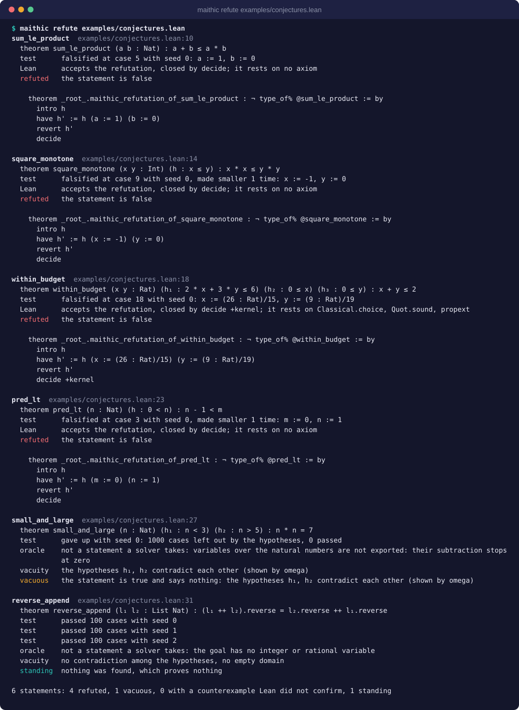
</p>

For arithmetic whose failing points are not small, the solver names an exact one:

<p align="center">
  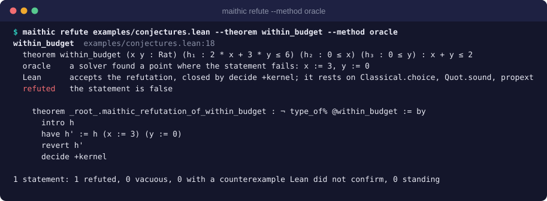
</p>

A run comes back with one of three things, and the exit status says which:

<p align="center">
  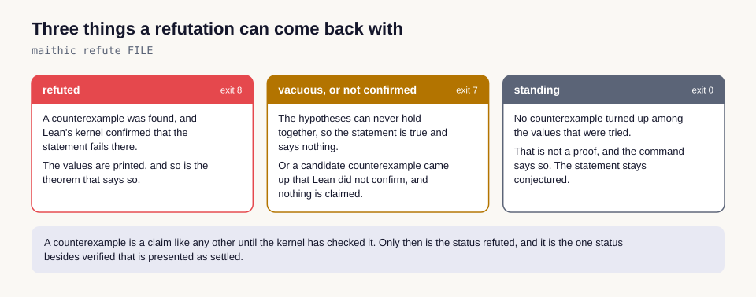
</p>

Nothing found is reported as that and as nothing more. [`docs/guides/refuting-statements.md`](docs/guides/refuting-statements.md)
has the methods, the budgets and the way a counterexample is confirmed.

## From a problem in words to a statement in Lean

Before a theorem can be proved it has to be written down, and the step from a sentence to a formal statement is
where meaning is lost without anyone noticing. A statement can compile and say something else: about the wrong
kind of number, with a bound that is off by one, or with hypotheses that cannot hold together, which makes it
true and empty. `maithic formalize` has a model draft several statements and then puts each one to Lean, which
rejects the vacuous and the false ones and never needs to be told what the sentence meant.

<p align="center">
  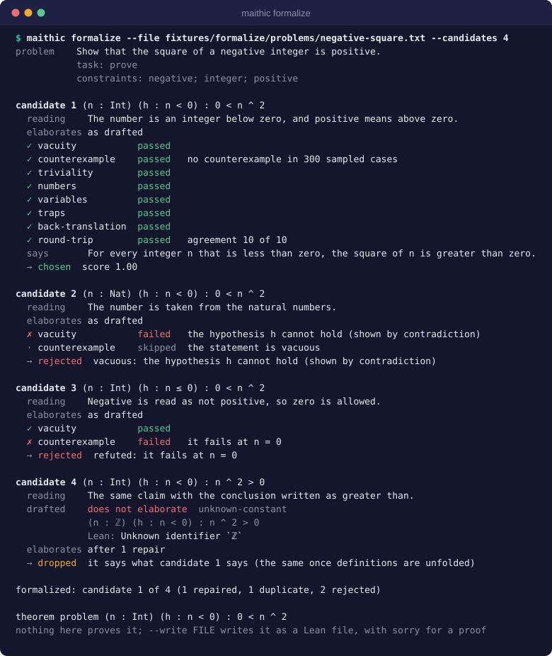
</p>

Three of the four candidates are out before any model is asked to read anything: one because no natural number
is below zero, one because zero is not negative, and one because it is the first statement in other notation.
A statement that does not compile goes back to the model with Lean's error and the signatures of the names Lean
does know. Only then come the softer checks: whether every number of the problem is in the statement, whether
an operation means what its symbol suggests, and whether a model that sees the statement alone describes the
problem it came from. Those flag a statement; they never pass one that Lean rejected.

<p align="center">
  
</p>

Sometimes the problem itself is off, and the report says how:

<p align="center">
  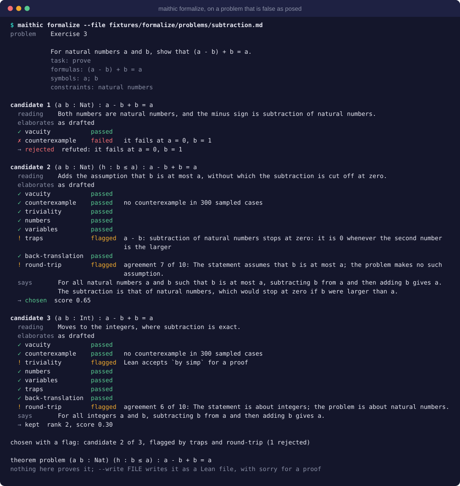
</p>

Subtraction of natural numbers stops at zero, so the sentence as written is false, and Lean says where. The
statement that survives adds `b ≤ a`, the run ends with exit status 7, and a person decides whether that is the
statement they meant. `--write` puts the chosen statement into a Lean file with `sorry` for a proof, and there
the prover takes over:

<p align="center">
  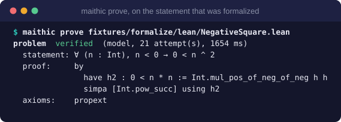
</p>

Three problems were put through the command, and this is what became of every statement that was drafted:

<p align="center">
  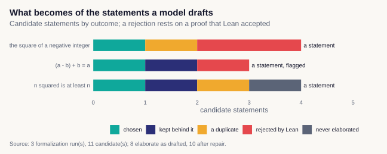
</p>

The three runs in the figure are recorded under [`fixtures/formalize`](fixtures/formalize) and replay without a
key. Of their eleven drafted statements, eight elaborate as drafted and ten after repair; three are rejected by
Lean on a proof. With `--statement` the candidates are yours, and with `--no-ai` as well no model is asked at
all. [`docs/guides/formalizing.md`](docs/guides/formalizing.md) has the seven steps, the checks and the three
Lean commands behind them.

## A council: several roles, one judge

A model that is asked to prove a theorem, check its own proof and report the result will report success.
`maithic council` splits that work among roles that cannot vouch for each other. A researcher names lemmas, and
every name is looked up in Lean. A prover proposes proofs. A critic explains failures from Lean's own errors.
A verifier gives every proof to Lean, and asks no model.

<p align="center">
  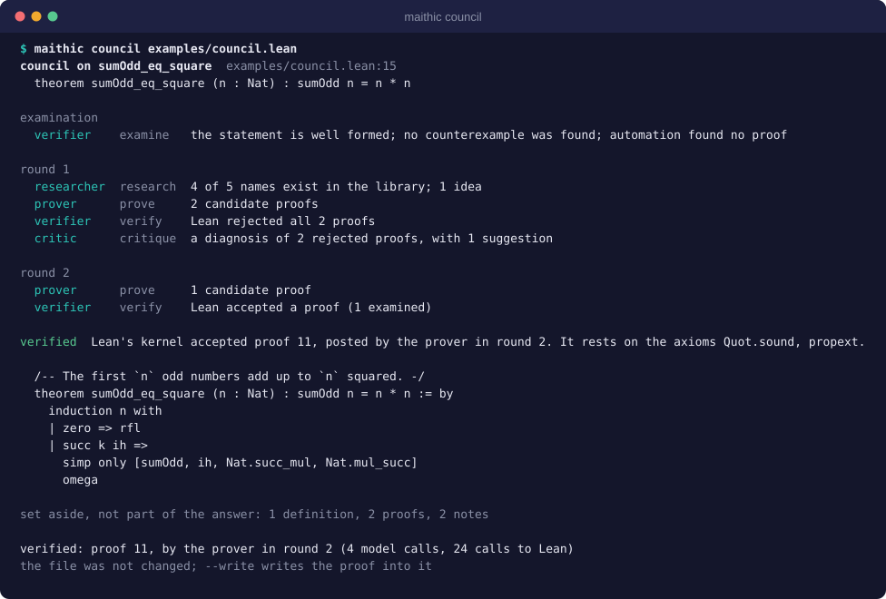
</p>

The members do not hand work to each other. They post it on a shared board, where an item is never changed and
a claim has a status: `conjectured` when it is posted, whatever its text says, `formalized` when Lean has
elaborated its statement, `verified` when the kernel has accepted a proof within the trust policy, `refuted`
when Lean has accepted a proof that it is false at given values. The functions that change a status take
evidence, and evidence is made from an answer of Lean by tools that only the verifier is handed. The prover can
post "this is proved" as often as it likes; it is a note.

<p align="center">
  
</p>

The same session, read as a sequence of turns:

<p align="center">
  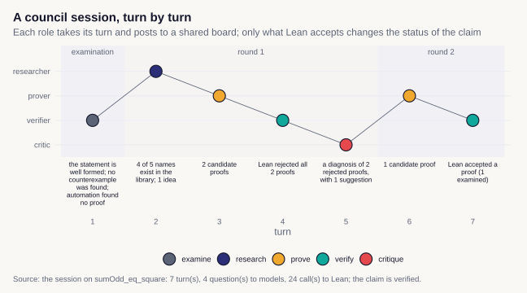
</p>

In this session one of the five lemmas the researcher named does not exist; Lean said so and it never reached
the prover. The critic's remark, that `omega` cannot read a product of two variables, is what the second
attempt acts on. The session took four questions to models and twenty-four calls to Lean, and the answer at the
end is built from what Lean accepted and from nothing else that was said. A session has budgets for tokens,
cost, time and calls, and it begins with an examination that costs no tokens and often settles the matter:

<p align="center">
  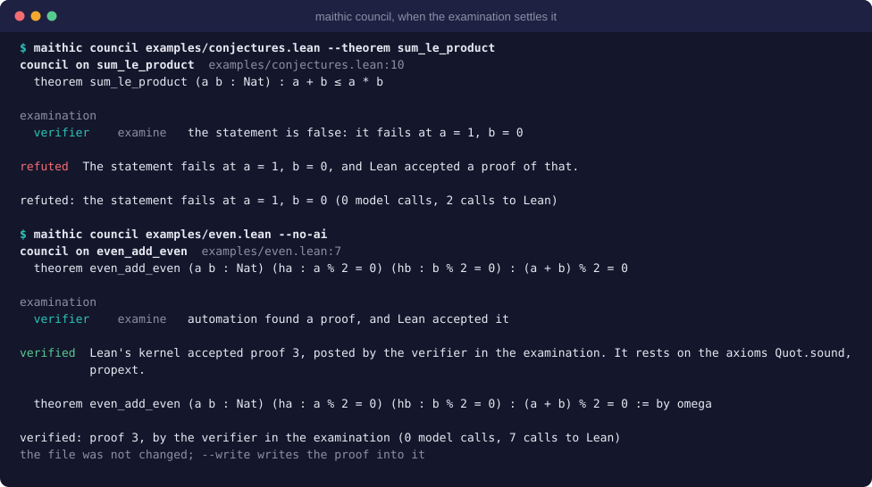
</p>

[`docs/guides/council.md`](docs/guides/council.md) has the roles, the board, the budgets and the transcript;
[`fixtures/council/sum-odd.md`](fixtures/council/sum-odd.md) is the transcript of the session above.

## Reading a codebase as a graph

Lean knows what every declaration refers to. `maithic intel scan` asks once and keeps the answer as a graph;
the questions that follow need no Lean and take milliseconds.

<p align="center">
  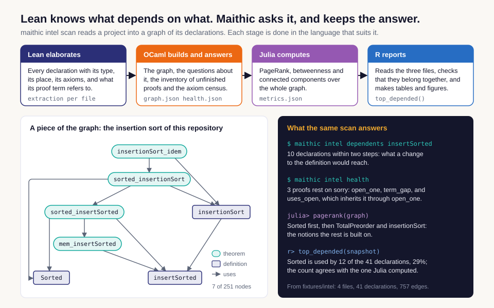
</p>

One scan, and the questions it answers:

<p align="center">
  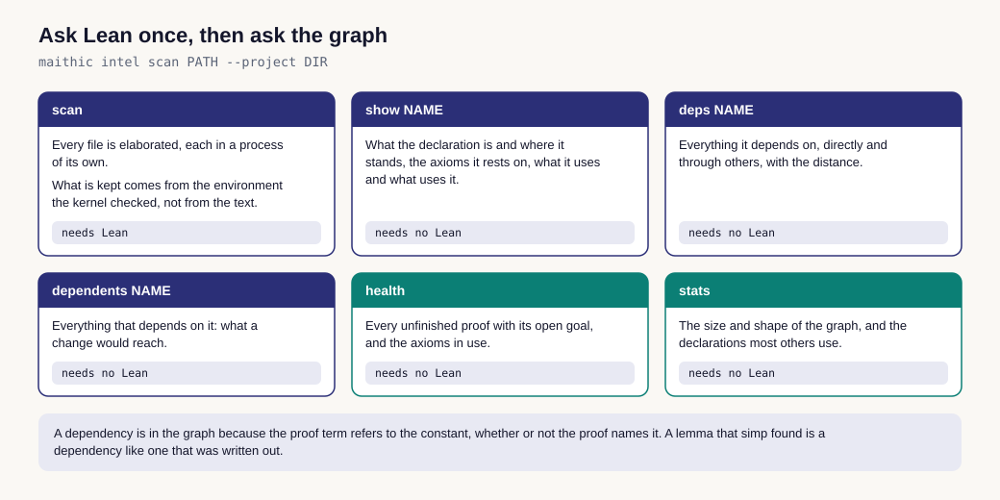
</p>

Here is the scan of the algorithm library of this repository, and the shape of its graph:

<p align="center">
  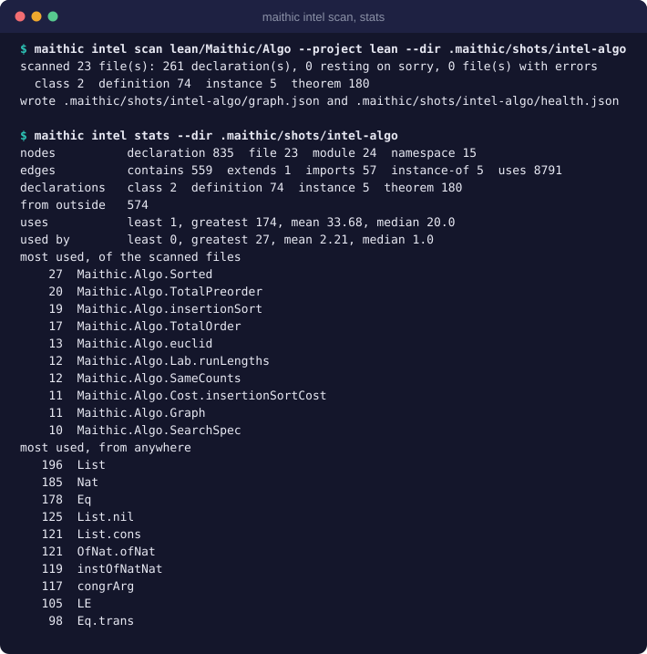
</p>

`show` and `dependents` answer what a change to one definition would reach:

<p align="center">
  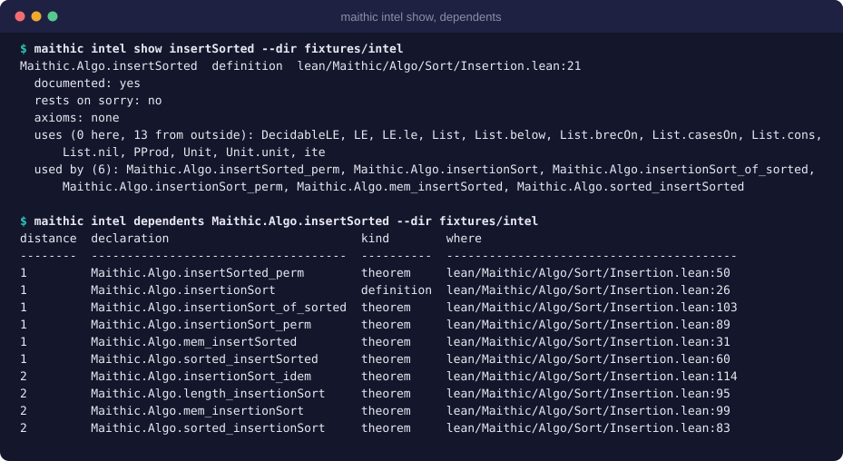
</p>

`deps` looks the other way, at everything a theorem rests on, with the distance of each declaration:

<p align="center">
  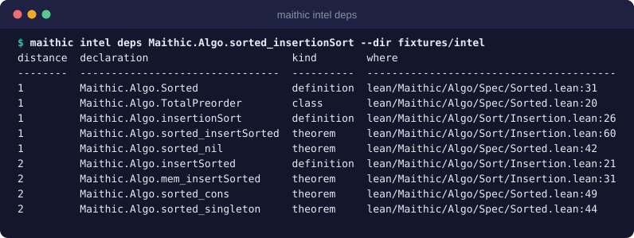
</p>

The graph is read from the environment the kernel checked, not from the text: a dependency is there because
the proof term refers to the constant. That is why the report on the state of a project can say more than a
search for the word `sorry`. It shows the goal that is open at each one, and it lists the theorems that contain
none and still rest on one:

<p align="center">
  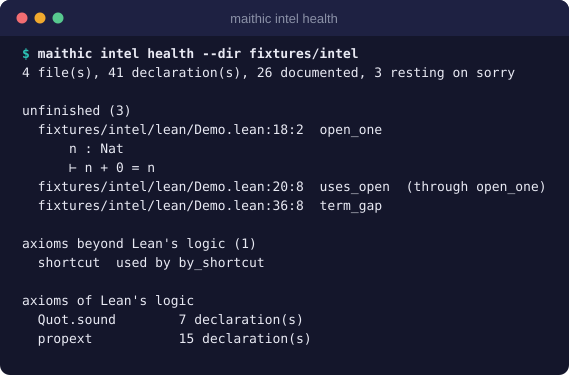
</p>

The graph also says what a library rests on. These are the declarations that most others use:

<p align="center">
  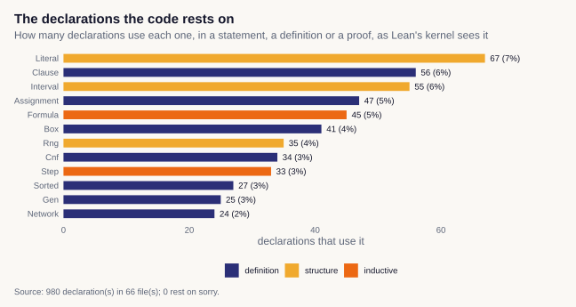
</p>

The figure is the Lean library of this repository, 980 declarations in 66 files, drawn in R from its graph.
[`docs/guides/code-intelligence.md`](docs/guides/code-intelligence.md) has the commands, the graph and the
computations on it.

## Datasets from proofs

`maithic corpus harvest` traces proofs while Lean elaborates them and writes what Lean saw: every tactic with
the goals before and after it, and every constant each proof term refers to.

<p align="center">
  
</p>

Harvesting a library and checking the result are one command each:

<p align="center">
  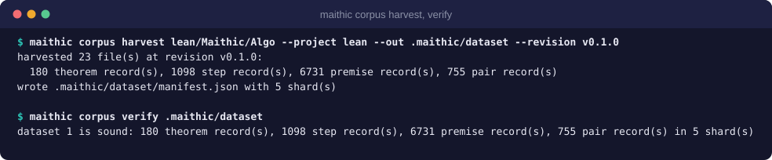
</p>

Three decisions shape what is written, and each is made so that a record says only what Lean knows:

<p align="center">
  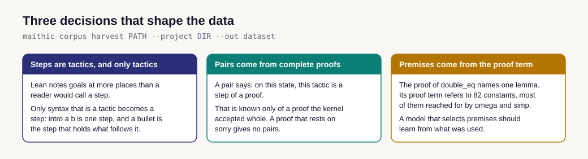
</p>

A state-and-tactic pair is written only for a proof the kernel accepted whole; a proof that rests on `sorry`
gives none. Shards are named by the hash of their content, so the same sources give the same files on any
machine, and `maithic corpus verify` checks a dataset against its manifest:

<p align="center">
  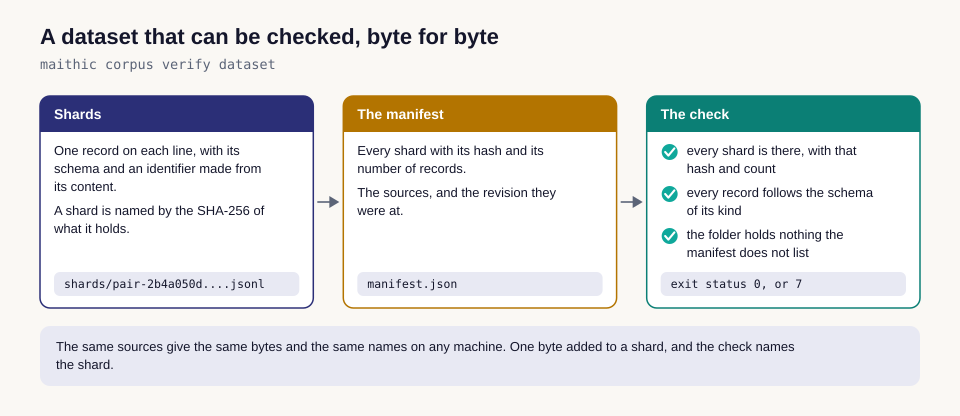
</p>

Julia splits a dataset by theorem and checks the split for leakage, because a split by step would measure a
model on proofs it has all but seen:

<p align="center">
  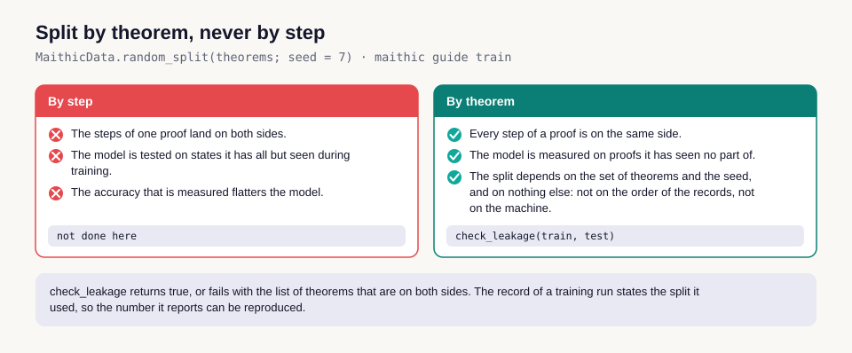
</p>

R shows what is in a dataset. These two figures are the proofs of the Lean library of this repository, 307
theorems and 1,278 pairs of a state and a tactic:

<p align="center">
  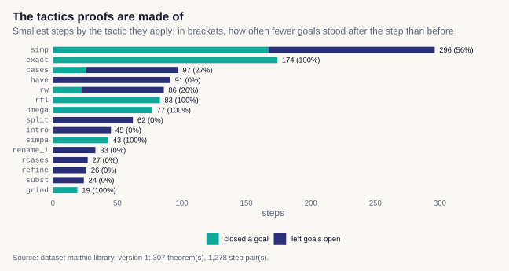
</p>

And how long the proofs are:

<p align="center">
  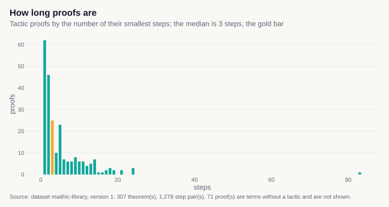
</p>

[`docs/guides/datasets.md`](docs/guides/datasets.md) has the records, the checks and the preparation of data.

## Guiding the search with a small model

The step-wise search tries tactics on a goal in a fixed order of preference, so a proof that needs the eighth
tactic on the list waits for seven others at every goal. A *guide* is a small model, trained on a dataset of
recorded proofs, that says which tactics are worth trying first on the goal at hand. It reorders the candidates
and does nothing else: every step is still run by Lean, and a proof still counts only when the kernel accepts
it.

<p align="center">
  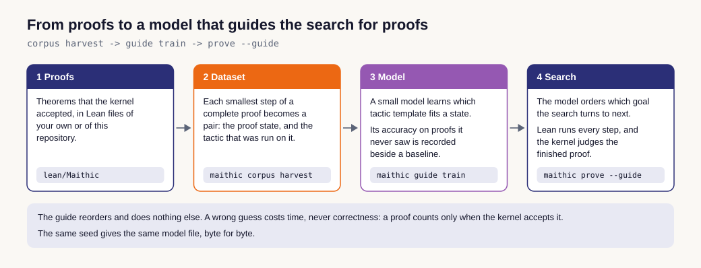
</p>

The effect shows on a single theorem, proved once without a guide and once with one:

<p align="center">
  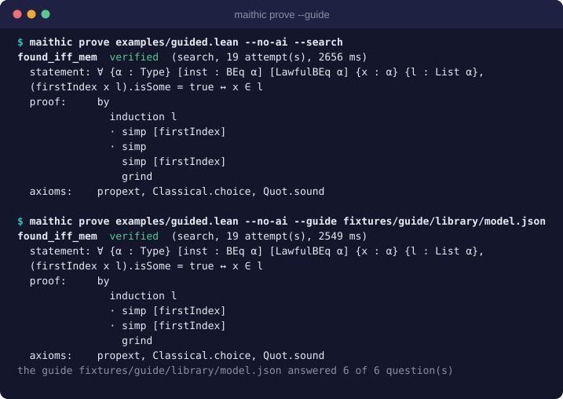
</p>

On [`examples/guided.lean`](examples/guided.lean) the unguided search expands 28 goals and visits 71 states
before it finds a proof. With the model this repository keeps it expands 6 and visits 21. The model is trained
in Julia with no dependency outside the standard library, `maithic guide train` writes it with the record of
its training, and the same seed gives the same two files byte for byte. From proofs to a model that ranks tactics
takes three commands and a few seconds:

<p align="center">
  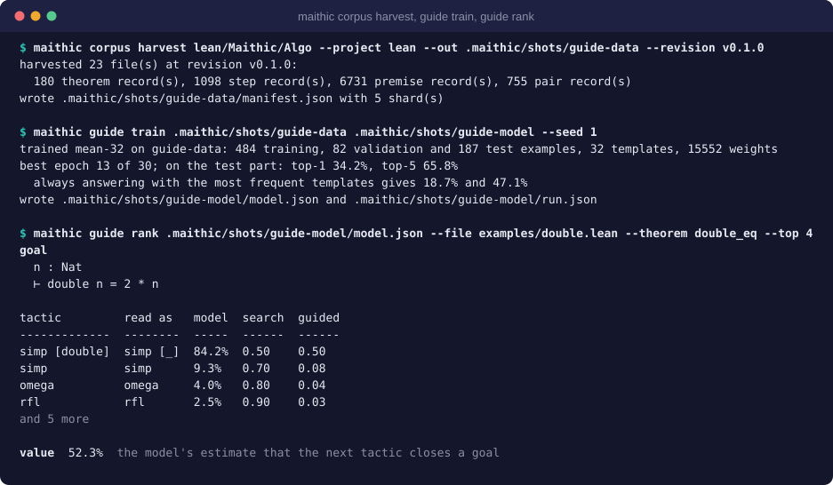
</p>

What the guide changes is the order in which goals are taken up. Each circle below is a goal that a search expanded:

<p align="center">
  
</p>

`maithic guide info` says what a model is made of, and `guide rank` shows how it would order the tactics on one goal:

<p align="center">
  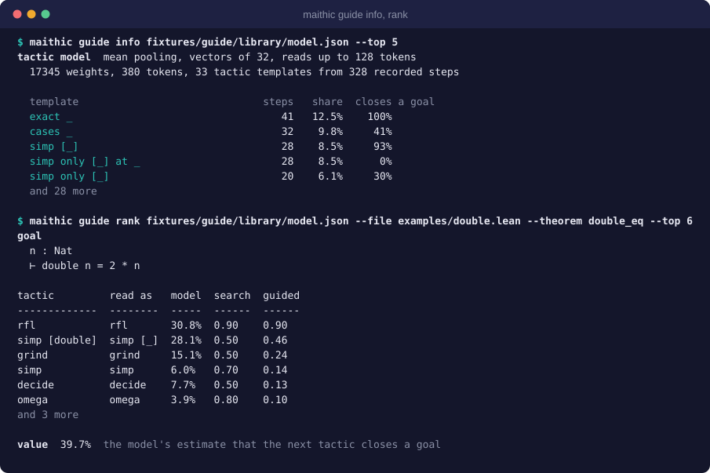
</p>

How much a guide knows is measured on proofs it never saw any part of: the data are split by theorem, not by
step. Twenty training runs are kept under [`fixtures/guide/runs`](fixtures/guide/runs), four shapes of model
with five seeds each, on 570 pairs of a state and a tactic from 104 theorems of the Lean library.

<p align="center">
  
</p>

Pooled over the seeds, the plain model with mean pooling names the tactic the proof used in 32.7% of held-out
steps (95% interval 29.3% to 36.4%), where a baseline that always answers with the most frequent templates
does so in 10.3%; within the first five ranks it is 68.0% against 48.8%. A model that reads only the first
token of a goal is no better than the baseline.

<p align="center">
  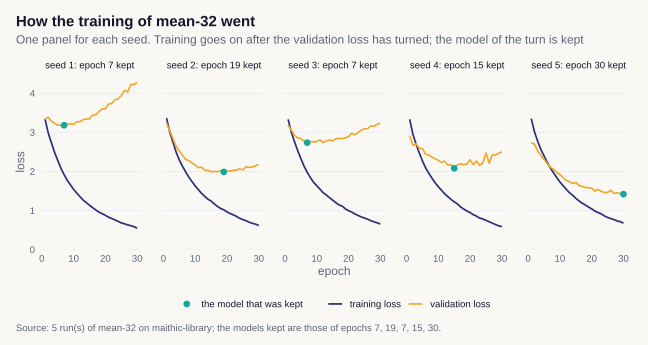
</p>

These are measurements on one small library. Ordering tactics well makes a search that would succeed succeed
sooner; it does not make a search succeed that would fail, and a search never fails because of its guide: if
the service stops answering, the search goes on in its own order and the record says so.
[`docs/guides/guided-search.md`](docs/guides/guided-search.md) has the training, the options and the numbers.

## Review that Lean checks

`maithic review` reads Lean files for unfinished work, axioms, restated theorems, missing documentation and
names out of convention, and every one of these is read from what Lean elaborated. With `--suggest` it also
tries to make proofs simpler, and it shows an edit only after Lean has compiled it.

<p align="center">
  
</p>

With `--suggest`, on a file whose proofs can be made simpler:

<p align="center">
  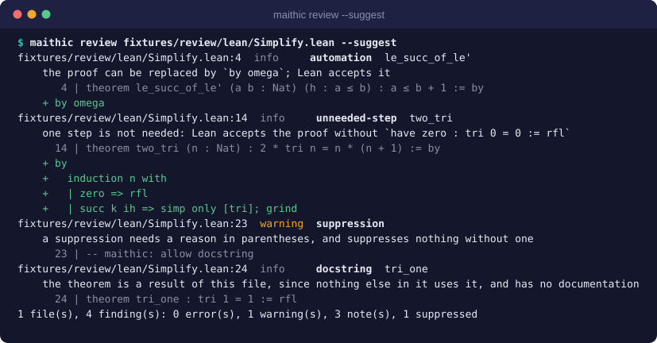
</p>

A policy sets which rules run and how serious each is; a comment above a declaration suppresses a rule there,
and has to say why. A model may add notes with `--ai`, and cannot remove or lower anything Lean found. The exit
status is 7 when a finding is an error, so a review can gate a merge. This is the review of a file with
unfinished proofs, each finding with its place, its rule and the line it is about:

<p align="center">
  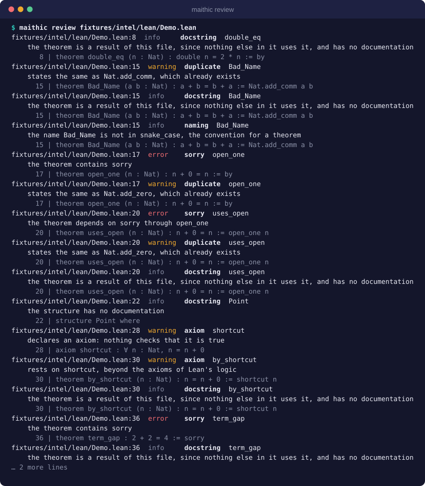
</p>

A report can also be read as counts, by rule and by how serious each finding is:

<p align="center">
  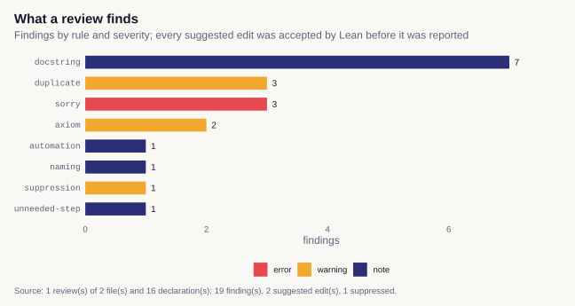
</p>

[`docs/guides/review.md`](docs/guides/review.md) has the rules, the policy and the reports.

## Repairing proofs that stopped compiling

A library is upgraded and a hundred proofs break. Most of the breakages are not about mathematics: a lemma was
renamed, a name was deprecated, a tactic closes less than it used to. `maithic mend` finds what is broken, sorts
it by cause, and repairs it with the cheapest remedy that works. An edit is kept only when Lean accepts it, and
a model may change a proof and never a statement.

<p align="center">
  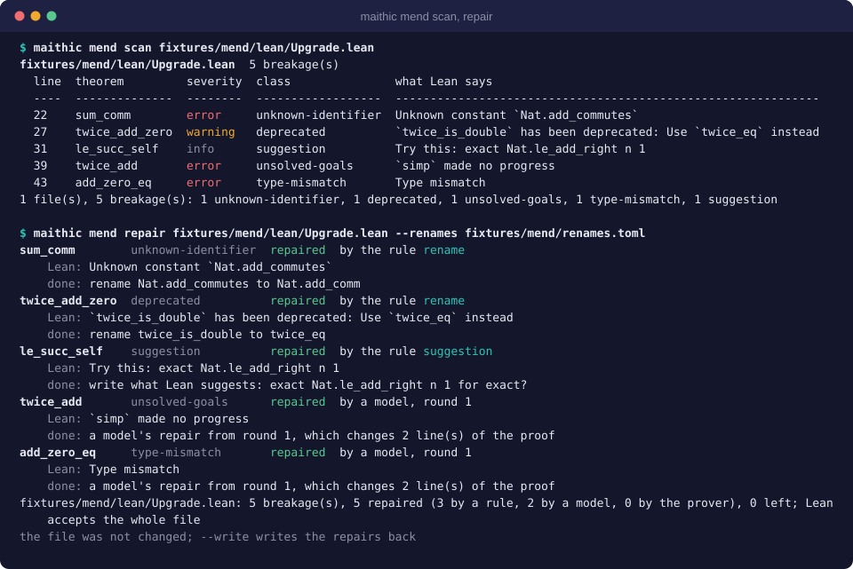
</p>

Rules come first and need no model: a deprecated name is replaced by the successor Lean names, a name that is
gone by its entry in a table of renames, and a call such as `exact?` by what Lean suggested. A model is asked
only about what is left, for the smallest change to the proof that compiles, and the statement Lean prints for
the repaired theorem must be the statement it printed before. What the model cannot repair, the prover tries to
prove again from nothing.

<p align="center">
  
</p>

What each stage is worth shows when the same file is repaired three times, with one more stage each time:

<p align="center">
  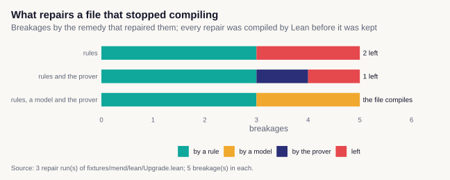
</p>

`maithic mend minimize` goes the other way and takes out what a proof does not need, one step and one lemma at a
time. A removal is kept when Lean accepts the proof, the theorem states what it stated, and it rests on no
axiom it did not rest on before:

<p align="center">
  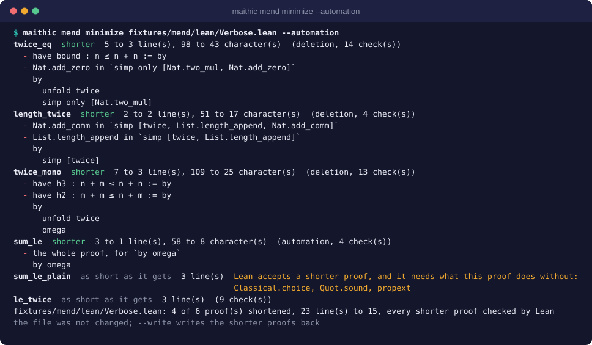
</p>

The third condition is why one proof in the picture is left alone: `by omega` would prove it at the price of
three axioms that its three-line proof does without.
[`docs/guides/repairing-proofs.md`](docs/guides/repairing-proofs.md) has the classes of breakage, the stages and
the options.

## Planning a formalization and tracking it

A large proof is taken apart before it is written: definitions, lemmas, and what rests on what. A *blueprint* is
that plan as a Markdown file. `maithic blueprint plan` drafts one from an argument in words, `skeleton` turns it
into Lean in which every proof is still `sorry`, and from then on `status` reports where the work stands by asking
Lean.

<p align="center">
  
</p>

This is a blueprint of eight nodes, part of the way through:

<p align="center">
  
</p>

The picture is drawn by the command from what Lean reported. A node is *stated* when its declaration exists with
`sorry` in it, *proved* when its own proof is complete, and *done* only when everything it rests on is complete
too. The theorem in dark blue was proved first, on a lemma that is still open: it looks finished in the file, and
Lean knows it is not.

<p align="center">
  
</p>

On the command line the same report is a table:

<p align="center">
  
</p>

`maithic blueprint next` answers the question a contributor has: what can be worked on now, and which piece
unblocks the most. Snapshots of the status over time become the figure below; `--strict` makes a finished
blueprint a condition of continuous integration.

<p align="center">
  
</p>

The plan itself can come from a model. `blueprint plan` takes an argument in words apart, and what the model
answers is put in order before it is written: here an identifier was made plain and a reference to a node that
does not exist was dropped, and both are reported.

<p align="center">
  
</p>

[`docs/guides/blueprints.md`](docs/guides/blueprints.md) has the file format, the planner and what each status
means.

## Finding what is already there

Half of proving is knowing which lemma exists. `maithic search` finds declarations by the words of their names,
statements and documentation, with `add comm` matching `Nat.add_comm` and a statement that contains
`a + b = b + a`; with `--lean` it also asks Lean about everything in scope.

<p align="center">
  
</p>

A name, a formula and a sentence are brought to one vocabulary before anything is compared, which is why a query
in words finds a statement written in symbols:

<p align="center">
  
</p>

Every hit says which retriever found it and why. Up to three retrievers answer, and their rankings are merged by
rank, so that no score of one has to be compared with a score of another:

<p align="center">
  
</p>

The search is measured like any retrieval system. On the sixteen queries the repository keeps, the first hit is a
relevant declaration for fifteen, and the share of the relevant declarations that are found rises from 78 percent
at the first result to 97 percent at ten:

<p align="center">
  
</p>

[`docs/guides/finding-declarations.md`](docs/guides/finding-declarations.md) explains the ranking and the
evaluation.

## Oracles and certificates

Some goals are better computed than searched for. A solver can decide a system of inequalities at once, but a
solver is a large program and its answer is only a claim. The oracles of Maithic therefore return more than an
answer: a **certificate**, a small piece of data from which the fact can be checked by arithmetic alone.

<p align="center">
  
</p>

```julia
julia> using MaithicOracle

julia> outcome = prove_polynomial(["x + y = 3", "x * y = 2"], "x^2 + y^2 = 5");

julia> claim(outcome.certificate)
"∀ x y : ℚ, x + y = 3 → x * y = 2 → x ^ 2 + y ^ 2 = 5"

julia> print(lean_check(outcome.certificate; name = "sum_of_squares"))
theorem sum_of_squares (x y : Rat) : (x ^ 2 + y ^ 2 - 5 : Rat) = (x + y + 3) * (x + y - 3) + -2 * (x * y - 2) := by grind

julia> prove_polynomial(String[], "(x + y)^2 = x^2 + y^2")        # a false goal gets a counterexample, not a shrug
Refuted(x = 1, y = 1)
```

An oracle answers *proved* with a certificate, *refuted* with an exact counterexample, or *unknown* with the
reason; unknown is never a verdict. Every number in a certificate is exact and written as text. The statements
that the Julia package writes for Lean are in [`fixtures/oracle/lean/Checks.lean`](fixtures/oracle/lean/Checks.lean),
and the kernel accepts all of them:

```console
$ maithic check fixtures/oracle/lean/Checks.lean
theorem                        status    axioms or reason
-----------------------------  --------  -------------------------------------
discrete_bezout                verified  no axioms
discrete_factorization_fermat  verified  no axioms
linear_integer_parity          verified  propext, Quot.sound
polynomial_symmetric           verified  propext, Classical.choice, Quot.sound
...
19 of 19 theorem(s) verified, 0 error(s), 0 warning(s), 19 declaration(s) in 467 ms
```

From the command line, `maithic oracle list` names the oracles with what each takes, and `maithic oracle solve`
sends one a goal:

<p align="center">
  
</p>

`solve` also takes a theorem of a Lean file. The goal of the theorem is exported with Lean's own names, and the
certificate comes back as a tactic call for the verified checker:

<p align="center">
  
</p>

```console
$ maithic oracle solve examples/gap.lean --theorem no_point --project lean
linear  proved  (linear over int, 472 ms)
  claim:        ∀ x y : ℤ, 2 * x + 4 * y < 7 → x + 2 * y ≥ 4 → False
  certificate:  linear.farkas, 30ee6df090d61d8e
  in Lean:      maithic_linear_int [x, y] [(1, ⟨[1, 2], .le, 3⟩), (1, ⟨[-1, -2], .le, -4⟩)] using [h₁, h₂]

$ maithic oracle solve examples/gap.lean --theorem wrong --project lean
linear  refuted  (linear over int, 240 ms)
  fails at:     x = 0, y = 0
```

The other answers are as exact about what they are: a point where the goal fails, a reason why nothing was
decided, and a certificate that Lean cannot check yet, which is said in so many words:

<p align="center">
  
</p>

Put where `sorry` stood, the script is a proof like any other, and `maithic check` reports the theorem verified.
`maithic prove --oracle` asks the oracles by itself when the portfolio fails on an arithmetic goal. Today only
certificates for linear integer goals come with a script, and those are goals that `omega` decides as well; the
hand-off earns its place with the checkers for the other certificates, which are on the
[roadmap](ROADMAP.md).

Certificates of primality and of real inequalities have no checker in core Lean yet; they are checked exactly by
the oracle and are not reported as verified. [`docs/concepts/oracles.md`](docs/concepts/oracles.md) has the whole
picture and [`docs/reference/oracle-format.md`](docs/reference/oracle-format.md) the formats.

## Checkers with proofs

A certificate is only as good as what checks it. For propositional logic and for linear arithmetic over the
integers the checker is a small Lean function, and its soundness is a theorem of the Lean library: the kernel
runs the checker, and the theorem turns "it returned `true`" into a proof of the goal. Whatever found the
certificate, a solver, a model or a person, is never trusted.

<p align="center">
  
</p>

```lean
import Maithic.Oracle.Logic

-- Search, then check: the kernel runs the verified checker on the proof that the search wrote.
example (p q r s : Prop) (hpq : p → q) (hqr : q → r) (hrs : r → s) : p → s := by maithic_sat

-- A proof given as text, in the form solvers write. `maithic_cnf` prints the problem it must refute.
example (p q : Prop) (hp : p) (hpq : p → q) : q := by maithic_lrat "4 0 1 2 3 0"

-- A certificate of linear integer arithmetic: rows, multipliers, and the hypothesis behind each row.
example (x y : Int) (h₁ : 2 * x + 4 * y < 7) (h₂ : x + 2 * y ≥ 4) : False := by
  maithic_linear_int [x, y] [(1, ⟨[1, 2], .le, 3⟩), (1, ⟨[-1, -2], .le, -4⟩)] using [h₁, h₂]
```

A goal that does not follow is answered with truth values under which it fails, and a proof with a flaw is
refused at its first bad step:

```text
maithic_sat: the goal does not follow by propositional reasoning; it fails when
  p := True
  q := False

maithic_lrat: step 0: clause 4: unit propagation along the hints ends without a conflict
```

The library's examples include four pigeons and three holes, closed from the fifteen steps that the solver
CaDiCaL wrote for the problem. The linear oracle writes the `maithic_linear_int` calls itself, and
[`fixtures/oracle/lean/Replay.lean`](fixtures/oracle/lean/Replay.lean) goes through `maithic check` on every run
of `make e2e`. [`docs/guides/logic-checkers.md`](docs/guides/logic-checkers.md) says what is proved and what is
only checked.

## A neural network, with the kernel as judge

A verifier for neural networks computes in floating point, and its verdict is a claim. `maithic nnv verify` has
the verifier make the claim and Lean's kernel check it against the exact network.

<p align="center">
  
</p>

Two properties, one that holds and one that fails:

<p align="center">
  
</p>

When the verifier says the property holds, it hands over a box for every layer, and the kernel runs a checker on
them that is proved sound in Lean. When it says the property fails, it hands over an input, and the kernel
evaluates the exact network there. Either way the status is *verified* or *refuted* only after the kernel accepted
a theorem; a claim that Lean rejects is reported as failed and settles nothing.

The method is sound and not complete, and one small network shows both. It computes the absolute value as
`relu x + relu (-x)`. On inputs from -2 to 3 it never outputs more than 3, and bounds that follow each neuron on
its own can only prove 5:

<p align="center">
  
</p>

So the same network gets three answers, one for each claim. The third is *unknown*: nothing is claimed, Lean is
not asked, and the exit status says that nothing was verified.

<p align="center">
  
</p>

The four facts of the picture are theorems of the Lean library, in
[`Maithic.NN.Examples.AbsoluteValue`](lean/Maithic/NN/Examples/AbsoluteValue.lean): the outputs stay within
[0, 6]; they do not stay within [0, 2]; the checker does not accept [0, 4]; and the outputs do stay within [0, 3],
which is proved there by cases on the sign of the input, where no certificate of this kind can reach. The method
is exact for the network and the boxes that are given and scales to small networks;
[`docs/guides/verifying-networks.md`](docs/guides/verifying-networks.md) says what it shows and what it does not.

## Algorithms: drafted, tested, proved, measured

An algorithm earns trust in steps, and the laboratory is exact about which step a function has reached.

<p align="center">
  
</p>

The first two steps are one command:

<p align="center">
  
</p>

**Drafted and tested.** `maithic algo synth` takes a task, a description with examples, and asks a model for a
Lean function. Lean compiles each draft and runs the examples; an error or a wrong answer goes back to the model
word for word. The function that comes out has passed its examples, and the command says exactly that.

<p align="center">
  
</p>

**Proved.** [`Maithic.Algo.Lab.RunLengths`](lean/Maithic/Algo/Lab/RunLengths.lean) takes the function from the
picture as the model wrote it and proves that decoding its result gives back the list, that no run is empty and
that neighbouring runs differ, and that these three properties have exactly one solution. The model's draft is
that solution.

**Tested from outside.** A proof does not say that the compiled program is the definition. `maithic algo
differential` sends generated inputs to the compiled Lean code of nineteen verified algorithms and to independent
implementations in Julia, and reports every answer that differs. There are none.

<p align="center">
  
</p>

A run with ten generated requests for each algorithm:

<p align="center">
  
</p>

**Measured.** For four algorithms Lean also counts comparisons and proves a bound on the count. The figure lays
the counts of the compiled code beside the proved bounds.

<p align="center">
  
</p>

No count exceeds its bound, and the growth that R fits to the counts is the growth of each bound. A fit describes
the inputs that were measured; it is the proof that covers the rest. For insertion sort both ends of the range are
theorems too, in [`Maithic.Algo.Cost.Extremes`](lean/Maithic/Algo/Cost/Extremes.lean): a list in falling order
costs exactly `n (n - 1) / 2` comparisons, a sorted list exactly `n - 1`, and no list costs less.
[`docs/guides/algorithm-lab.md`](docs/guides/algorithm-lab.md) walks through all four steps.

## Model providers and keys

Every part that asks a model builds one request that names no provider, and the gateway turns it into the call
that the chosen provider expects:

<p align="center">
  
</p>

| Provider | Setting | Key variable | API |
|---|---|---|---|
| Anthropic | `--provider anthropic` | `ANTHROPIC_API_KEY` | Messages |
| OpenAI | `--provider openai` | `OPENAI_API_KEY` | Responses |
| xAI | `--provider xai` | `XAI_API_KEY` | Responses, or chat completions |
| A server on your machine | `--provider local` | none | chat completions |

The provider, the quality tier (`fast`, `balanced`, `best`) and the model can be set in `maithic.toml`, by
`MAITHIC_*` variables or by flags. `maithic models` lists what each tier means; the list is the file
[`config/models.toml`](config/models.toml), which you can replace, and `maithic auth status` shows which keys are
configured without printing one:

<p align="center">
  
</p>

A setting can come from six places, and a later one overrides an earlier one. `maithic config show` prints every
setting with its value and the place it came from:

<p align="center">
  
</p>

The settings of this repository as the command reports them, with the gateway mode taken from the environment:

<p align="center">
  
</p>

**Keys.** A key is read at the moment of a call. It is never written to a configuration file, a log or a
cassette, and Lean worker processes are started without it. `maithic auth login` stores one in a file only you
can read.

<p align="center">
  
</p>

**Modes.** The gateway answers a model call in one of five ways. Tests and continuous integration use `replay`,
which never opens a connection:

<p align="center">
  
</p>

**Cassettes.** A recorded exchange is found again by what was asked. The same request gives the same file name
on every machine, and a request that was never recorded is an error in replay mode, never a silent call:

<p align="center">
  
</p>

[`docs/reference/gateway.md`](docs/reference/gateway.md) has the providers, the modes, the cassettes and the
prompts.

## Commands

One command, `maithic`, with forty-nine subcommands in seven families:

<p align="center">
  
</p>

| Command | What it does |
|---|---|
| `maithic prove FILE` | Proves the theorems of a file that contain `sorry`, or the ones named with `--theorem`. |
| `maithic check FILE` | Checks a file from its imports and reports the status of every theorem. |
| `maithic tree FILE` | Shows the record of a step-wise search, step by step, and draws it. |
| `maithic refute FILE` | Looks for counterexamples to unproved statements and has Lean confirm each one; finds vacuous statements. |
| `maithic formalize [PROBLEM]` | States a problem written in words as a Lean theorem; Lean rejects the vacuous and the false candidates. |
| `maithic council FILE` | Puts a researcher, a prover, a critic and a verifier to work on a theorem, with Lean as the only judge. |
| `maithic review PATH` | Reviews Lean files, and suggests only the edits that Lean accepted. |
| `maithic mend scan` · `repair` · `minimize` | Finds what stopped compiling, repairs it by rule, with a model and with the prover, and shortens proofs. |
| `maithic intel scan` · `show` · `deps` · `dependents` · `health` · `stats` | Reads a project into a graph of its declarations and answers questions about it. |
| `maithic corpus harvest` · `verify` | Writes the proofs of a project as a dataset of states, tactics and premises, and checks a dataset. |
| `maithic guide train` · `info` · `rank` | Trains a tactic model on a dataset, describes it, and shows how it orders tactics on a goal. |
| `maithic blueprint check` · `plan` · `skeleton` · `status` · `next` · `graph` | Plans a formalization as nodes that rest on each other, writes its Lean skeleton, and reports from Lean what is stated, proved and done. |
| `maithic search QUERY` | Finds declarations by the words of their names, statements and documentation, in your files and in Lean's scope. |
| `maithic oracle list` · `solve` | Lists the oracles; sends a goal, or the goal of a theorem, to one. |
| `maithic nnv verify MODEL PROPERTY` | Decides a property of a neural network and has Lean's kernel check the answer. |
| `maithic algo synth` · `differential` | Drafts a Lean function for a task and judges it by Lean and by examples; tests the compiled verified algorithms against independent references. |
| `maithic bench run` · `gate` | Runs the prover on a benchmark suite; holds a run against a stored baseline and fails on a regression. |
| `maithic doctor` | Checks toolchains, the Bridge, the provider and keys, and prints remedies. |
| `maithic config show` | Shows the effective configuration and where each value came from. |
| `maithic auth status` · `login` · `logout` · `check` | Manages and tests provider keys. |
| `maithic models` | Lists providers and the model of each tier. |
| `maithic bridge selftest` | Starts the Lean bridge and runs its self-test. |
| `maithic help exit-codes` · `help status` | Prints the reference tables. |

Every command accepts `--json` and then prints one document that names its schema, so that a script or another
language can read a result without parsing text:

<p align="center">
  
</p>

The schema that a document names is a file of the repository, and a gate holds every recorded document to it:

<p align="center">
  
</p>

Exit codes are stable and documented in [`docs/reference/exit-codes.md`](docs/reference/exit-codes.md): `0` means
every result is verified, `7` means something was not, `8` means a statement was refuted, and `13` means the
regression gate failed. [`docs/guides/scripting.md`](docs/guides/scripting.md) shows a shell script, a Julia
program and an R program that work from the reports and these codes.

<p align="center">
  
</p>

The command prints both reference tables itself, the status words and the exit codes:

<p align="center">
  
</p>

An error has a code of the form `MTH-AREA-NNNN`, says what happened in one line, and ends the command with the
exit status of its kind. [`docs/reference/errors.md`](docs/reference/errors.md) lists every code with its remedy.

<p align="center">
  
</p>

## The Bridge: one Lean process behind every command

Nothing in Maithic reads Lean's mind from its text. The command talks to `maithic-bridge`, a Lean program of this
repository, in JSON-RPC over standard input and output, and every fact about a proof is an answer of that
process:

<p align="center">
  
</p>

An environment is never changed by what is run on it, so many candidates can be tried on the same one, and a
failed candidate leaves nothing behind. The protocol has sixteen methods in five groups:

<p align="center">
  
</p>

`maithic bridge selftest` starts the Bridge and has it show that it tells a true statement from a false one,
that it sees an axiom that was slipped in, and that its guard refuses commands that would run something:

<p align="center">
  
</p>

[`docs/reference/bridge-protocol.md`](docs/reference/bridge-protocol.md) specifies every request and answer, and
[`docs/adr/0002`](docs/adr/0002-bridge-with-environment-handles.md) says why the Bridge is built this way.

## What is in the repository

<p align="center">
  
</p>

Each language does the work it is best at, and none of them is decoration: the register of capabilities counts
230 in OCaml, 117 in Lean, 72 in Julia and 62 in R.

<p align="center">
  
</p>

The folders at the top of the repository, and what each holds:

<p align="center">
  
</p>

```text
ocaml/      the maithic command, the AI gateway, the Bridge client, the prover with its step-wise search
            and the pictures of it, the refuter, formalization, the council, repair and review, blueprints,
            the search for declarations, the algorithm laboratory, the network verification job, the
            code graph, the dataset writer, the oracle registry, the benchmark gate, the trust policy,
            the schema validator and the repository tools
lean/       the Bridge server with proof states, the tactic suite, the axiom audit, verified algorithms
            with counted costs and the program that runs them, verified checkers (network bounds and
            properties, propositional proofs, linear integer certificates), tests of statements
            (sampling, vacuity, necessity of hypotheses), the commands that inspect, find and compare
            statements, the tracer of proofs, the benchmark suite
julia/      MaithicOracle (certificates for linear, polynomial, real and discrete goals), MaithicGuide
            (the tactic model, its training and its service), MaithicNNV (bounds and verdicts for neural
            networks), MaithicAlgoRef (reference algorithms and differential tests), MaithicGraphs
            (measures on the code graph), MaithicData (splits and checks of datasets), MaithicEmbed
            (embeddings and search), MaithicCore (what they share)
r/          maithicstats (intervals, comparisons, and readers for every kind of result file),
            maithicviz (figures in one visual style)
schemas/    the JSON Schemas of every document that crosses a language boundary
config/     the model registry, the prompts and the default trust policy
registry/   the capability register: every capability, its status and its tests
fixtures/   Bridge sessions and transcripts, provider exchanges, cassettes, oracle goals and certificates,
            clausal proofs with expected verdicts, trained models with their training records, recorded
            runs, searches, repairs, formalizations, council sessions, blueprint snapshots, network
            jobs, syntheses and measured costs
examples/   the small Lean files of the demonstrations, a blueprint, networks with properties and a task
bench/      the benchmark manifest and committed results
docs/       guides, concepts, reference pages and design decisions
```

The languages meet at documents, and every such document names a schema under [`schemas/`](schemas). A check
that is part of `make hygiene` validates each fixture, each recorded Bridge answer and each result the command
writes against the schema it names; [`docs/reference/schemas.md`](docs/reference/schemas.md) lists them.

What the code depends on is short enough to draw. The OCaml core uses the compiler's own libraries, the Lean
package uses core Lean, and the Julia packages use the standard library and each other:

<p align="center">
  
</p>

Six decisions shaped the design, and each is recorded with its reasons under [`docs/adr/`](docs/adr):

<p align="center">
  
</p>

Every capability has an identifier, and a capability counts as done only when a test carries that identifier.
A gate compares the register with the tests on every run:

<p align="center">
  
</p>

A file that one language writes for another is a fixture, and fixtures are regenerated, never edited. Each kind
has a target that makes it again:

<p align="center">
  
</p>

## Verified libraries

The Lean package contains proofs, not only tools: 980 declarations in 66 files, 307 of them theorems.

<p align="center">
  
</p>

Everything below is checked by the kernel on every build, with no `sorry` and no added axiom:

| Module | What is proved |
|---|---|
| [`Maithic.Algo.Sort.Insertion`](lean/Maithic/Algo/Sort/Insertion.lean) | Insertion sort returns a sorted permutation of its input, and is idempotent. |
| [`Maithic.Algo.Sort.MergeSort`](lean/Maithic/Algo/Sort/MergeSort.lean) | Merge sort returns a sorted permutation of its input. A sorted permutation of a list is unique, so merge sort and insertion sort are the same function. |
| [`Maithic.Algo.Sort.Linear`](lean/Maithic/Algo/Sort/Linear.lean) | Linear search returns the first position of the target, or proves its absence. |
| [`Maithic.Algo.Sort.Binary`](lean/Maithic/Algo/Sort/Binary.lean) | Binary search on a sorted array terminates, returns a position that holds the target, and returns none only when the target is absent. |
| [`Maithic.Algo.Sort.MinMax`](lean/Maithic/Algo/Sort/MinMax.lean), [`Dedup`](lean/Maithic/Algo/Sort/Dedup.lean) | The minimum and the maximum of a list are members and bound every member. Removing repeats from a sorted list keeps its members and its order, and leaves no repeat. |
| [`Maithic.Algo.Graph.Fib`](lean/Maithic/Algo/Graph/Fib.lean), [`PrefixSum`](lean/Maithic/Algo/Graph/PrefixSum.lean) | The table and the pair-based computations of the Fibonacci numbers agree with the definition. A sum over a range is the difference of two prefix sums. |
| [`Maithic.Algo.Spec.Perm`](lean/Maithic/Algo/Spec/Perm.lean), [`Search`](lean/Maithic/Algo/Spec/Search.lean) | Two lists are permutations of each other exactly when every value occurs equally often in both, which a function decides. What it means for a search to be right, and that the first position found is unique. |
| [`Maithic.Algo.Sort.Selection`](lean/Maithic/Algo/Sort/Selection.lean) | Selection sort and quicksort return sorted permutations of their input, and so all four sorts of the library are the same function. |
| [`Maithic.Algo.Sort.Match`](lean/Maithic/Algo/Sort/Match.lean) | The search for a pattern in a text returns the first position where the pattern occurs, and none only when it occurs nowhere. |
| [`Maithic.Algo.Graph.Path`](lean/Maithic/Algo/Graph/Path.lean) | A path that the search returns starts and ends where it was asked to and follows edges of the graph. |
| [`Maithic.Algo.Arith.Gcd`](lean/Maithic/Algo/Arith/Gcd.lean), [`Pow`](lean/Maithic/Algo/Arith/Pow.lean) | Euclid's algorithm computes the greatest common divisor. Exponentiation by squaring computes the power, and its modular form the remainder of the power. |
| [`Maithic.Algo.Cost.Comparisons`](lean/Maithic/Algo/Cost/Comparisons.lean) | Bounds on work: linear search compares at most `n` times, binary search looks at no more than `log₂ n + 1` elements, insertion sort compares at most `n (n - 1) / 2` times and merge sort at most `n (log₂ n + 1)` times. |
| [`Maithic.Algo.Cost.Extremes`](lean/Maithic/Algo/Cost/Extremes.lean) | The bound of insertion sort is reached: a list in falling order costs exactly `n (n - 1) / 2` comparisons. A sorted list costs exactly `n - 1`, and no list of `n` elements costs less. |
| [`Maithic.Algo.Lab.RunLengths`](lean/Maithic/Algo/Lab/RunLengths.lean) | A run-length encoder that a model drafted decodes to its input, has no empty run and no equal neighbours, and is the only function with these properties. |
| [`Maithic.NN.Cert.Interval`](lean/Maithic/NN/Cert/Interval.lean) | Rational interval arithmetic is sound, operation by operation. |
| [`Maithic.NN.Cert.Bounds`](lean/Maithic/NN/Cert/Bounds.lean) | If the bound-certificate checker accepts, the bounds hold for the exact semantics of the ReLU network. |
| [`Maithic.NN.Cert.Property`](lean/Maithic/NN/Cert/Property.lean) | If the property checker accepts, every input of the box is mapped into the claimed box; and an input whose exact output lies outside refutes the property. |
| [`Maithic.NN.Examples.AbsoluteValue`](lean/Maithic/NN/Examples/AbsoluteValue.lean) | A network whose outputs stay within [0, 3], a fact that the certificate checker cannot reach: it accepts the claim [0, 6], rejects [0, 4], and the claim [0, 2] is false. |
| [`Maithic.Oracle.Logic.Clause`](lean/Maithic/Oracle/Logic/Clause.lean) | The conversion to clause normal form keeps the truth value of a formula under every assignment. |
| [`Maithic.Oracle.Logic.Table`](lean/Maithic/Oracle/Logic/Table.lean) | The truth table is sound and complete, so validity of a formula is decidable. |
| [`Maithic.Oracle.Logic.Lrat`](lean/Maithic/Oracle/Logic/Lrat.lean) | A clause set with an accepted clausal proof is unsatisfiable. |
| [`Maithic.Oracle.Logic.Resolution`](lean/Maithic/Oracle/Logic/Resolution.lean) | A clause set with an accepted resolution proof is unsatisfiable. |
| [`Maithic.Oracle.Logic.LinearInt`](lean/Maithic/Oracle/Logic/LinearInt.lean) | The rows of an accepted certificate of linear integer arithmetic have no common solution. |
| [`Maithic.Tactic.Auto`](lean/Maithic/Tactic/Auto.lean) | Not a theorem but a tactic: `maithic_auto`, the same portfolio the prover uses, inside the editor. |

The certificate checker is the reason [`MaithicNNV`](julia/MaithicNNV) exists: it computes bounds quickly in
floating point with outward rounding and writes them as exact rational certificates, which the Lean checker then
accepts or rejects. The certificates in [`fixtures/nnv`](fixtures/nnv) are written by the Julia tests and run
through the checker by `make e2e`.

## Benchmark

The *basics* suite is 24 statements of logic, arithmetic and list facts, defined in
[`lean/MaithicBench/Basics.lean`](lean/MaithicBench/Basics.lean) with kernel-checked reference solutions. With no
model, the automation portfolio verifies all 24; the run is committed as
[`bench/results/basics-portfolio.json`](bench/results/basics-portfolio.json) and the integration tests repeat it.

```sh
maithic bench run --no-ai
```

<p align="center">
  
</p>

The figures below are drawn from that committed run by the R packages; `make figures` repeats the run and redraws
them. The intervals are long because the groups are small, which is the honest way to show seven problems.

<p align="center">
  
</p>

How many candidates were tried before one was accepted:

<p align="center">
  
</p>

And how long each problem took:

<p align="center">
  
</p>

The suite is deliberately easy. Its purpose is to exercise the whole pipeline with no provider and to catch any
change that makes the prover worse on simple problems. It says nothing about hard mathematics.

Catching such a change is the job of `maithic bench gate`: it holds a run against the baseline stored under
[`bench/baselines`](bench/baselines) and exits with status 13 when a problem that used to be verified no longer
is.

<p align="center">
  
</p>

The second run in the picture below is a copy of the committed one with a result changed by hand, to show a
failure.

<p align="center">
  
</p>

[`docs/guides/regression-gate.md`](docs/guides/regression-gate.md) has the thresholds and how baselines are stored.

## What the kernel says about this repository

The same packages summarise what `maithic check` and `maithic prove` report. The figures here are drawn from the
result files under [`fixtures/runs`](fixtures/runs): the insertion-sort library, the examples of the logic
checkers, the statements written from oracle certificates, the certificates replayed through the verified
checker, and the demonstration proofs. Every figure takes the same way from a file to a picture:

<p align="center">
  
</p>

The axioms that the recorded results rest on:

<p align="center">
  
</p>

And the status of each result:

<p align="center">
  
</p>

The one result that is not verified is [`examples/triangle.lean`](examples/triangle.lean) as it ships, with a
`sorry` where its proof belongs. It is the example the prover is shown on: the portfolio fails on it, a first
round of candidates fails, and a repair round that carries Lean's error messages succeeds.

<p align="center">
  
</p>

Where the time of a proof goes:

<p align="center">
  
</p>

And how many theorems were proved, by provider:

<p align="center">
  
</p>

These runs are in replay mode: the model answers come from cassettes written by hand for the demonstration, and
each caption says so. The charts show how the tools report, with intervals as long as five theorems deserve. They
are not a measurement of any model. [`docs/guides/statistics.md`](docs/guides/statistics.md) describes the
packages.

## Development

```sh
make ci          # everything the required workflow runs, in the same order
make test        # unit tests in all four languages
make integration # the real Bridge and the built command
make hygiene     # language share, capability register, schemas and contracts, scans, README images
```

The required workflow has six jobs, and `make ci` runs what they run:

<p align="center">
  
</p>

The tests are in layers, from one language on its own to the whole command on a fresh clone:

<p align="center">
  
</p>

`make hygiene` is six gates that look at the repository and not at the code alone:

<p align="center">
  
</p>

The versions are pinned where a build can read them, and they are the versions this release is tested with:

<p align="center">
  
</p>

- Unit tests need neither Lean nor a network: the Bridge is played by a stub that replays recorded transcripts,
  and model calls are served by scripted providers and cassettes.
- Every capability has an identifier such as `P10-07-05`. A test that covers a capability carries its identifier,
  and `make hygiene` fails if the register and the tests disagree. `make cap-sync` updates the register.
- The repository must stay at least 85 percent OCaml, Lean, Julia and R by bytes of code, with a floor for
  each: OCaml 30, Lean 15, Julia 12, R 8. `maithic-dev langshare` measures it against
  [`PROJECT.toml`](PROJECT.toml).
- Fixtures that one language writes for another are regenerated, never edited: `make julia-fixtures`,
  `make lean-fixtures`, `make run-fixtures`, `make transcripts`, `make cassettes`. The tests fail when a
  fixture is stale.
- The figures of this page are drawn from recorded results by `make figures`, and the pictures of terminal
  sessions from what the built command prints, by `make shots`. The diagrams that explain how a part works are
  SVG files written by hand, under [`assets/readme/`](assets/readme).

[`CONTRIBUTING.md`](CONTRIBUTING.md) describes the workflow and the conventions.

## Documentation

- [`docs/install.md`](docs/install.md): toolchains and building.
- [`docs/quickstart.md`](docs/quickstart.md): the first proof, step by step.
- [`docs/concepts/trust.md`](docs/concepts/trust.md): what *verified* means here and what it does not.
- [`docs/concepts/oracles.md`](docs/concepts/oracles.md): computing without trusting, by certificates.
- [`docs/guides/search.md`](docs/guides/search.md): the step-wise proof search, its record and its picture.
- [`docs/guides/testing-statements.md`](docs/guides/testing-statements.md): testing a statement by sampling,
  for vacuity and for the hypotheses it needs.
- [`docs/guides/refuting-statements.md`](docs/guides/refuting-statements.md): counterexamples from the command
  line, each confirmed by Lean.
- [`docs/guides/formalizing.md`](docs/guides/formalizing.md): from a problem in words to a statement that Lean
  has checked for vacuity and for counterexamples.
- [`docs/guides/council.md`](docs/guides/council.md): several roles at work on one theorem, their shared board
  and their budgets.
- [`docs/guides/code-intelligence.md`](docs/guides/code-intelligence.md): a project as a graph of its
  declarations, and the questions it answers.
- [`docs/guides/datasets.md`](docs/guides/datasets.md): proofs as datasets of states, tactics and premises.
- [`docs/guides/guided-search.md`](docs/guides/guided-search.md): training a tactic model and searching with it.
- [`docs/guides/review.md`](docs/guides/review.md): review of Lean code, with edits that Lean accepted.
- [`docs/guides/repairing-proofs.md`](docs/guides/repairing-proofs.md): repairing proofs after an upgrade, and
  shortening them.
- [`docs/guides/blueprints.md`](docs/guides/blueprints.md): a formalization as a plan of nodes, and its status
  according to Lean.
- [`docs/guides/finding-declarations.md`](docs/guides/finding-declarations.md): searching declarations by words,
  and measuring the search.
- [`docs/guides/logic-checkers.md`](docs/guides/logic-checkers.md): the verified checkers and their tactics.
- [`docs/guides/verifying-networks.md`](docs/guides/verifying-networks.md): properties of neural networks, decided
  by a verifier and checked by the kernel.
- [`docs/guides/algorithm-lab.md`](docs/guides/algorithm-lab.md): functions drafted by a model, tested, proved
  and measured.
- [`docs/guides/regression-gate.md`](docs/guides/regression-gate.md): baselines and the gate that guards them.
- [`docs/guides/statistics.md`](docs/guides/statistics.md): summaries and figures from result files.
- [`docs/guides/scripting.md`](docs/guides/scripting.md): the command from a script, from Julia, from R and
  from any other language, by its JSON reports and exit codes.
- [`docs/reference/commands.md`](docs/reference/commands.md): the commands and their options.
- [`docs/reference/configuration.md`](docs/reference/configuration.md): every setting.
- [`docs/reference/gateway.md`](docs/reference/gateway.md): providers, modes, cassettes and prompts.
- [`docs/reference/bridge-protocol.md`](docs/reference/bridge-protocol.md): the protocol of the Lean bridge.
- [`docs/reference/oracle-format.md`](docs/reference/oracle-format.md): goals, certificates and outcomes.
- [`docs/reference/schemas.md`](docs/reference/schemas.md): the schemas and the check that enforces them.
- [`docs/reference/errors.md`](docs/reference/errors.md): error codes and remedies.
- [`docs/adr/`](docs/adr): design decisions and their reasons.
- [`CHANGELOG.md`](CHANGELOG.md): what this release contains, part by part, and [`ROADMAP.md`](ROADMAP.md): what
  comes after it.
- A page for each package, with an example and what it prints:
  [`MaithicCore`](julia/MaithicCore/README.md), [`MaithicOracle`](julia/MaithicOracle/README.md),
  [`MaithicNNV`](julia/MaithicNNV/README.md), [`MaithicGuide`](julia/MaithicGuide/README.md),
  [`MaithicData`](julia/MaithicData/README.md), [`MaithicGraphs`](julia/MaithicGraphs/README.md),
  [`MaithicEmbed`](julia/MaithicEmbed/README.md), [`MaithicAlgoRef`](julia/MaithicAlgoRef/README.md),
  [`maithicstats`](r/maithicstats/README.md) and [`maithicviz`](r/maithicviz/README.md).

## License

Code is released under the [Apache License 2.0](LICENSE); documentation under CC BY 4.0. See [`NOTICE`](NOTICE)
and [`CITATION.cff`](CITATION.cff). Security reports: [`SECURITY.md`](SECURITY.md).
