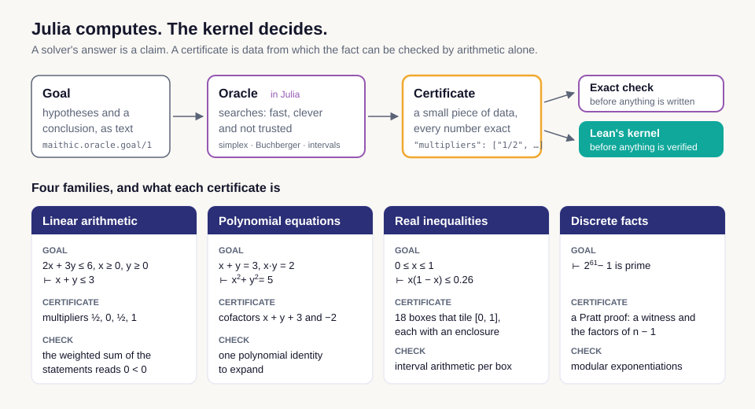
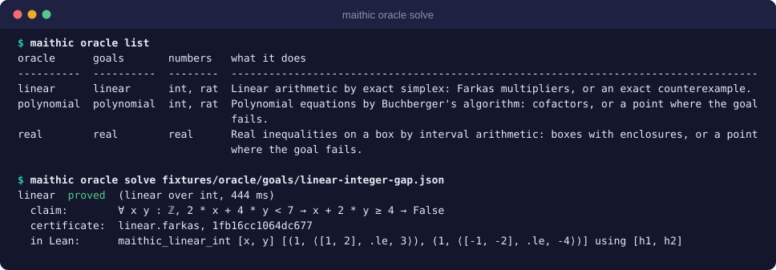
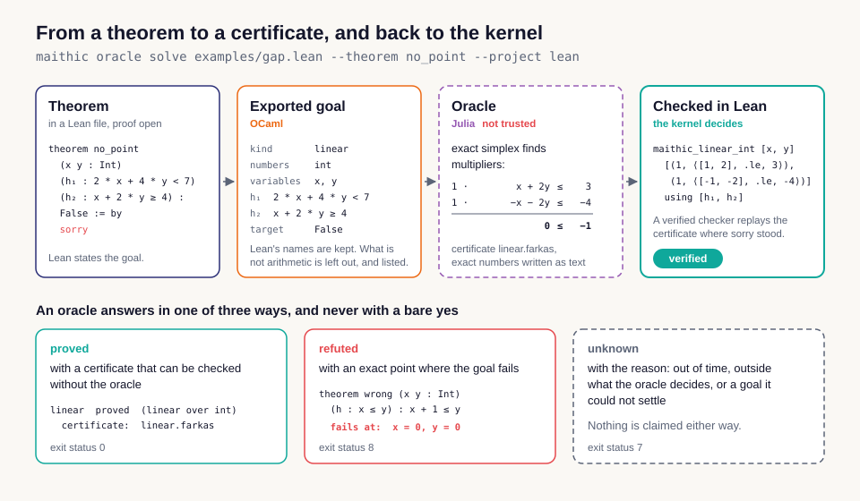

# Oracles and certificates

A solver can settle in a moment what a proof search would take minutes to find. A solver is also a large program,
and its answer is only a claim. Maithic uses solvers without trusting them, by asking each one for more than an
answer: a **certificate**, a small piece of data from which the fact can be checked by arithmetic alone.

<p align="center">
  
</p>

The search may be as clever, as fast and as unverified as it likes. Simplex pivoting, Gröbner bases, interval
subdivision and integer factoring are all search. What comes out is checked twice: by the oracle itself, in exact
arithmetic and with nothing of the search, before anything is written; and by Lean, before anything is called
verified.

## The four families

| Family | A goal such as | The certificate is | Checking it means |
|---|---|---|---|
| Linear arithmetic | `2x + 3y ≤ 6`, `x ≥ 0`, `y ≥ 0` imply `x + y ≤ 3` | Farkas multipliers: one number per hypothesis | adding the hypotheses up with those weights and reading off `0 < 0` |
| Polynomial equations | `x + y = 3`, `xy = 2` imply `x² + y² = 5` | cofactors: one polynomial per hypothesis | expanding one polynomial identity |
| Real inequalities | `x(1 − x) ≤ 0.26` on `[0, 1]` | boxes that tile the domain, each with an enclosure | interval arithmetic on each box |
| Discrete facts | `2⁶¹ − 1` is prime | a Pratt proof: a witness and the factors of `n − 1`, recursively | modular exponentiations |

Each family has a definite idea of what it cannot do, and says so. The answer to a goal is one of three:

- **proved**, with the certificate;
- **refuted**, with an exact point that satisfies every hypothesis and violates the goal;
- **unknown**, with the reason, such as "the goal is not a polynomial combination of the hypotheses". Unknown is
  never a verdict on the goal.

## An example

```julia
using MaithicOracle

outcome = prove_linear(["2*x + 3*y <= 6", "x >= 0", "y >= 0"], "x + y <= 3")
certificate = outcome.certificate

claim(certificate)                           # "∀ x y : ℚ, 2 * x + 3 * y ≤ 6 → x ≥ 0 → y ≥ 0 → x + y ≤ 3"
certificate.refutations[1].multipliers       # [1//2, 0, 1//2, 1]
check(certificate)                           # true
```

The multipliers say: half of the first hypothesis, half of the third, and the negated goal `x + y > 3` once.
Add them up and every variable cancels, leaving `0 < 0`. Checking that takes four multiplications and no trust
in the simplex method that found the numbers.

Ask for something false and the answer is a point, not a shrug:

```julia
prove_linear(["2*x + 3*y <= 6", "x >= 0", "y >= 0"], "x + y <= 2")   # Refuted(x = 3, y = 0)
prove_polynomial(String[], "(x + y)^2 = x^2 + y^2")                  # Refuted(x = 1, y = 1)
prove_real(["0 <= x", "x <= 1"], "x * (1 - x) <= 1/5")               # Refuted(x = 1/2)
```

## What Lean checks

`lean_check` writes the arithmetic of a certificate as a Lean statement that core Lean decides: `omega` over the
integers, `grind` over the rationals and for ring identities, `decide` for closed arithmetic. For the polynomial
example the statement is the identity the certificate asserts, with the hypotheses as they were given:

```lean
theorem polynomial_symmetric (x y : Rat) :
    (x ^ 2 + y ^ 2 - 5 : Rat) = (x + y + 3) * (x + y - 3) + -2 * (x * y - 2) := by grind
```

[`fixtures/oracle/lean/Checks.lean`](../../fixtures/oracle/lean/Checks.lean) holds such statements for every
fixture, written by the Julia package, and `make e2e` runs them through `maithic check`. The kernel accepts all
of them; the discrete ones rest on no axiom at all.

That confirms the claim, but the decision procedure finds its own proof and never looks at the multipliers.
`lean_replay` goes further where the Lean library has a checker for the certificate itself: the kernel runs the
checker on the data the oracle found, and a theorem proved once says that what the checker accepts is true. For
linear arithmetic over the integers that checker exists:

```lean
theorem replay_linear_integer_gap (x y : Int) (h1 : (2 * x + 4 * y : Int) < 7) (h2 : (x + 2 * y : Int) ≥ 4) : False := by
  maithic_linear_int [x, y] [(1, ⟨[1, 2], .le, 3⟩), (1, ⟨[-1, -2], .le, -4⟩)] using [h1, h2]
```

[`fixtures/oracle/lean/Replay.lean`](../../fixtures/oracle/lean/Replay.lean) holds the replay of every integer
fixture, and `make e2e` runs it as well. [The guide to the checkers](../guides/logic-checkers.md) explains what
is checked and what is proved.

Two kinds of certificate have no statement in core Lean yet: Pratt proofs and order certificates need modular
exponentiation by a verified function, and interval certificates need real analysis. Their checkers need
Mathlib and are not part of this release. Until they exist, such certificates are checked by the oracle's own exact check
only, and nothing built on them is reported as verified.

## Exact numbers

Every number in a certificate is an integer or a fraction of integers of any size, written as text: `"3"`,
`"-7/2"`. A certificate that passed through a floating-point number is no longer a certificate, and JSON readers
differ in what they do to long numbers; text survives them all. The interval oracle computes in floating point,
with every operation rounded in the direction that keeps the enclosure valid, and converts its endpoints to
exact fractions before writing them.

## From the command line, and from a theorem

The `maithic` command reaches the oracles through a registry: `maithic oracle list` prints the oracles with the
kinds of goal and the number types each takes, and `maithic oracle solve` sends a goal to the first that takes
it, or to the one named with `--oracle`.

<p align="center">
  
</p>

<p align="center">
  
</p>

A goal is a document in the exchange format, or a theorem of a Lean file:

```console
$ maithic oracle solve fixtures/oracle/goals/linear-refuted.json
linear  refuted  (linear over rat, 236 ms)
  fails at:     x = 3, y = 0

$ maithic oracle solve examples/gap.lean --theorem no_point --project lean
linear  proved  (linear over int, 472 ms)
  claim:        ∀ x y : ℤ, 2 * x + 4 * y < 7 → x + 2 * y ≥ 4 → False
  certificate:  linear.farkas, 30ee6df090d61d8e
  in Lean:      maithic_linear_int [x, y] [(1, ⟨[1, 2], .le, 3⟩), (1, ⟨[-1, -2], .le, -4⟩)] using [h₁, h₂]
```

For a theorem, the file is elaborated up to the theorem, a proof state is opened at its statement, and the goal
of that state is **exported**:

- the variables whose type is `Int` or `Rat` become the variables of the goal; a goal with a variable of type
  `Nat` is not exported, because the subtraction and division of natural numbers are not those of the oracles;
- a hypothesis that is a comparison of polynomial expressions in those variables is kept, under the name it has
  in Lean;
- a hypothesis that says anything else is left out and listed with the reason. That is sound: an oracle that
  proves the goal from fewer hypotheses has proved it;
- the target must be such a comparison, or `False`. Otherwise nothing can be sent, and the command says what
  stands in the way.

A proved answer comes with scripts for Lean when its certificate has a checker there. For a linear certificate
over the integers the first script replays the certificate through the verified checker, with Lean's own names
for the variables and hypotheses; put where `sorry` stood, it is a proof like any other, and `maithic check`
reports the theorem verified. `maithic prove --oracle` does the same inside the proving loop: when the
automation portfolio has failed, the goal is exported, the oracles are asked, and their scripts are tried as
proposals, through the screen, the kernel and the trust policy. Whatever goes wrong on the way, a goal that
cannot be exported, an oracle that does not answer, costs only time: the loop goes on to the search and the
model.

Two limits of the present state are worth knowing. Scripts exist for linear integer certificates only, and
those are goals that `omega` decides too, so `prove --oracle` proves nothing yet that the portfolio does not;
that changes with the checkers for rational linear and polynomial certificates. And a refutation is reported by
`oracle solve` but not yet confirmed by Lean or shown by `prove`.

An engine is a Julia process. Julia loads a package through a manifest of its dependencies, and a source tree
that was never used has none; the command writes it on first use, which takes a few seconds once and needs no
network, because the package depends only on Julia's standard library and on its sibling `MaithicCore`.
Starting Julia and compiling the package takes several seconds, most of it
compilation that a small goal does not need, so a goal is first given ten seconds in a run without compilation,
which answers small goals in a fraction of a second, and only then the full time of `oracle.timeout_s` in a
compiled run. The settings are `oracle.julia`, `oracle.project` and `oracle.timeout_s`; see
[`docs/reference/configuration.md`](../reference/configuration.md).

The formats are specified in [`docs/reference/oracle-format.md`](../reference/oracle-format.md).
