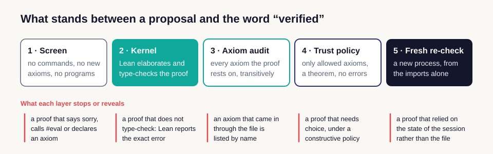

# What "verified" means

Maithic uses eight status words and no others.

| Status | Meaning |
|---|---|
| `verified` | The kernel accepted the proof of exactly the requested statement and the trust policy passed. |
| `checked` | The kernel accepted a proof, but a policy requirement, such as the re-check, is still pending. |
| `refuted` | A counterexample to the statement was confirmed by the kernel. |
| `conjectured` | Stated and not yet proved or refuted. |
| `unverified` | Produced by a model or engine and not checked. |
| `unknown` | A verification method ended without a decision. |
| `failed` | The attempt ended without a proof, with a recorded reason. |
| `abstained` | The system declined to choose. |

Only `verified` is ever presented as an established result. When a result depends on several parts, the weakest
part decides: a proof built on a verified lemma and an unverified one is unverified.

## Who can say "verified"

One function: `Trust_policy.decide` in `ocaml/lib/ledger/policy/`. It takes facts reported by Lean and a policy,
and returns a status with reasons. A model cannot produce the word, a configuration switch cannot, and no code
path prints it without going through that function.

The eight status words, of which one is a result:

  

The facts are: the declaration exists, it is a theorem, elaboration reported no error, the axioms it depends on,
and whether those facts were confirmed in a fresh process.

## The layers

1. **Screen.** Text from a model is untrusted. Lean can run programs while it elaborates, so a candidate proof
   that contains an evaluation command, a new declaration, a meta-program, an option change or a reference to
   input and output is rejected before Lean sees it. The same rules are applied twice: in the orchestrator
   (`ocaml/lib/bridge/sandbox/screen.ml`) and in the Bridge (`lean/MaithicBridge/Server/Guard.lean`).
2. **Kernel.** The candidate is elaborated by Lean. A declaration exists afterwards only if the kernel accepted
   it.
3. **Axiom audit.** The Bridge collects every axiom the declaration rests on, transitively. `sorry` shows up as
   the axiom `sorryAx`; a proof by compiled evaluation shows up as an axiom with `_native` in its name; an axiom
   declared in the file shows up under its own name.
4. **Trust policy.** The default policy allows `propext`, `Quot.sound` and `Classical.choice`, rejects native
   evaluation and requires the re-check. A project can use its own policy file, for example one without choice.
5. **Fresh re-check.** The finished text, the file up to the theorem followed by the theorem with its proof, is
   elaborated from its imports in a new Bridge process. The re-check must reach the same statement, and its
   facts, not the session's, are what the policy judges.

The same layers as a picture, with what each one stops:

  

## What this does not give you

- The statement is the one in your file. Maithic checks that the proof proves it; it does not check that the
  statement says what you meant.
- The trusted base includes Lean's kernel, the Lean toolchain that elaborates the file and the Maithic code that
  reads Lean's answers and applies the policy. The screen reduces what untrusted text can do, but it is a lexical
  filter, not an operating-system sandbox.
- A proof that passes with `allow_native = true` trusts the compiler in addition to the kernel.

  

