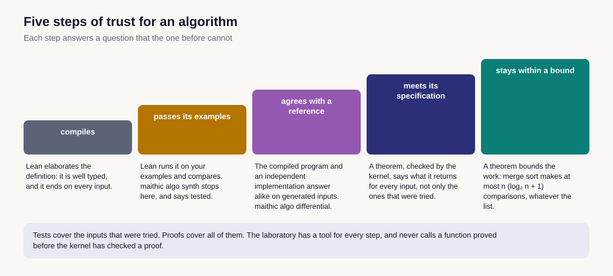
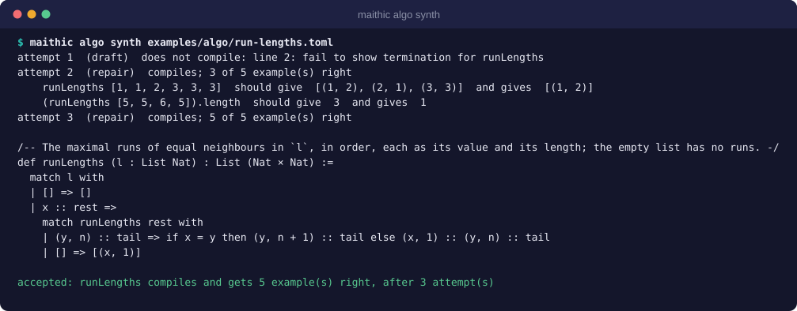
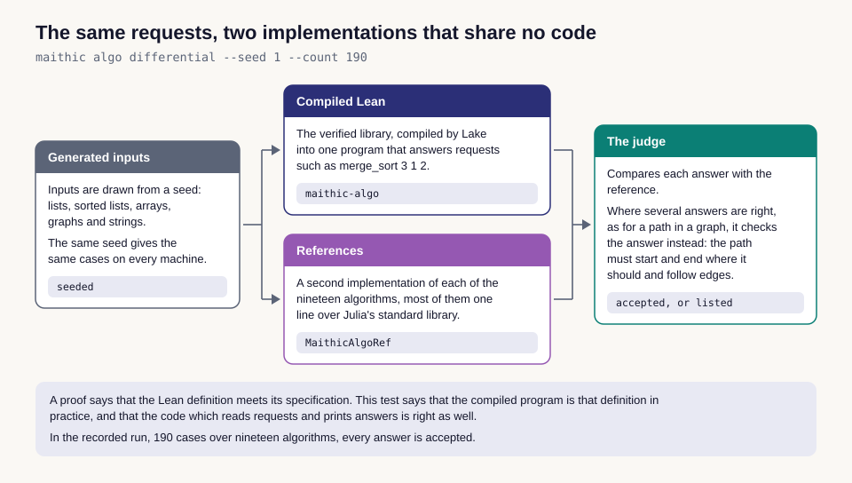
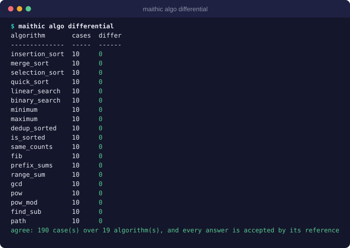
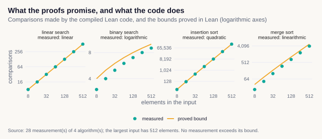

# The algorithm laboratory

An algorithm earns trust in steps. It compiles. It gets examples right. It agrees with an implementation
written by someone else. It is proved to meet a specification. It is proved not to work harder than a bound.
The laboratory has a tool for each step, and it is exact about which step a function has reached: a function
that passed its examples is *tested*, and nothing here calls it proved until Lean's kernel has checked a
proof.

<p align="center">
  
</p>

## A function from a description

```console
$ maithic algo synth examples/algo/run-lengths.toml
```

<p align="center">
  
</p>

<p align="center">
  
</p>

The task is a TOML file: what the function is called, what it should do, and examples.

```toml
name = "runLengths"
description = "Run-length encoding of a list of natural numbers. Every maximal run of equal neighbours becomes one pair: the value, and how long the run is. The pairs stand in the order of the runs."
signature = "(l : List Nat) : List (Nat × Nat)"
constraints = ["Recursion on the structure of the list: no well-founded recursion and no partial definition."]

[[example]]
call = "runLengths [1, 1, 2, 3, 3, 3]"
expect = "[(1, 2), (2, 1), (3, 3)]"
```

A model drafts the definition, and then Lean has the word:

1. **Screen.** The draft has to be one `def` of the function that was asked for. `partial`, `unsafe`, `IO`,
   `sorry`, new axioms, compiler attributes and commands such as `#eval` are refused before Lean sees the
   text, because Lean will run this code.
2. **Compile.** Lean elaborates the definition. An error, such as a recursion that Lean cannot see end, goes
   back to the model word for word.
3. **Run.** Each example is evaluated with `#eval`, and the value is compared with what was expected. A
   wrong answer goes back to the model with the value the function gave.

The model is asked for a correction at most `--rounds` times (3), and the run ends early when it returns a
version it returned before. The function is accepted when it compiles and every example gives what was expected. `--write FILE.lean` keeps
it, with every example as a `#guard` that Lean checks again whenever the file is compiled, and `--out FILE`
writes the record of the run: every draft, what Lean said about each, and the final text (schema
`maithic.algolab.synthesis/1`). `--given FILE` starts from an implementation you wrote, and with `--no-ai`
as well no model is asked: the command is then a judge for your own code. It exits with status 7 when
nothing was accepted.

In the recorded run the first draft takes a whole run at a time and recurses on what is left, which is
right and which Lean rejects, because it cannot see that the rest is shorter. The second recurses on the
tail and loses a run whenever a new one starts. Lean reports `[(1, 2)]` where three pairs were expected, and
the third version keeps the run.

## From tested to proved

Five examples say nothing about the sixth. [`Maithic.Algo.Lab.RunLengths`](../../lean/Maithic/Algo/Lab/RunLengths.lean)
takes the accepted function as it was written and proves what a run-length encoding has to be:

| Theorem | What it says |
|---|---|
| `expand_runLengths` | Decoding the result gives back the list: nothing is lost and nothing is added. |
| `runLengths_pos` | No run has length zero. |
| `separated_runLengths` | Neighbouring runs have different values, so every run is maximal. |
| `sum_runLengths` | The lengths of the runs add up to the length of the list. |
| `eq_runLengths` | Any list of pairs with the first three properties is the one `runLengths` returns. |

The last theorem says the specification has exactly one solution. So the function that a model proposed is
not merely a function that passes five examples; it is the run-length encoding. The model's part was the
proposal. The proofs were written for this library and are checked by the kernel like any other.

## The verified algorithms, tested from outside

A proof says that a definition meets its specification. It does not say that the compiled program is the
definition, or that the code that reads the input and prints the result is right. So the verified
algorithms are also run.

<p align="center">
  
</p>

```console
$ maithic algo differential
```

<p align="center">
  
</p>

Lake compiles the library into one program, `maithic-algo`, that answers requests such as
`merge_sort 3 1 2` or `path 4 0 3 | 0 1 1 2 2 3`. The Julia package `MaithicAlgoRef` holds a second
implementation of each of the nineteen algorithms, most of them one line over Julia's standard library, and
generators that draw lists, sorted lists, graphs and strings from a seed. The same requests go to both
sides. Where there are several right answers, as for a path in a graph, the reference checks the answer
instead of comparing it: a path is accepted when it starts and ends where it should and follows edges.

`--seed`, `--count` and `--size` choose the inputs, `--algorithm NAME` tests one algorithm, and `--exe FILE`
tests another program that speaks the same protocol. The command exits with status 7 when an answer is not
accepted, and lists each such answer with the request that led to it.

## How much work, proved and measured

[`Maithic.Algo.Cost`](../../lean/Maithic/Algo/Cost/Comparisons.lean) counts the comparisons of four
algorithms, with a function that follows each algorithm branch for branch, and proves a bound for each
count:

| Algorithm | Proved bound on the comparisons | Theorem |
|---|---|---|
| linear search | `n` | `linearSearchCost_le` |
| binary search | `log₂ n + 1` elements looked at | `binarySearchCost_le` |
| insertion sort | `n (n - 1) / 2` | `two_mul_insertionSortCost_le` |
| merge sort | `n (log₂ n + 1)`, and `n k` for a list of at most `2^k` elements | `mergeSortCost_le`, `mergeSortCost_le_of_le_pow` |

The program answers `cost merge_sort 3 1 2` with the count, so the counts can be measured on inputs of any
size. `bin/costs.jl` of `MaithicAlgoRef` does that for sizes from 8 to 512 and writes
[`fixtures/algolab/costs.csv`](../../fixtures/algolab/costs.csv), each count beside the bound proved for
that size.

<p align="center">
  
</p>

In R, `maithicstats::fit_growth()` fits five growth models to the counts (constant, logarithmic, linear,
linearithmic and quadratic) and picks one by the Bayesian information criterion; `growth_table()` lays the
measured growth beside the proved bound. The measurements agree with the proofs in every row: no count
exceeds its bound, and each measured order is the order of the bound. A search for something that is not
there and a list in falling order reach their bounds exactly, which shows those two bounds cannot be
lowered.

Two cautions. A counting function is a model of the cost written by hand; that it counts what the
algorithm does is read off its shape and is not proved. And a fit describes the inputs that were measured:
it is the proof, not the curve, that covers the inputs that were not.
