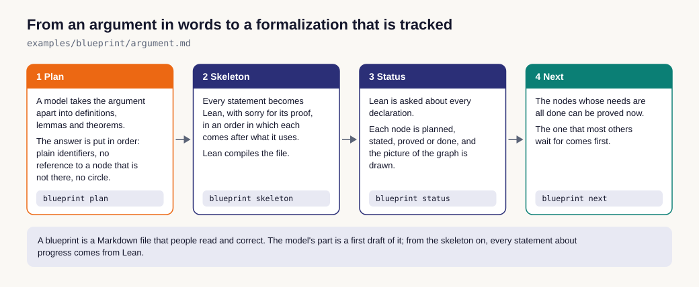
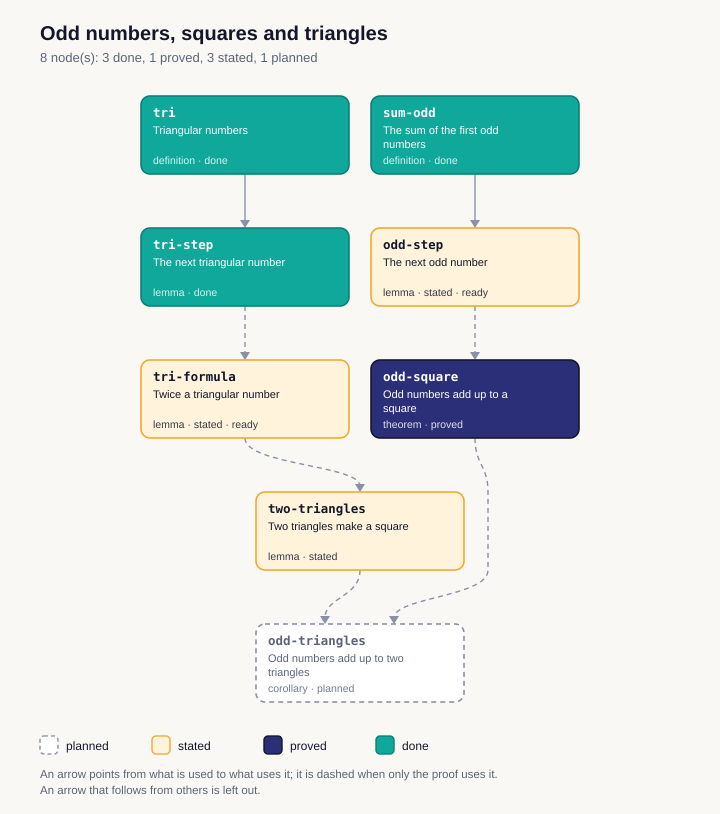
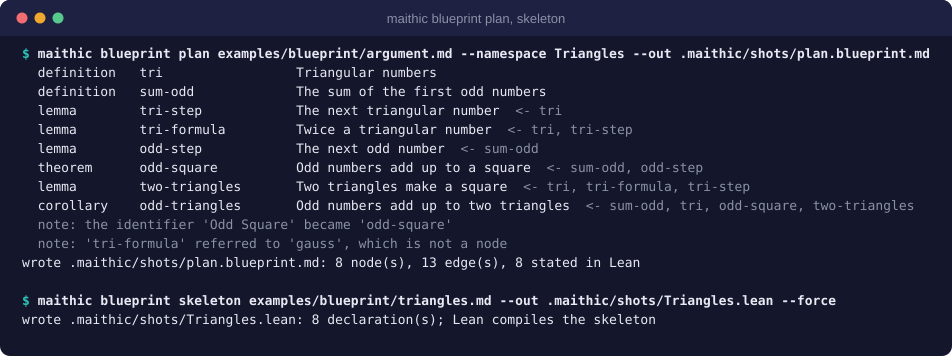
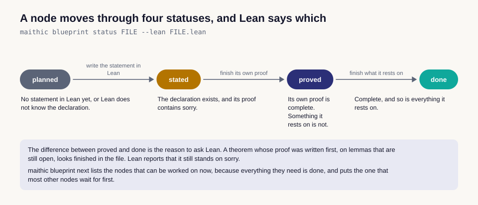
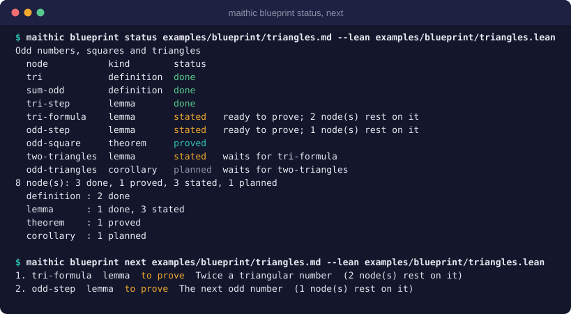
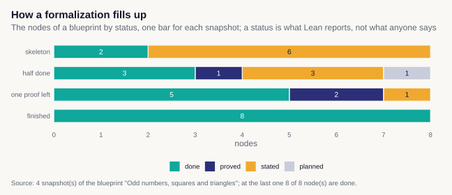

# Blueprints: a formalization, planned and tracked

A large proof is not written in one sitting. It is taken apart into definitions and lemmas, each stated,
then proved, in an order that the dependencies allow. A *blueprint* is that plan as a file: the nodes, what
each one says in words, what it says in Lean, and what it rests on. `maithic blueprint` makes the plan from
an argument in words, turns it into Lean that compiles, and from then on reports where the work stands by
asking Lean, never by asking the people who do it.

<p align="center">
  
</p>

<p align="center">
  
</p>

## The file

A blueprint is Markdown with a small header. [`examples/blueprint/triangles.md`](../../examples/blueprint/triangles.md)
starts like this:

````markdown
---
blueprint: 1
title: Odd numbers, squares and triangles
namespace: Triangles
---

## Lemma `tri-step`: The next triangular number

- lean: `tri_succ`
- uses: `tri`

The triangular number after the n-th is the n-th plus n + 1.

```lean
theorem tri_succ (n : Nat) : tri (n + 1) = tri n + (n + 1)
```

**Proof.** By the definition of `tri`.
````

A node is a section whose heading gives its kind (definition, lemma, proposition, theorem or corollary), its
identifier and its title. `lean` names the declaration, `uses` lists the nodes the statement needs, and
`proof uses` those that only the proof needs. The text is the informal statement, the `lean` block the
formal one, and what follows `**Proof.**` the informal proof. A node needs a statement, in words or in Lean;
the rest is optional. A node without a `lean` block is *planned*.

`maithic blueprint check FILE` reads a file and reports what is wrong with it: an identifier used twice, a
reference to a node that is not there, a circle of dependencies, two nodes with the same Lean name, a
definition that has a proof. It exits with status 7 when it finds a problem.

## From an argument to a plan

```console
$ maithic blueprint plan examples/blueprint/argument.md --namespace Triangles --out plan.blueprint.md
```

<p align="center">
  
</p>

A model reads the argument and answers with nodes. The answer is not trusted to be a plan: identifiers are
made plain and unique, a reference to a node that does not exist is dropped and reported, a definition keeps
no proof, and an answer whose dependencies form a circle is refused. The notes under the table say what was
put in order. What is written is a blueprint file like any other, to be read and corrected by hand.

`maithic blueprint skeleton FILE --out FILE.lean` writes the Lean side: every definition as it stands, and
every stated claim as a theorem with `sorry` for a proof, in an order in which each comes after what it
uses. Each declaration carries a comment with the identifier of its node. Lean then compiles the file, and
an error is reported against the node it belongs to; the command exits with status 7 when the skeleton does
not compile. `--no-check` skips Lean, and `--force` overwrites a file that is there.

## Where the work stands

```console
$ maithic blueprint status examples/blueprint/triangles.md --lean examples/blueprint/triangles.lean
$ maithic blueprint next examples/blueprint/triangles.md --lean examples/blueprint/triangles.lean
```

<p align="center">
  
</p>

<p align="center">
  
</p>

The Lean file is given to Lean, and each node gets one of four statuses from what Lean reports about its
declaration:

| Status | Meaning |
|---|---|
| planned | The node has no statement in Lean yet, or Lean does not know its declaration. |
| stated | The declaration exists and its proof contains `sorry`. |
| proved | Its own proof is complete, and something it rests on is not: the proof stands on `sorry` further down. |
| done | Its proof is complete and so is everything it rests on. Lean reports no `sorry` anywhere beneath it. |

The difference between *proved* and *done* is the reason to ask Lean. A theorem whose proof was finished
first, on lemmas that are still open, looks finished in the file and is not. The status also notes where
plan and code drifted apart, such as a dependency that the blueprint lists and the Lean proof never uses.

`blueprint next` lists the frontier: the nodes that can be worked on now because everything they need is
done, the one that most other nodes wait for first. `--blocked` lists the others with what each waits for.

`status` takes `--svg FILE` for the picture at the top of this page, `--out FILE` for the snapshot as JSON
(schema `maithic.blueprint.status/1`), `--label TEXT` to name the snapshot, and `--strict` to exit with
status 7 unless every node is done, which is how a finished blueprint is guarded in continuous integration.
`maithic blueprint graph FILE --format json|dot|svg` writes the graph alone.

## Progress over time

Snapshots taken as the work goes on are read in R by `maithicstats::read_blueprint_snapshots()`.
`status_composition()` counts the nodes of each status in each snapshot, `status_changes()` lists the nodes
that moved between two snapshots, and `maithicviz::plot_blueprint_progress()` draws the figure below from
the four snapshots under [`fixtures/blueprint/snapshots`](../../fixtures/blueprint/snapshots).

<p align="center">
  
</p>
