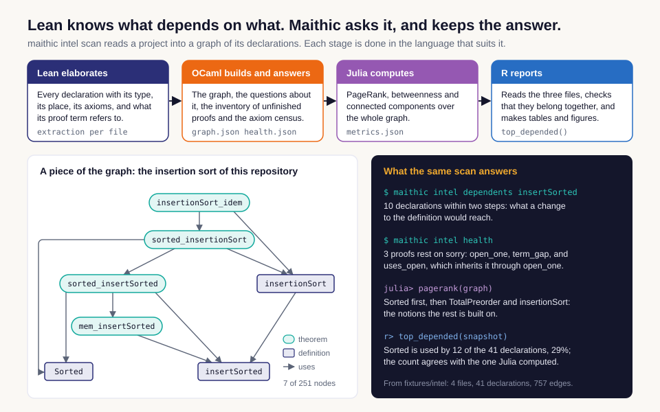
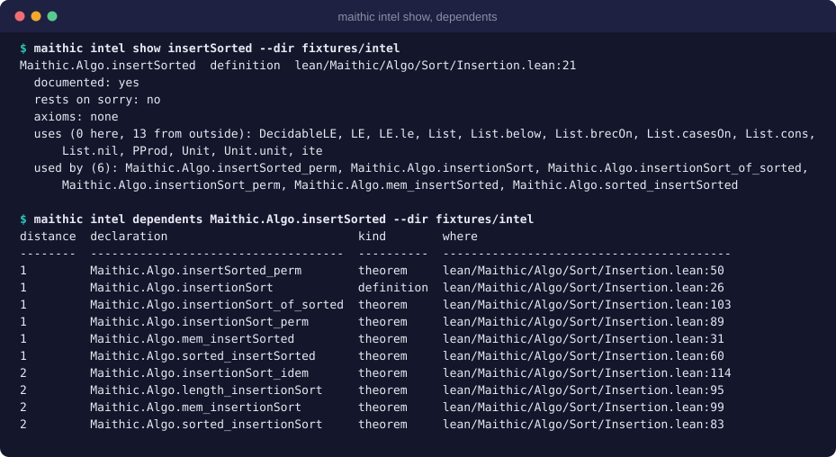
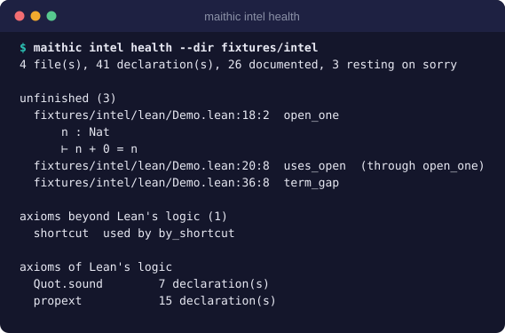
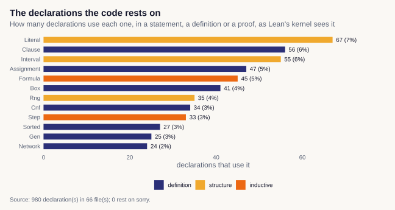

# Reading a codebase as a graph

Which theorems does this definition hold up? What breaks if I change this lemma? How much of the project is
still unfinished, and what rests on what is unfinished? Lean knows the answers: every declaration in a checked
file carries the constants it refers to. `maithic intel` asks Lean once, keeps the answer as a graph, and
answers such questions from the graph in milliseconds.

<p align="center">
  
</p>

## Scanning

```console
$ maithic intel scan lean/Maithic/Algo --project lean
scanned 23 file(s): 261 declaration(s), 0 resting on sorry, 0 file(s) with errors
  class 2  definition 74  instance 5  theorem 180
wrote .maithic/intel/graph.json and .maithic/intel/health.json
```

Every Lean file among the paths is elaborated, each in a process of its own, and what is written comes from
the environment that the kernel checked, not from the text: a dependency is there because the proof term refers
to the constant, whether or not the proof names it. `--project DIR` names the Lake project whose modules the
files import; `--dir DIR` says where the graph is kept, `.maithic/intel` unless given. The other commands read
the graph and need no Lean.

## Asking

<p align="center">
  
</p>

| Command | Answers |
|---|---|
| `maithic intel show NAME` | What the declaration is, where it stands, whether it is documented and finished, the axioms it rests on, what it uses and what uses it. |
| `maithic intel deps NAME` | Everything it depends on, directly and through others, with the distance. `--depth 1` for the direct ones; `--all` to follow into the libraries. |
| `maithic intel dependents NAME` | Everything that depends on it: what a change would reach. |
| `maithic intel health` | The state of the project: declarations by kind, every unfinished proof with its open goal, and the axioms in use. |
| `maithic intel stats` | The size and shape of the graph, and the declarations most others use. |

A name may be given by its last part when that is enough to tell it apart: `insertionSort` for
`Maithic.Algo.insertionSort`. Each command prints JSON with `--json`.

## The state of a project

<p align="center">
  
</p>

Three things in this report are worth more than a search for the word `sorry` in the sources:

- **The goal that is open.** For every `sorry` in a tactic proof, the report shows the goal Lean had at that
  point: what is left to prove, with its hypotheses.
- **What is inherited.** `uses_open` contains no `sorry`. It uses `open_one`, which does, and so it is not
  proved either. The report lists it with the lemma it inherits the gap from.
- **The axioms.** Every axiom that a declaration rests on is counted, and the ones beyond Lean's logic are
  named with the declarations that use them. An `axiom` in a project is a claim that nobody checked.

## What a declaration looks like in the graph

Nodes are declarations, modules, namespaces and files. Edges say that a declaration **uses** another (in its
statement, in its definition or proof, or in both), that a module **imports** another, that a file, module or
namespace **contains** something, that an instance is an **instance of** a class, and that a structure
**extends** another. Declarations of the libraries the code leans on are nodes too, marked as coming from
outside, with no edges of their own. The format is
[`schemas/intel/graph.schema.json`](../../schemas/intel/graph.schema.json).

A declaration has two places. Where it begins, its documentation included, and where its name stands. Reports
point at the name: that is the line an editor jumps to. A position inside the documentation still belongs to
the declaration when the graph is asked what stands at a line.

## Computing on the graph

The Julia package `MaithicGraphs` loads the graph and computes what needs the whole of it:

```console
$ julia --project=julia/MaithicGraphs julia/MaithicGraphs/bin/metrics.jl .maithic/intel/graph.json > .maithic/intel/metrics.json
```

```julia
using MaithicGraphs

graph = read_graph(".maithic/intel/graph.json")
top(graph, pagerank(graph), 3; internal_only = true)   # the notions the rest is built on
component_sizes(graph)                                  # parts of the code that share nothing
```

PageRank weighs a declaration by the weight of what uses it, so a small lemma under an important theorem
ranks above a lemma with many trivial users. Betweenness finds the declarations that most paths of dependency
run through.

## Tables and figures

The R package `maithicstats` reads the folder of a scan. It checks first that the files belong together: that
every edge joins two nodes, that the health report counts the declarations the graph holds, and that the
metrics are about this graph.

```r
library(maithicstats)

snapshot <- read_intel_snapshot(".maithic/intel")
top <- top_depended(snapshot, 5)
print(top[, c("rank", "name", "kind", "used_by", "share")], digits = 3)
#>   rank                       name       kind used_by  share
#> 1    1        Maithic.Algo.Sorted definition      27 0.1034
#> 2    2 Maithic.Algo.TotalPreorder      class      20 0.0766
#> 3    3 Maithic.Algo.insertionSort definition      19 0.0728
#> 4    4    Maithic.Algo.TotalOrder      class      17 0.0651
#> 5    5        Maithic.Algo.euclid definition      13 0.0498
writeLines(intel_report_table(snapshot))   # the same as Markdown, for a report
```

<p align="center">
  
</p>

The figure is `maithicviz::plot_top_depended(snapshot)`, here for the whole Lean library of this repository.

## Extraction on its own

`maithic intel extract PATH...` writes what Lean reports about each file as one JSON document, and all
declarations together as JSON lines, for tools that want the raw material:

```console
$ maithic intel extract lean/Maithic/Algo --project lean --trace --out out
23 file(s), 261 declaration(s) written to out
```

With `--trace`, the tactic steps of every proof are included, each with the goals before and after it; with
`--lint`, the findings of the lint rules; with `--duplicates`, for every theorem the theorems elsewhere that
state the same thing. The format is
[`schemas/bridge/extraction.schema.json`](../../schemas/bridge/extraction.schema.json). The
[datasets](datasets.md) and the [review](review.md) are built on the same extraction.
