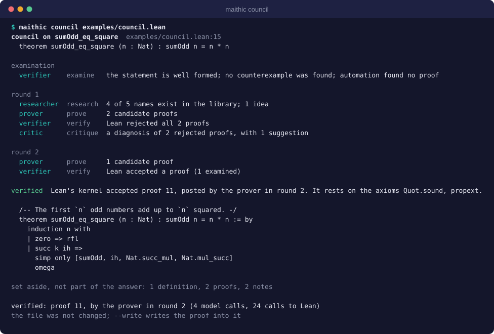
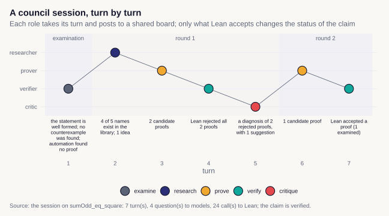
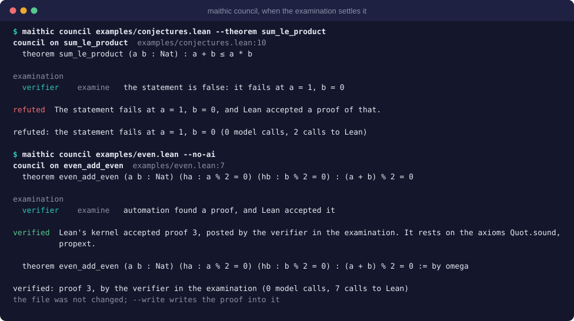

# A council: several roles, one judge

A model that is asked to prove a theorem, check its own proof and report the result will report success.
`maithic council` splits that work among roles that cannot vouch for each other: one looks for lemmas, one
proposes proofs, one explains failures, and one asks Lean. The last asks no model. A claim is *verified*
when Lean's kernel has accepted a proof of it within the trust policy, and by nothing a member says.

<p align="center">
  
</p>

## A session

```console
$ maithic council examples/council.lean
```

The problem is the theorem of the file that is named with `--theorem`, or the one theorem whose proof is
unfinished. `--goal TEXT` adds what you are after, in words, for the roles that ask a model.

| Role | What it does | Asks a model | Tools |
|---|---|---|---|
| verifier | Examines the statement, gives every proof to Lean, says what Lean decided. | no | Lean check, elaborate, check a proof, the prover, the refuter |
| researcher | Names definitions and lemmas that bear on the statement. Each name is looked up in Lean, and one Lean does not know is dropped. | yes | look-up |
| prover | Proposes proofs, with the lemmas, the rejected proofs and the critic's remarks before it. | yes | none |
| critic | Says why the proofs Lean rejected failed, from Lean's own errors, and what to try. | yes | none |

A session starts with an **examination**, which costs no tokens: Lean is asked whether the statement is
well formed, a counterexample is looked for, and the prover's automation has one attempt. Many sessions end
there. Then come rounds, and within a round the order is fixed: researcher (in the first round), prover,
verifier, critic. The critic does not speak in the last round, since nobody would act on it.

<p align="center">
  
</p>

In the recorded session the researcher names five lemmas and one of them, `Nat.add_mul_self_eq`, does not
exist; Lean says so and it never reaches the prover. The prover's first two proofs fail, and the errors go
to the critic word for word. The critic's remark, that `omega` cannot read a product of two variables, is
what the prover's second attempt acts on. The session took four questions to models and twenty-four calls
to Lean.

## The blackboard, and who may write what

Members do not hand work to each other. They post it on a shared board: definitions, statements, claims,
proofs, counterexamples, notes and questions, each with its author, its round and the items it refers to.
Items are never changed. Two things are recorded beside them, and both only from what Lean said: whether a
proof was accepted, and the status of a claim.

| Status of a claim | Reached when | On what evidence |
|---|---|---|
| `conjectured` | It is posted, whatever its text says. | none |
| `formalized` | Lean elaborated its statement. | the statement as Lean prints it |
| `verified` | Lean's kernel accepted a proof of that statement, without `sorry`, on axioms the policy allows, and, when the policy asks for it, a second time in a fresh process. | the proof's axioms and the policy |
| `refuted` | Lean accepted a proof that the statement is false at given values. | the refutation |

The functions that change a status take evidence, and evidence is made from an answer of Lean by the tools
that only the verifier is handed. The prover can post "this is proved" as often as it likes; it is a note.

<p align="center">
  
</p>

The **answer** at the end is built the same way: from the claim, the proof Lean accepted, the lemmas that
proof uses, or the counterexample. Everything else that was said is set aside and counted, so the report
shows how much was said and how little of it the answer needs.

## Budgets

| Option | Limit | Default |
|---|---|---|
| `--budget-tokens N` | Tokens of all model calls together. | 200000 |
| `--budget-cost USD` | Their cost at `--price-input` and `--price-output`, in dollars for a million tokens. | none |
| `--budget-seconds S` | The time of the session. | 600 |
| `--budget-lean-calls N` | Texts given to Lean. | 200 |
| `--budget-model-calls N` | Questions put to a model. | 24 |

A limit of 0 is no limit. The budget is asked before every call, so a session stops between two calls. When
the models are spent, the proofs already on the board are still given to Lean; when Lean may no longer be
asked, the session ends, because nothing more could be established. What was established stays.

## What comes out

| Option | Output |
|---|---|
| `--transcript FILE` | The session as Markdown: every message in order, by round, and the answer. [An example](../../fixtures/council/sum-odd.md). |
| `--out FILE`, `--json` | The whole session as JSON (schema `maithic.council.session/1`): turns, board, messages, answer, budget. |
| `--write` | The verified proof, written into the file. |

`--rounds N` (3) and `--candidates N` (3) size the session; `--no-ai` runs the examination alone. The exit
status is 0 when the claim is verified, 8 when it is refuted, and 7 otherwise.

<p align="center">
  
</p>

`maithicstats::read_council_sessions` loads sessions written with `--out`, and `role_contributions` counts,
for each role, its turns, its messages, the items it posted and how many of those Lean confirmed.
