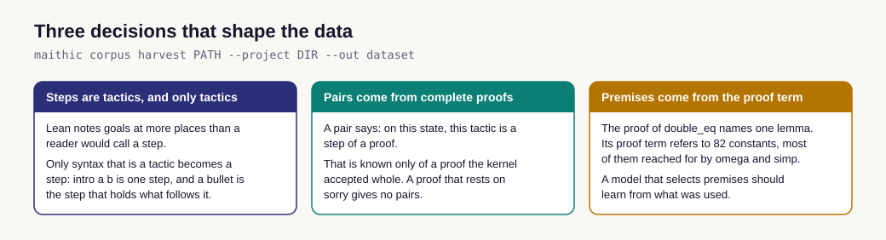
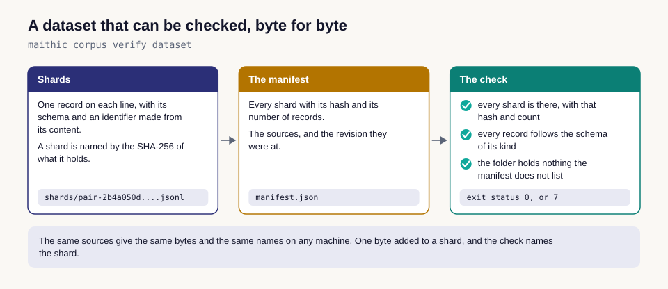
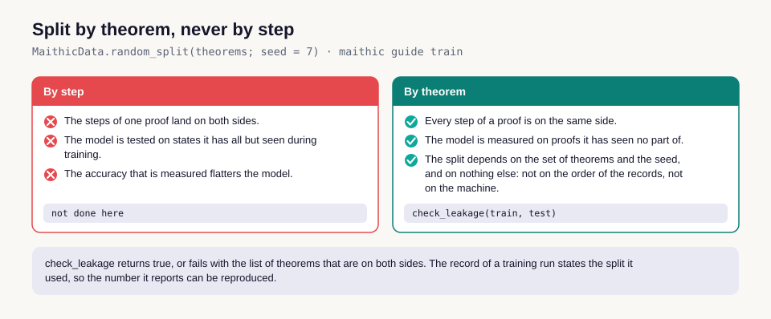
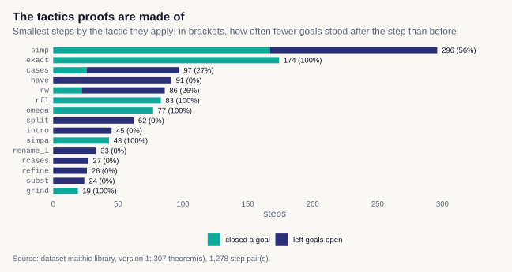
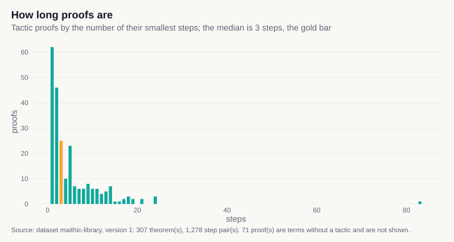

# Datasets from proofs

A model that proposes tactics is trained on proofs: on states and the tactics that were run on them, on the
lemmas that proofs use. Most such data is scraped from text, and text does not say what the goal was when a
tactic ran. `maithic corpus harvest` traces proofs while Lean elaborates them and writes what Lean saw:
every tactic with the goals before and after it, and every constant that each proof term refers to.

<p align="center">
  
</p>

## Harvesting

```console
$ maithic corpus harvest lean/Maithic/Algo --project lean --out dataset --revision v0.1.0
harvested 23 file(s) at revision v0.1.0:
  180 theorem record(s), 1098 step record(s), 6731 premise record(s), 755 pair record(s)
wrote dataset/manifest.json with 5 shard(s)

$ maithic corpus verify dataset
dataset 1 is sound: 180 theorem record(s), 1098 step record(s), 6731 premise record(s), 755 pair record(s) in 5 shard(s)
```

Every Lean file among the paths is traced. A file that does not elaborate is noted in the record of the harvest
and left out, and the harvest goes on. Without `--revision`, the revision recorded is the commit the sources
are at.

| Option | Meaning |
|---|---|
| `--project DIR` | The Lake project whose modules the files import. |
| `--out DIR` | The dataset directory (`dataset`). |
| `--name NAME`, `--dataset-version V` | How the dataset calls itself (the name of the directory, version `1`). |
| `--shard-size N` | Records in a shard at most (5000). |
| `--revision TEXT` | The revision of the sources to record, instead of the commit read from version control: for sources unpacked from an archive, or for a dataset that must not change with every commit. |

## What is written

```
dataset/
  manifest.json                        name, version, sources, counts, and every shard with its SHA-256
  harvest.json                         what happened to each file
  shards/theorem-f8b8077d66694cc2.jsonl
  shards/step-5d89f7b3936c766d.jsonl
  shards/premise-22a023d137ff8517.jsonl   the first 5,000 premise records
  shards/premise-82b4cdaaca29359f.jsonl   the other 1,731
  shards/pair-2b4a050dbd5af65c.jsonl
```

Three decisions shape the records:

<p align="center">
  
</p>

Each line of a shard is one record, a JSON object with its schema and an identifier made from its content.

| Record | One for | Holds | Schema |
|---|---|---|---|
| theorem | every theorem | name, module, file and line, the statement as Lean prints it, the proof as written, the number of smallest steps and of premises, and whether the proof is complete | [`theorem`](../../schemas/corpus/theorem.schema.json) |
| step | every tactic as written | the tactic, its place, its depth, how many tactics it holds, and the goals before and after it | [`step`](../../schemas/corpus/step.schema.json) |
| premise | every constant a proof term refers to | the theorem and the constant | [`premise`](../../schemas/corpus/premise.schema.json) |
| pair | every smallest step of a complete proof | the proof state as one text, the tactic, and the number of goals before and after | [`pair`](../../schemas/corpus/pair.schema.json) |

Three decisions shape the data.

**Steps are tactics, and only tactics.** Lean notes goals at more places than a reader would call a step: at
the bullet in front of `· simp`, at the second name of `intro a b`. Only syntax that is a tactic becomes a
step, so `intro a b` is one step that leaves one goal, and a bullet is the step that holds what follows it.

**Pairs come from complete proofs only.** A pair says: on this state, this tactic is a step of a proof. That is
known only of a proof the kernel accepted whole. A proof that rests on `sorry`, its own or that of a lemma it
uses, keeps its theorem and step records, the theorem marked as not complete, and gives no pairs.

**Premises are read from the proof term.** The proof of `double_eq` names one lemma. Its proof term refers to
82 constants, most of them reached for by `omega` and `simp`. A model that selects premises should learn from
what was used.

## A dataset can be checked

A shard is named by the SHA-256 of its content, and the manifest lists every shard with its hash and its
number of records. The same sources give the same bytes and the same names, on any machine.
`maithic corpus verify DIR` checks all of it: that every shard is there with the hash and the count the
manifest states, that every record follows the schema of its kind, and that the directory holds nothing the
manifest does not list. It exits with status 7 when the dataset is not sound.

<p align="center">
  
</p>

```console
$ echo >> dataset/shards/pair-2b4a050dbd5af65c.jsonl
$ maithic corpus verify dataset
shards/pair-2b4a050dbd5af65c.jsonl does not have the hash the manifest states
```

A harvest into a directory that already holds a dataset replaces it: shards of the earlier one are removed.

## Preparing data in Julia

The package `MaithicData` loads a dataset into typed records and prepares it for training.

<p align="center">
  
</p>

```julia
using MaithicData

data  = load_dataset("dataset")              # checked against the manifest while it is read
pairs = deduplicate(data.pairs)              # one record for each content
split = random_split(data.theorems; seed = 7, validation = 0.1, test = 0.2)
split_counts(split)                          # Dict(:test => 36, :train => 126, :validation => 18)

train = [p for p in pairs if part_of(split, p) == :train]
test  = [p for p in pairs if part_of(split, p) == :test]
check_leakage(train, test)                   # true, or an error that lists the theorems
```

The split is by theorem: all records of a theorem go to the same part, so a model is never tested on a state
from a proof it was trained on. It depends on the set of theorems and the seed and on nothing else, not on the
order of the records and not on the machine. `split_manifest(split)` writes it down.

## Looking at a dataset in R

```r
library(maithicstats)

corpus <- read_corpus("dataset")             # the same checks, hashes included
print(proof_length_summary(corpus), digits = 3)
#>   theorems term_proofs tactic_proofs median p90 mean max one_step
#> 1      307          71           236      3  13 5.42  83    0.263
print(head(tactic_frequency(corpus), 3), digits = 3)
#>   tactic uses  share proofs closes
#> 1   simp  296 0.2316    146  0.564
#> 2  exact  174 0.1362     87  1.000
#> 3  cases   97 0.0759     31  0.268
writeLines(corpus_report_table(corpus))      # the same as Markdown, for a dataset card
```

The numbers above are for the whole Lean library of this repository: 307 theorems, 1,278 pairs. `closes` is the
share of a tactic's uses after which fewer goals stood than before: `exact` and `rfl` always close their goal,
`cases` usually opens more.

<p align="center">
  
</p>

<p align="center">
  
</p>

The figures are `maithicviz::plot_tactic_frequency(corpus)` and `maithicviz::plot_proof_lengths(corpus)`.
