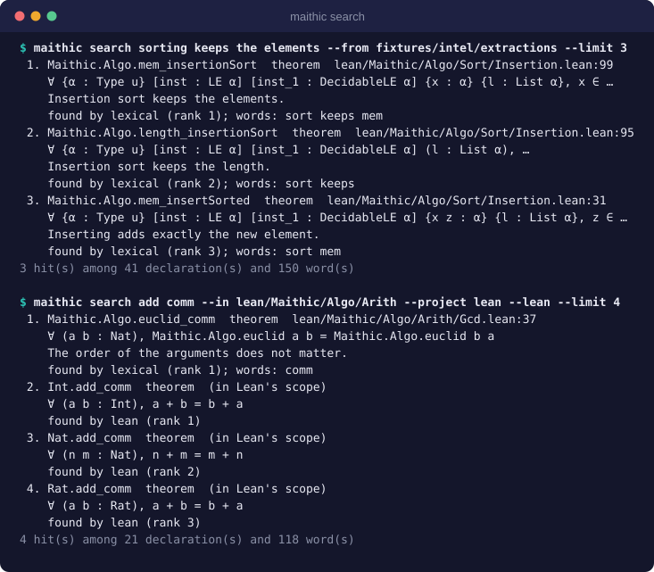
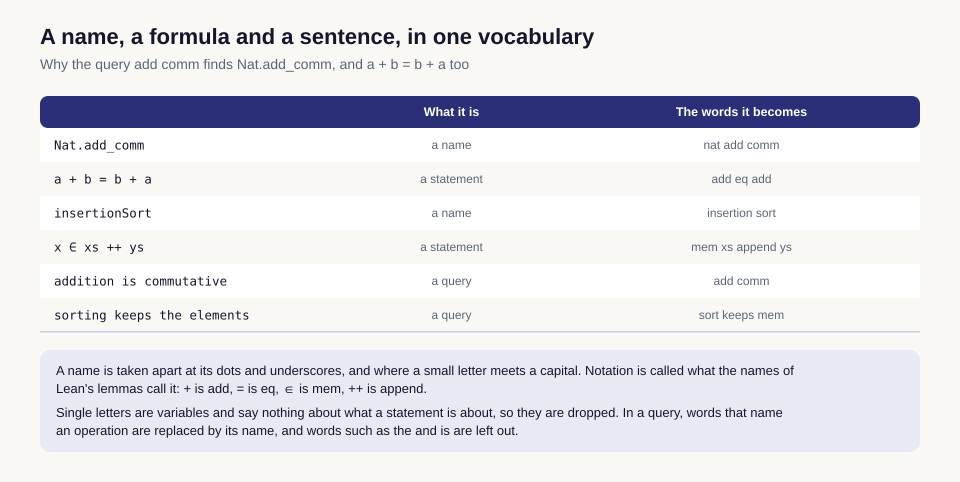
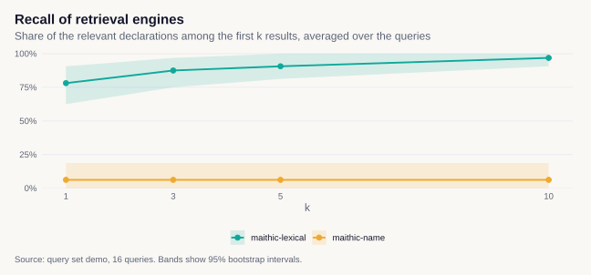

# Finding declarations

Half of proving is knowing what is already there. `maithic search` finds declarations by the words of their
names, their statements and their documentation, in your own files and, when asked, in everything Lean has
in scope.

<p align="center">
  
</p>

## Where the declarations come from

```console
$ maithic search sorting keeps the elements --from fixtures/intel/extractions
$ maithic search add comm --in lean/Maithic/Algo/Arith --project lean --lean
```

`--from DIR` reads declarations that `maithic intel extract --out DIR` wrote earlier, which costs no call to
Lean. `--in PATH` reads Lean files and folders now; `--project DIR` names the Lake project they belong to.
`--lean` also asks Lean about everything in scope, the core library and the imports of `--import MODULE`
included, so that a search finds `Nat.add_comm` although it is in none of your files.

## How a query is answered

Three retrievers can answer, and each hit says which of them found it.

<p align="center">
  
</p>

<p align="center">
  
</p>

- **Lexical.** Declarations are ranked with BM25 by the words they share with the query. A name is taken
  apart at its dots, underscores and capitals, so `add comm` matches `Nat.add_comm`. Notation counts as its
  name: a statement with `a + b = b + a` contains the words *add* and *eq*, and `x ∈ l` the word *mem*. A
  word in a name weighs more than one in a statement, which weighs more than one in the documentation.
- **Name.** The query is taken for a name or a part of one. An exact name wins.
- **Lean.** With `--lean`, Lean's own environment is searched for declarations whose names hold every word.

The rankings are merged by reciprocal rank fusion: a declaration's score is the sum, over the retrievers
that found it, of one over its rank plus a constant. A declaration that two retrievers agree on rises; no
score of one retriever has to be compared with a score of another.

`--kind theorem` and `--module PREFIX` filter the hits, `--limit N` sets their number, and
`--only lexical|name` asks one retriever. The command exits with status 7 when nothing is found, and
`--json` prints the hits in the schema `maithic.search.results/1`.

## How good the answers are

A search that is not measured gets worse without anyone noticing. `--queries FILE --rankings OUT` answers a
set of queries with known relevant declarations and writes the rankings, and
[`maithicstats`](statistics.md) scores them with recall at k, mean reciprocal rank and nDCG, each with a
bootstrap interval.

<p align="center">
  
</p>

On the sixteen queries of [`fixtures/search/queries.json`](../../fixtures/search/queries.json) over the 41
declarations of the demonstration sources, the first hit is a relevant declaration for fifteen (mean
reciprocal rank 0.96), and the first five hits hold 91% of all the declarations marked relevant. The name
retriever alone answers one of the sixteen, the one that is a name: the queries are written in words, which
is what the lexical retriever is for. The set is small and its sources are this repository's own, so these
figures describe the demonstration and are no claim about other libraries.
