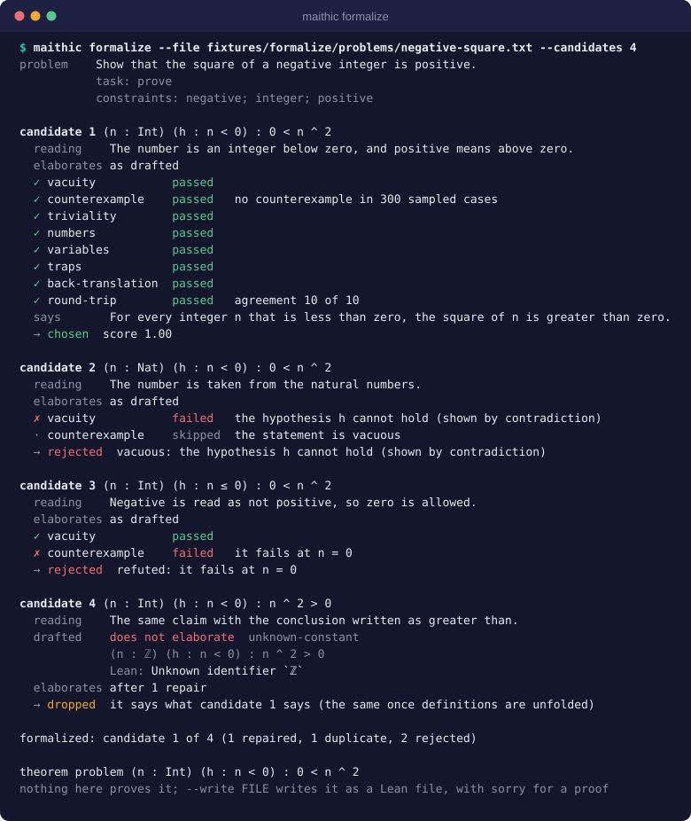
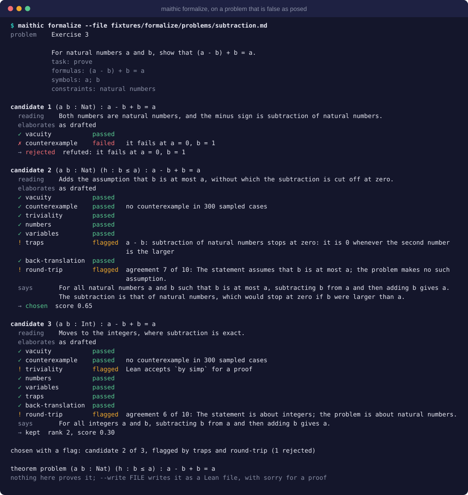
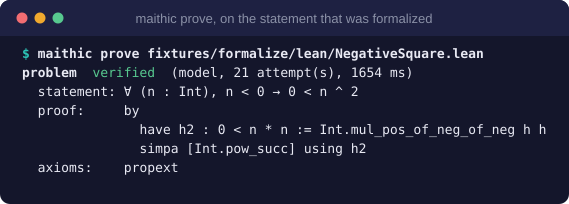
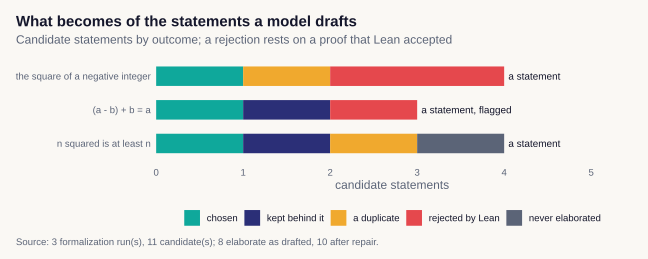

# From a problem in words to a statement in Lean

Before a theorem can be proved it has to be written down, and the step from a sentence to a formal statement
is where meaning is lost without anyone noticing. A statement can compile and say something else: about the
wrong kind of number, with a bound that is off by one, or with hypotheses that cannot hold together, which
makes it true and empty. `maithic formalize` has a model draft several statements and then puts each to
Lean, which rejects the ones that are vacuous or false and never needs to be told what the sentence meant.

<p align="center">
  
</p>

## What happens to a problem

```console
$ maithic formalize "Show that the square of a negative integer is positive." --candidates 4
```

The problem comes from the argument, from `--file FILE`, or from standard input, in plain words, Markdown or
LaTeX. Seven things then happen, in this order.

1. **Intake.** The text is put into one spelling (`x²`, `x^{2}` and `x^2` become the same; `\leq`, `<=` and
   `≤` too; dollar signs and Markdown marks go), and the formulas, numbers, variables and the words that
   quantify, constrain and ask are picked out, each with its place in the text as given.
2. **Drafting.** A model is asked for several statements that read the problem in different ways, each with
   a sentence that says which choices it makes.
3. **Elaboration.** Lean compiles each statement, with `sorry` for a proof, where only the core library and
   the modules named with `--import` are known. A name that is not declared is an error, not a guess.
4. **Repair.** A statement that does not compile goes back to the model with Lean's error, its class, and
   the signatures of the names in the statement that Lean does know. The loop ends when Lean accepts a
   repair, after `--rounds` rounds (2), or when the model repeats itself.
5. **Duplicates.** Of two statements that are the same once notation and definitions are unfolded, as
   `0 < n ^ 2` and `n ^ 2 > 0` are, the later is dropped before any more is spent on it.
6. **Checks.** Each remaining statement is checked, the surest checks first (the table below).
7. **Choice.** The statement with the best score is chosen and printed. Nothing proves it.

| Check | What is asked | A finding |
|---|---|---|
| `vacuity` | Lean looks for a contradiction among the hypotheses. | **rejects** the statement |
| `counterexample` | The statement is run on sampled values, and a failing case is confirmed by a proof Lean accepts. | **rejects** the statement |
| `triviality` | Does `trivial`, `rfl` or `simp` prove it at once? | flags it |
| `numbers` | Is every number of the problem in the statement? | flags it |
| `variables` | Is there a variable that nothing mentions? | flags it |
| `traps` | Does it use an operation that does not mean what its symbol suggests, such as subtraction of natural numbers? | flags it |
| `back-translation` | A model that sees the statement, and nothing of the problem, says in English what it claims. | recorded |
| `round-trip` | A second call scores how well that English agrees with the problem, from 0 to 10, and lists the differences. | flags it below 8 |

The two checks that reject rest on proofs. The others are evidence, laid out in the report, and no model
decides alone whether a statement is right. In the session above three of four candidates are out before
any model is asked to read anything: one because no natural number is below zero, one because zero is not
negative, and one because it is the first statement in other notation.

<p align="center">
  
</p>

## When the problem itself is off

<p align="center">
  
</p>

"For natural numbers a and b, show that (a − b) + b = a" is false as Lean reads it, because subtraction of
natural numbers stops at zero. Lean refutes the literal statement at `a = 0, b = 1`. The candidate that
survives adds the assumption `b ≤ a`, and the report says exactly how it differs from what was asked. The
run ends with a statement and a flag, and exit status 7: a person has to decide whether that statement is
the one they meant.

## The exit status and the files

| Status of the run | Meaning | Exit status |
|---|---|---|
| `formalized` | A statement was chosen, and no check flagged it. | 0 |
| `flagged` | A statement was chosen, and something about it deserves a second look. | 7 |
| `none` | No candidate was left. | 7 |

`--write FILE` writes the chosen statement as a Lean file: the problem and what every check found in a
comment, then the theorem with `sorry`. `--out FILE` writes the whole run as JSON (schema
`maithic.formalize.run/1`): every candidate, every attempt to compile it with what Lean said, every check.
`--name NAME` names the theorem.

The file is where the prover takes over:

<p align="center">
  
</p>

## Your own statements, and no model

```console
$ maithic formalize "For natural numbers a and b, show that (a - b) + b = a." --no-ai \
    --statement "(a b : Nat) : a - b + b = a" --statement "(a b : Nat) (h : b ≤ a) : a - b + b = a"
```

With `--statement` the candidates are yours and nothing is drafted. A statement is what stands between the
name of a theorem and its `:=`: the binders, a colon and the claim. With `--no-ai` as well, no model is
asked at all: Lean compiles the statements and makes the checks that need no model, which are the ones
that reject.

## Looking at a statement in Lean

The checks use three commands of the Maithic Lean library, which are there for anyone
(`import Maithic.Formalize`):

```lean
#maithic_stmt ∀ (a b : Nat) (h : b ≤ a), a - b + b = a
-- the binders with their roles, the conclusion, and a warning:
--   a - b: subtraction of natural numbers stops at zero: it is 0 whenever the second number is the larger

#maithic_explicit ∀ n : Nat, (n : Int) + 1 > 0
-- the statement with every implicit argument, instance and coercion written out

#maithic_compare (∀ n : Int, n < 0 → 0 < n ^ 2) with (∀ n : Int, n < 0 → n ^ 2 > 0)
-- definitional: the same statement once definitions are unfolded
```

## How often it works

<p align="center">
  
</p>

The three runs in the figure are recorded in [`fixtures/formalize`](../../fixtures/formalize) and can be
replayed without a key. Of their eleven drafted statements, eight elaborate as drafted and ten after repair.
`maithicstats::read_formalize_runs` loads runs written with `--out`; `compile_rate` gives the share that
elaborates before and after repair with its interval, and `check_summary` counts what each check found.
