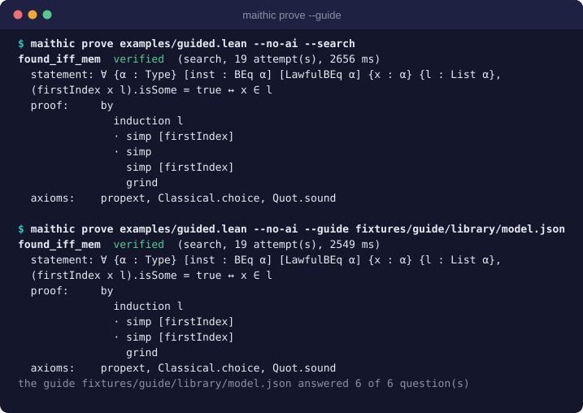
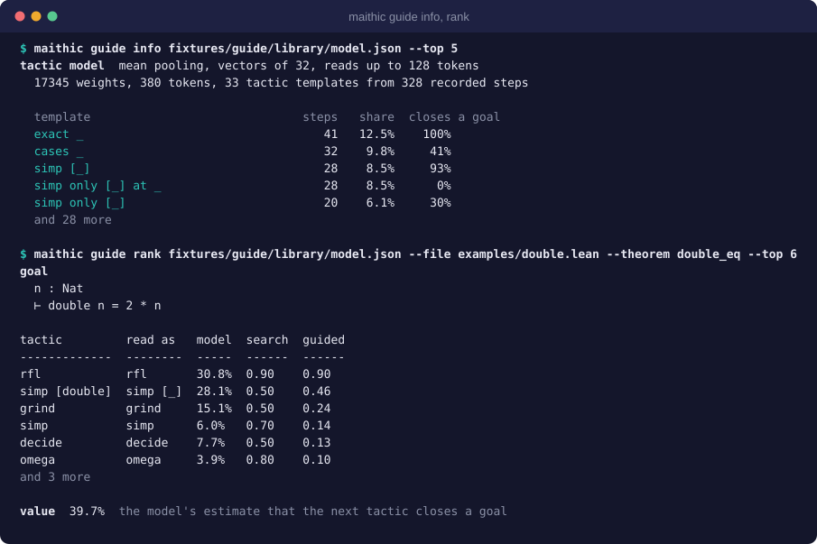
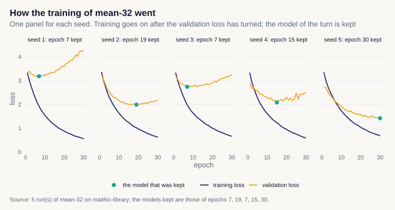

# Guiding the search with a small model

The step-wise search of `maithic prove --search` tries tactics on a goal in a fixed order of preference. A
proof that needs the eighth tactic on the list waits until seven others have been tried, at every goal. A
*guide* is a small model that has seen recorded proofs and says, for the goal at hand, which tactics are worth
trying first. It reorders the candidates and does nothing else: every step is still run by Lean, and a proof
still counts only when the kernel accepts it.

<p align="center">
  
</p>

On [`examples/guided.lean`](../../examples/guided.lean) the unguided search expands 28 goals and visits 71
states before it finds a proof. With the model that the repository keeps it expands 6 and visits 21, and the
proof it finds is one step shorter.

<p align="center">
  
</p>

Every candidate is still tried on every goal that is expanded, in one call to Lean. What the guide decides
is which of the goals that are left the search turns to next: after the induction it goes to the goal that
`simp [firstIndex]` left, and not into the branches that `constructor`, `intros` and `simp` opened.

## Training a model

A model is trained from a dataset of proofs, which `maithic corpus harvest` makes from Lean files (see
[Datasets from proofs](datasets.md)):

```console
$ maithic corpus harvest lean/Maithic --project lean --out dataset --name my-library
$ maithic guide train dataset model --seed 1
```

`guide train` writes two files into the folder `model`. `model.json` is the model: its vocabulary, its tactic
templates and its weights, in a format that is read back bit for bit. `run.json` is the record of the
training: the split of the data, the loss and the accuracy of every epoch, and the accuracy on proofs the
model never saw, beside that of a baseline which always answers with the most frequent templates. The same
seed gives the same two files, byte for byte.

| Option | Meaning |
|---|---|
| `--seed N` | Decides the split of the data and the first weights (0). |
| `--epochs N`, `--batch N`, `--rate X`, `--weight-decay X` | The schedule of the optimizer (30, 16, 0.01, 0.0001). |
| `--dim N`, `--max-length N` | The size of the model's vectors (32) and the longest goal it reads, in tokens (128). |
| `--pooling mean\|first`, `--mixer none\|attention` | The shape of the model. |
| `--k N` | The `k` of the top-k accuracy that is reported (5). |
| `--name NAME` | The name of the run in its record. |

The split is by theorem, never by step: every step of a proof is on the same side, so the model is measured
on proofs it has not seen any part of.

## What a model knows

<p align="center">
  
</p>

A tactic is learned as a *template*: `simp [foo, bar]` and `simp [baz]` are both `simp [_]`. `guide info`
lists the templates with how often each occurred and how often it closed a goal. `guide rank` shows the
model at work on one goal: for each tactic the search would try, the template it is read as, the
probability the model gives it, the preference of the search, and the two combined, which is the order the
guided search uses. The goal comes from `--goal TEXT`, from `--goal-file FILE`, or from a theorem of a Lean
file with `--file FILE --theorem NAME`.

## Proving with a guide

```console
$ maithic prove examples/guided.lean --no-ai --guide fixtures/guide/library/model.json
```

`--guide MODEL` switches the step-wise search on and starts the model as a service, a Julia process that
answers one goal at a time over its standard streams. The setting `guide.model` (or `MAITHIC_GUIDE_MODEL`)
names a model once for every run. The run record says what the guide did: how many goals it was asked about
and how many it answered.

A guide can only change the order of the candidates. If the service does not start, stops answering or
answers nonsense, the search goes on in its own order and the record says that the guide was down: a
proof search never fails because of its guide.

## How much it helps

<p align="center">
  
</p>

The repository keeps twenty training runs in [`fixtures/guide/runs`](../../fixtures/guide/runs): four shapes
of model, five seeds each, trained on the proofs of the Maithic Lean library as it stood when the runs were
recorded: 570 pairs of a state and a tactic, from 104 theorems. Pooled over the seeds, the
plain model with mean pooling names the tactic that the proof actually used first in 32.7% of held-out steps
(95% interval 29.3% to 36.4%), where the baseline does so in 10.3%. Seed by seed the difference is between
15.5 and 28.6 percentage points. Within the first five ranks the model is right in 68.0% of steps, the
baseline in 48.8%. The shape matters: a model that reads only the first token of a goal is no better than
the baseline, at 9.4%.

Training goes on for a fixed number of epochs, and the model that is kept is the one of the epoch with the
lowest validation loss, which for these runs comes early:

<p align="center">
  
</p>

These are measurements on one small library, and they say what they say. Ordering tactics well makes a
search that would succeed succeed sooner. It does not make a search succeed that would fail: on the held-out
theorems of the kept model, the ones the unguided search could not prove were not proved with the guide
either, after the same number of expansions. `maithicstats::read_guide_runs`, `model_accuracy` and
`accuracy_difference` compute these numbers from the run records, and `maithicviz::render_guide` draws the
two figures.
