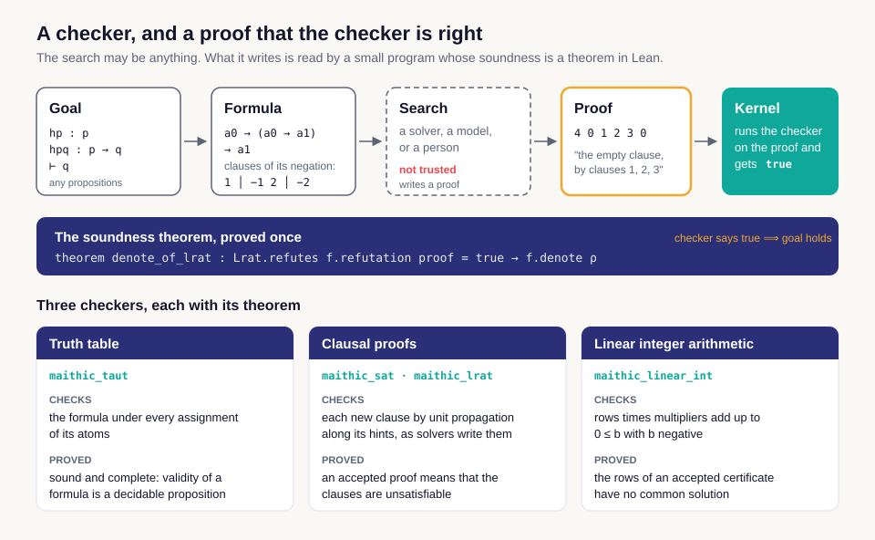

# Checkers with proofs

Some goals are settled by computation: a truth table, a solver's refutation, a handful of multipliers. Lean could
simply be told the answer, and then the program that found it would have to be trusted. Maithic does the
opposite. For each kind of answer there is a small **checker**, written in Lean, and a **theorem** that whatever
the checker accepts is true. The kernel runs the checker; the theorem turns "it returned `true`" into a proof of
the goal. Nothing that searches is trusted, and nothing is added to the axioms.

<p align="center">
  
</p>

The checkers live in [`lean/Maithic/Oracle/Logic/`](../../lean/Maithic/Oracle/Logic), and
[`Examples.lean`](../../lean/Maithic/Oracle/Logic/Examples.lean) is a compiled tour of them.

## Propositional goals

```lean
import Maithic.Oracle.Logic

example (p q : Prop) : ((p → q) → p) → p := by maithic_taut

example (p q r s : Prop) (hpq : p → q) (hqr : q → r) (hrs : r → s) : p → s := by maithic_sat
```

Both tactics read the goal as a formula: `True`, `False`, `¬`, `∧`, `∨`, `→`, `↔` and `≠` are connectives, and
every other proposition is an **atom**, the same proposition always the same atom. Hypotheses that are
propositions become premises. `#maithic_reflect` shows the reading:

```lean
variable (p q r : Prop)

#maithic_reflect p ∧ q → q ∨ ¬r
-- ((a0 ∧ a1) → (a1 ∨ ¬a2))
-- where a0 := p, a1 := q, a2 := r
```

- **`maithic_taut`** evaluates the truth table in the kernel. It is the simplest method and is meant for goals
  with few atoms; past sixteen it declines and points to `maithic_sat`.
- **`maithic_sat`** searches for a refutation of the negated goal, and the kernel checks what the search wrote.
  The search is a small procedure of the library and is deliberately unverified: its proof is checked like
  anyone else's.

Atoms are independent for these tactics. `x < 3` and `x < 5` are two unrelated atoms, so a goal that needs
arithmetic to connect them does not follow *propositionally*, even if it is true:

```lean
example (x : Nat) (h : x < 3 ∨ x = 3 ∨ x > 3) (h₁ : ¬x < 3) (h₂ : ¬x > 3) : x = 3 := by maithic_sat  -- follows
```

### When the goal does not follow

The answer is a set of truth values under which the goal fails:

```lean
example (p q : Prop) : p → q := by maithic_sat
-- error: maithic_sat: the goal does not follow by propositional reasoning; it fails when
--   p := True
--   q := False
```

Such an assignment is itself checkable. On formulas, `Formula.not_valid_of_falsifiedBy` turns it into a proof
that the formula is not valid, and `Formula.not_forall_denote_of_falsifiedBy` into a refutation of the statement
about all propositions:

```lean
theorem not_forall_imp : ¬∀ a b : Prop, a → b := fun h =>
  Formula.not_forall_denote_of_falsifiedBy (f := .imp (.atom 0) (.atom 1)) (trueAtoms := [0])
    (by decide) fun ρ => h (ρ 0) (ρ 1)
```

## Proofs written by a solver

`maithic_cnf` prints the problem whose unsatisfiability proves the goal, in the DIMACS format that
satisfiability solvers read, with the proposition behind each variable:

```lean
example (p q : Prop) (hp : p) (hpq : p → q) : q := by
  maithic_cnf
  -- c 1 := p
  -- c 2 := q
  -- p cnf 2 3
  -- 1 0
  -- -1 2 0
  -- -2 0
  maithic_lrat "4 0 1 2 3 0"
```

`maithic_lrat` takes a proof in the LRAT text form, one step per line:

```text
<number of the new clause> <its literals> 0 <the clauses to propagate with, in order> 0
```

The step `4 0 1 2 3 0` adds clause 4, the empty clause, and says that clauses 1, 2 and 3 show it: clause 1 makes
`p` true, clause 2 then makes `q` true, and clause 3 is false. Checking a step is a single pass over its hints,
with no search, which is why the checker is small enough to verify.

The library's example of a real solver's output is four pigeons and three holes. The fifteen steps were written
by the solver CaDiCaL for the problem that `maithic_cnf` prints, and pasted in:

```lean
theorem pigeonhole_four_three {a₁ a₂ a₃ b₁ b₂ b₃ c₁ c₂ c₃ d₁ d₂ d₃ : Prop}
    (ha : a₁ ∨ a₂ ∨ a₃) (hb : b₁ ∨ b₂ ∨ b₃) (hc : c₁ ∨ c₂ ∨ c₃) (hd : d₁ ∨ d₂ ∨ d₃)
    (h₁ : ¬(a₁ ∧ b₁) ∧ ¬(a₁ ∧ c₁) ∧ ¬(a₁ ∧ d₁) ∧ ¬(b₁ ∧ c₁) ∧ ¬(b₁ ∧ d₁) ∧ ¬(c₁ ∧ d₁))
    (h₂ : …) (h₃ : …) : False := by
  maithic_lrat "23 -11 -12 0 22 19 13 16 1 3 6 0
    24 -7 -12 0 21 19 6 8 1 2 11 0
    …
    37 0 35 36 9 0"
```

A proof that does not hold up is refused at its first bad step, with the reason:

```lean
example (p q : Prop) (hp : p) (hpq : p → q) : q := by maithic_lrat "4 0 1 2 0"
-- error: maithic_lrat: step 0: clause 4: unit propagation along the hints ends without a conflict
```

Two limits are worth knowing. Only steps justified by unit propagation (`RUP`) are accepted; a step that uses
the `RAT` rule, which some solver techniques need, is refused when the proof is read. And the conversion to
clauses distributes disjunction over conjunction, which keeps the clause set equivalent to the formula and adds
no auxiliary variables, but can grow quickly on deeply nested equivalences.

## Linear integer arithmetic

A system of linear constraints over the integers has no solution when its rows, multiplied by suitable numbers
and added up, give `0 ≤ b` with `b` negative. The multipliers are the certificate:

```lean
theorem no_integer_point (x y : Int) (h₁ : 2 * x + 4 * y < 7) (h₂ : x + 2 * y ≥ 4) : False := by
  maithic_linear_int [x, y] [(1, ⟨[1, 2], .le, 3⟩), (1, ⟨[-1, -2], .le, -4⟩)] using [h₁, h₂]
```

The tactic takes the variables, the rows with their multipliers, and for each row the hypothesis it comes from.
Two things are then checked, separately:

1. The kernel runs `LinearInt.refutes` on rows and multipliers: `1 · (x + 2y ≤ 3) + 1 · (−x − 2y ≤ −4)` is
   `0 ≤ −1`. The theorem `LinearInt.not_allHold_of_refutes` says that such rows have no common solution.
2. Each row is derived from its one hypothesis, with every other hypothesis out of sight, by `omega`. The row
   `x + 2y ≤ 3` is not `h₁` word for word: it is `h₁` strengthened for the integers, and that step is what is
   confirmed here.

Because a row sees a single hypothesis, the contradiction can only come from the certificate. Lean's `omega`
decides such goals unaided; the point of the certificate is that the reasoning is *replayed* rather than found
again, by a checker whose proof you can read, and that the same shape carries over to theories that have no
decision procedure.

The linear oracle in Julia writes these calls. For an integer goal, `lean_replay` returns the theorem with the
tightened rows, whole-number multipliers and the names of the hypotheses in use:

```julia
julia> using MaithicOracle

julia> outcome = prove_linear(["2*x + 4*y < 7", "x + 2*y >= 4"], "false"; domain = :int);

julia> print(lean_replay(outcome.certificate; name = "no_integer_point"))
theorem no_integer_point (x y : Int) (h1 : (2 * x + 4 * y : Int) < 7) (h2 : (x + 2 * y : Int) ≥ 4) : False := by
  maithic_linear_int [x, y] [(1, ⟨[1, 2], .le, 3⟩), (1, ⟨[-1, -2], .le, -4⟩)] using [h1, h2]
```

[`fixtures/oracle/lean/Replay.lean`](../../fixtures/oracle/lean/Replay.lean) holds the replay of every integer
fixture, and `make e2e` runs it through `maithic check`:

```console
$ maithic check fixtures/oracle/lean/Replay.lean --project lean
theorem                         status    axioms or reason
------------------------------  --------  -------------------------------------
replay_linear_integer_bound     verified  propext, Classical.choice, Quot.sound
replay_linear_integer_cycle     verified  propext, Classical.choice, Quot.sound
replay_linear_integer_distinct  verified  propext, Classical.choice, Quot.sound
replay_linear_integer_gap       verified  propext, Classical.choice, Quot.sound
replay_linear_integer_parity    verified  propext, Classical.choice, Quot.sound
replay_linear_integer_system    verified  propext, Classical.choice, Quot.sound
6 of 6 theorem(s) verified, 0 error(s), 0 warning(s), 6 declaration(s) in 1075 ms
```

Certificates over the rationals have no checker in the library yet; for those, `lean_check` asks `grind` to
confirm the claim, as before.

## What is proved, and what is trusted

| Part | Status |
|---|---|
| `Formula.eval_cnf` | proved: the clause set of a formula has its truth value under every assignment |
| `Formula.isTautology_iff` | proved: the truth table is sound and complete, so validity is decidable |
| `Resolution.unsatisfiable_of_refutes` | proved: a clause set with an accepted resolution proof is unsatisfiable |
| `Lrat.unsatisfiable_of_refutes` | proved: a clause set with an accepted clausal proof is unsatisfiable |
| `Formula.denote_of_lrat`, `denote_of_isTautology` | proved: from an accepted proof to the proposition itself |
| `LinearInt.not_allHold_of_refutes` | proved: the rows of an accepted certificate have no common solution |
| `Search.solve` | not proved, and not trusted: its output is checked |
| the readers of DIMACS and LRAT text | not proved, and not trusted: what they produce is checked |
| a solver that wrote a proof | not trusted |

Theorems closed by these tactics depend on `propext`, `Classical.choice` and `Quot.sound` and on nothing else:
no compiled evaluation, no new axiom. The classical axiom enters at one point only, where truth values are read
off arbitrary propositions; the checkers themselves do not use it. The test suite asserts all of this with
`#maithic_audit`.

## Fixtures

[`fixtures/oracle/logic/`](../../fixtures/oracle/logic) holds clause sets with proofs and a manifest that says
what the checker must answer for each: accepted, rejected at a given step for a given reason, or unreadable. The
rejected ones matter most. Among them are a proof with a hint missing, one that uses a deleted clause, one that
stops before the empty clause, a solver's proof with its last step cut off, a solver's proof offered for a
different problem, and a claimed refutation of a satisfiable clause set. The Lean test driver runs them all, and
the compile-time tests add every one-step and two-step proof over a small pool for a satisfiable clause set,
none of which may be accepted.
