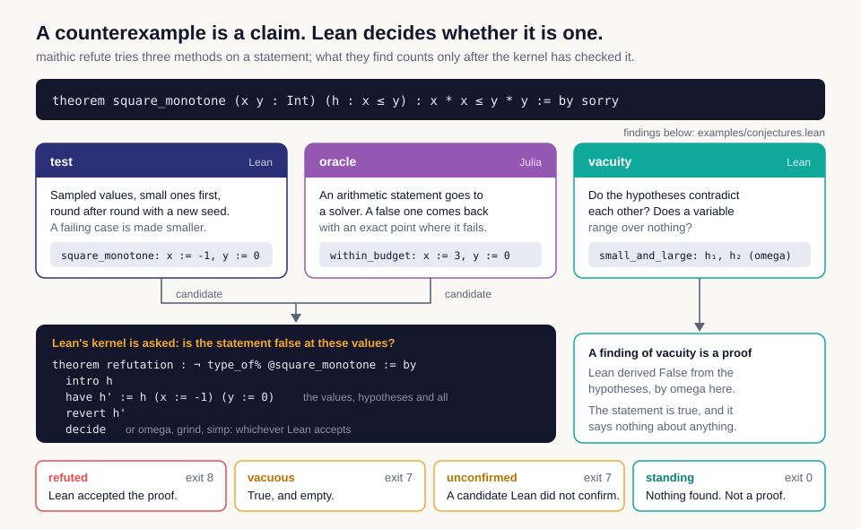
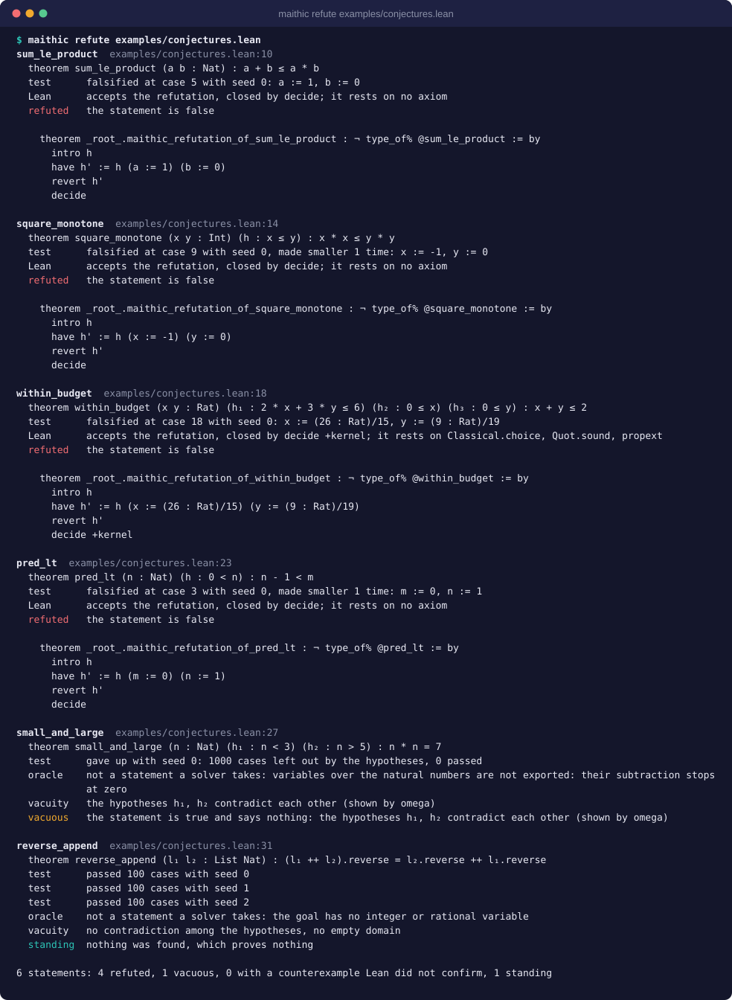

# Refuting a statement before proving it

A prover that is given a false statement spends its whole budget and returns nothing. A model that is given
one may return something worse: a long attempt that looks like progress. `maithic refute` examines a statement
first. It looks for a counterexample and for hypotheses that make the statement empty, and it reports a
counterexample only when Lean has accepted a proof that the statement is false there.

<p align="center">
  
</p>

## A first run

[`examples/conjectures.lean`](../../examples/conjectures.lean) holds six statements as they might come out of a
first attempt at writing them down. None is proved; each ends in `sorry`.

```console
$ maithic refute examples/conjectures.lean --theorem square_monotone
square_monotone  examples/conjectures.lean:14
  theorem square_monotone (x y : Int) (h : x ≤ y) : x * x ≤ y * y
  test      falsified at case 9 with seed 0, made smaller 1 time: x := -1, y := 0
  Lean      accepts the refutation, closed by decide; it rests on no axiom
  refuted   the statement is false

    theorem _root_.maithic_refutation_of_square_monotone : ¬ type_of% @square_monotone := by
      intro h
      have h' := h (x := -1) (y := 0)
      revert h'
      decide

1 statement: 1 refuted, 0 vacuous, 0 with a counterexample Lean did not confirm, 0 standing
```

The last block is a Lean theorem, and it is the result. Paste it below the statement and Lean checks it again:
it says that the statement of `square_monotone` is false, and proves it by putting `-1` and `0` in. The
hypothesis `h : x ≤ y` is part of what `decide` settles, so a point that the hypotheses exclude can never
confirm anything.

Without `--theorem`, every theorem of the file whose proof is unfinished is examined:

<p align="center">
  
</p>

## The three methods

| Method | What it does | What it can find |
|---|---|---|
| `test` | Runs the statement on sampled values in Lean, small ones first, round after round with a new seed. A failing case is made smaller while it still fails. | A counterexample over the types that can be generated: numbers, booleans, characters, strings, lists, arrays, options and pairs of these. |
| `oracle` | Sends an arithmetic statement over the integers or the rationals to a solver in Julia. | An exact point where a linear or polynomial statement fails, however far from the small values a test would try. |
| `vacuity` | Asks Lean whether the hypotheses contradict each other, and whether a variable ranges over an empty type. | A statement that is true and says nothing. |

The methods are tried in that order, and the search ends at the first counterexample that Lean confirms.
`--method` chooses among them: `--method test`, `--method test,vacuity`, or `all`, the default.

The solver earns its place on statements whose failing points are not small. Testing finds some point where
`within_budget` fails; the solver names the corner of the region:

```console
$ maithic refute examples/conjectures.lean --theorem within_budget --method oracle
within_budget  examples/conjectures.lean:18
  theorem within_budget (x y : Rat) (h₁ : 2 * x + 3 * y ≤ 6) (h₂ : 0 ≤ x) (h₃ : 0 ≤ y) : x + y ≤ 2
  oracle    a solver found a point where the statement fails: x := 3, y := 0
  Lean      accepts the refutation, closed by decide +kernel; it rests on Classical.choice, Quot.sound, propext
  refuted   the statement is false
```

The solver is not trusted, and does not need to be. Its point is a candidate like any other. When a
statement has hypotheses that the solver does not read, it works with fewer of them, and a point it returns may
violate one. Lean then refuses the refutation, and the point is reported as a candidate that was not confirmed.

## What a name Lean does not know becomes

```lean
theorem pred_lt (n : Nat) (h : 0 < n) : n - 1 < m := by
  sorry
```

The `m` was meant to be `n`. Lean does not report an error: a name it does not know, in a statement, becomes a
new variable. The statement elaborates and says something else, that `n - 1` is below every `m`. No amount of
proving will help, and the mistake is easy to read past.

```console
$ maithic refute examples/conjectures.lean --theorem pred_lt
pred_lt  examples/conjectures.lean:23
  theorem pred_lt (n : Nat) (h : 0 < n) : n - 1 < m
  test      falsified at case 3 with seed 0, made smaller 1 time: m := 0, n := 1
  Lean      accepts the refutation, closed by decide; it rests on no axiom
  refuted   the statement is false
```

The counterexample names a variable that the statement does not seem to have, which is the clue.

## True, and empty

```console
$ maithic refute examples/conjectures.lean --theorem small_and_large
small_and_large  examples/conjectures.lean:27
  theorem small_and_large (n : Nat) (h₁ : n < 3) (h₂ : n > 5) : n * n = 7
  test      gave up with seed 0: 1000 cases left out by the hypotheses, 0 passed
  oracle    not a statement a solver takes: variables over the natural numbers are not exported: their subtraction stops at zero
  vacuity   the hypotheses h₁, h₂ contradict each other (shown by omega)
  vacuous   the statement is true and says nothing: the hypotheses h₁, h₂ contradict each other (shown by omega)
```

No number is below three and above five, so every case of the test was left out by the hypotheses. The
vacuity check says why, and what it says is certain: Lean derived `False` from `h₁` and `h₂`. A prover would
have closed this statement at once, and the result would have been worth nothing.

## Verdicts and exit status

| Verdict | Meaning | Exit status |
|---|---|---:|
| `refuted` | Lean accepted a proof that the statement is false at the counterexample. The proof is printed. | 8 |
| `vacuous` | Lean proved that the hypotheses cannot hold together, or that a variable ranges over nothing. | 7 |
| open | A counterexample was found, and Lean did not accept the proof built from it. The statement is not shown false. | 7 |
| `standing` | Nothing was found within the budget. This is not a proof, and it is never reported as one. | 0 |

For a file, the most serious verdict decides: 8 when any statement is refuted, otherwise 7 when one is vacuous
or open, otherwise 0. A script can use `maithic refute` as a gate in front of `maithic prove`:

```sh
maithic refute Conjectures.lean && maithic prove Conjectures.lean
```

## Budgets

| Option | Meaning | Default |
|---|---|---:|
| `--cases N` | Cases that must pass in one round of testing. | 100 |
| `--size N` | The size of the largest case: the bound on numbers and on the length of lists. | 30 |
| `--seed N` | The seed of the first round. Each round takes the next. | 0 |
| `--rounds N` | Rounds of testing. | 3 |
| `--seconds S` | No method is started after this much time. What was left out is said in the report. | 60 |

A run is determined by its options: the same seed finds the same counterexample. When a round gives up because
the hypotheses are hardly ever met, further rounds are not tried; the vacuity check usually says why.

## How a counterexample is confirmed

The refutation of a theorem `t` at the values `a := 1`, `b := 0` is the text

```lean
theorem _root_.maithic_refutation_of_t : ¬ type_of% @t := by
  intro h
  have h' := h (a := 1) (b := 0)
  revert h'
  decide
```

It names the statement through the theorem, so it is right whatever notation, variables and namespaces the
statement was written with, and it does not use the theorem, which has no proof. What is left after the values
are put in is a closed statement, hypotheses included. The tactics `decide`, `decide +kernel`, `omega`, `grind`
and `simp` are tried on it in turn, and the first that Lean accepts is kept.

Three things keep this honest:

- The values come from outside: from a test or from a solver. They pass the screen of the Bridge before Lean
  elaborates them, like every text that Maithic did not write itself.
- A refutation that rests on `sorry` is not accepted. With the statement declared and unproved, a tactic that
  found and used it could prove anything.
- The axioms the refutation rests on are reported with it.

## As JSON

`--json` prints, and `--out FILE` writes, a report that follows
[`schemas/refute/report.schema.json`](../../schemas/refute/report.schema.json): for every statement its verdict,
the counterexample, the refutation as Lean accepted it, and every step that was taken with its outcome.
[`fixtures/refute/conjectures.json`](../../fixtures/refute/conjectures.json) is the report of the example file.

## In Lean

The commands behind the methods can be used directly in a Lean file; see
[Testing a statement](testing-statements.md). `#maithic_test` and `#maithic_vacuous` take the name of a theorem
as well as a statement, and with `json` after the command they print their report for a program to read.
