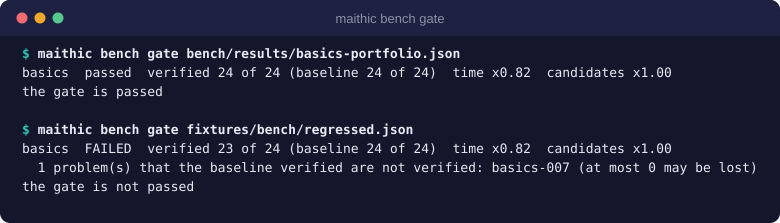

# A regression gate for the prover

A change to a prompt, to the automation or to the search can make the prover better at one theorem and
worse at five. `maithic bench gate` holds a benchmark run against a stored baseline and fails when
something that used to be proved no longer is. It is meant to run in continuous integration, where its exit
status stops the change.

<p align="center">
  
</p>

## Baselines

```console
$ maithic bench run --no-ai --out run.json
$ maithic bench gate run.json --update --note "after the search was added"
$ maithic bench gate run.json
```

A baseline is a file under `bench/baselines`, one for each suite, that records for every problem whether it
was verified, how many candidates were tried and how long it took (schema `maithic.bench.baseline/1`).
`--update` stores the run as the new baseline; `--baselines DIR` keeps them somewhere else. The repository
keeps [`bench/baselines/basics.json`](../../bench/baselines/basics.json), in which the automation verifies
24 of 24 problems.

## The rule

By default the gate asks one thing: every problem that the baseline verified is verified in the run. The
rest is on request, because it depends on the machine or on taste.

| Option | The run fails when |
|---|---|
| `--max-regressions N` | more than N problems that the baseline verified are not verified (0). |
| `--min-rate X` | the share of verified problems is below X. |
| `--max-slowdown X` | the total time is more than X times the baseline's. Times differ from machine to machine; set this only where runs are comparable. |
| `--max-attempts X` | the candidates tried are more than X times the baseline's. Unlike time, this does not depend on the machine. |
| `--allow-missing` | (relaxes the rule) a problem of the baseline may be absent from the run; without it, a run that lacks one fails. |

The command names every problem that was lost, prints one verdict for each suite, and exits with status 13
when a suite fails. `--suite NAME` gates one suite and `--out FILE` writes the verdicts as JSON (schema
`maithic.bench.gate/1`).

The second run in the picture is [`fixtures/bench/regressed.json`](../../fixtures/bench/regressed.json), a
copy of the committed run in which the result of one problem was changed by hand to show what a failure
looks like. It is not a run of the prover.
