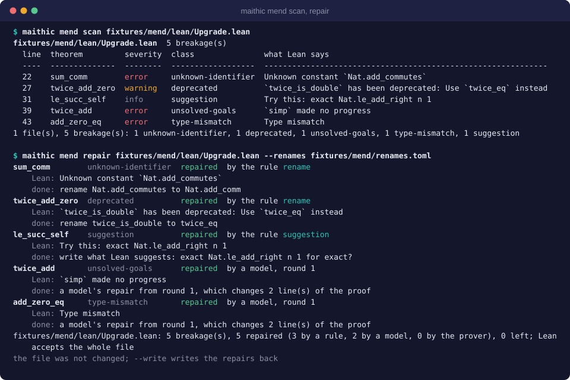
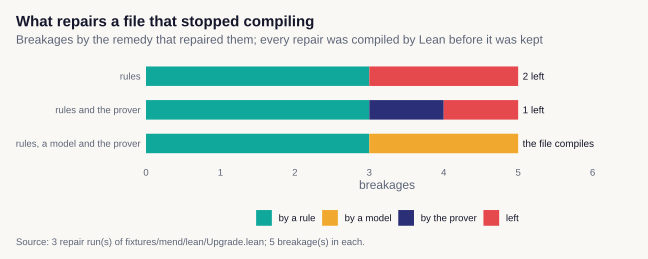
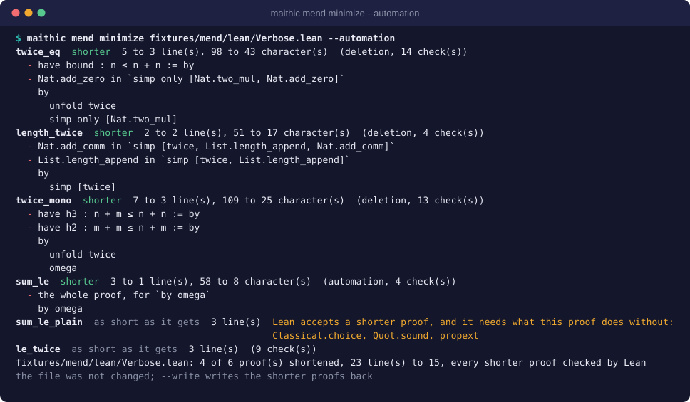

# Repairing proofs that stopped compiling

A library is upgraded and a hundred proofs break. Most of the breakages are not about mathematics: a lemma
was renamed, a name was deprecated, a tactic closes less than it used to. `maithic mend` finds what is
broken, sorts it by cause, and repairs it with the cheapest remedy that works. An edit is kept only when
Lean accepts it, and a model may change a proof and never a statement.

<p align="center">
  
</p>

## Finding what is broken

```console
$ maithic mend scan fixtures/mend/lean/Upgrade.lean
fixtures/mend/lean/Upgrade.lean  5 breakage(s)
  line  theorem         severity  class               what Lean says
  ----  --------------  --------  ------------------  -------------------------------------------------------------
  22    sum_comm        error     unknown-identifier  Unknown constant `Nat.add_commutes`
  27    twice_add_zero  warning   deprecated          `twice_is_double` has been deprecated: Use `twice_eq` instead
  31    le_succ_self    info      suggestion          Try this: exact Nat.le_add_right n 1
  39    twice_add       error     unsolved-goals      `simp` made no progress
  43    add_zero_eq     error     type-mismatch       Type mismatch
1 file(s), 5 breakage(s): 1 unknown-identifier, 1 deprecated, 1 unsolved-goals, 1 type-mismatch, 1 suggestion
```

`mend scan` takes files and folders, gives every file to Lean and collects what Lean reports by
declaration. Each breakage gets a class, and the class says which remedy can treat it. The command changes
nothing, and exits with status 7 when a file has an error.

| Class | What happened | Remedy |
|---|---|---|
| `unknown-identifier` | A name is gone. | The rule `rename`, when a table says what the name became. |
| `deprecated` | A name still works and has a successor. | The rule `rename`, from Lean's own message. |
| `suggestion` | A tactic such as `exact?` printed what to write. | The rule `suggestion` writes it. |
| `unsolved-goals`, `type-mismatch`, `other` | The proof no longer goes through. | A model, then the prover. |

## Repairing

`mend repair FILE` works through the breakages in three stages.

1. **Rules** need no model. A deprecated name is replaced by the successor Lean names. A name that is gone
   is replaced from a table of renames, a TOML file with one table `[renames]` of old names and new ones,
   which is what the release notes of a library amount to. A suggestion of Lean is written in place of the
   call that asked for it. A rule's edit stays only if the breakage is gone, no new one appeared and the
   number of errors did not rise.
2. **A model** is shown the theorem, Lean's error and what stands before the theorem, and is asked for the
   smallest change to the proof that makes it compile. Every proof it returns is compiled where the theorem
   stands. Of the proofs Lean accepts, the one that changes the fewest lines is kept. The statement Lean
   prints for the repaired theorem must be the statement it printed before.
3. **The prover** proves the statement again from nothing, with its automation, when the proof could not be
   repaired.

At the end the whole file is given to Lean once more, and the report says what is left.

<p align="center">
  
</p>

```console
$ maithic mend repair fixtures/mend/lean/Upgrade.lean --renames fixtures/mend/renames.toml
...
fixtures/mend/lean/Upgrade.lean: 5 breakage(s), 5 repaired (3 by a rule, 2 by a model, 0 by the prover), 0 left; Lean accepts the whole file
the file was not changed; --write writes the repairs back
```

| Option | Meaning |
|---|---|
| `--renames FILE` | The table of renames. |
| `--no-ai` | Rules and the prover only. |
| `--no-prove` | Do not prove a statement again when its proof cannot be repaired. |
| `--rounds N`, `--candidates N` | How often the model is asked about one proof (2), and for how many proofs each time (3). |
| `--write` | Write the repaired file back. Without it the file is not touched. |
| `--out FILE` | The report as JSON, schema `maithic.mend.report/1`. |
| `--project DIR`, `--policy FILE` | A Lake project the file may import from; a trust policy for the proofs of the prover. |

The exit status is 0 when Lean accepts the whole file at the end, and 7 when something is left.

<p align="center">
  
</p>

The three runs in the figure are the same file repaired with more remedies switched on each time; the
reports are in [`fixtures/mend`](../../fixtures/mend). `maithicstats::read_mend_runs` and `repair_success`
turn such reports into the share repaired by class of breakage, with intervals.

## Shortening proofs

A proof that was repaired in a hurry, or written by a model, often carries steps it does not need.

<p align="center">
  
</p>

`mend minimize FILE` takes out one step at a time, and one argument of a lemma list at a time, and gives the
theorem with the shorter proof to Lean. A removal is kept when three things hold: Lean accepts the proof,
the theorem states what it stated, and it rests on no axiom it did not rest on before. With `--automation`
the whole proof is first tried as a single call such as `by omega`. The third condition matters there:
`sum_le_plain` in the picture has a three-line proof that uses no axiom, and `by omega` would prove it at
the price of three. The command leaves it alone and says why.

`--theorem NAME` limits the work to some theorems, `--max-checks N` bounds the proofs given to Lean for one
theorem (200), and `--write` writes the shorter proofs into the file.
