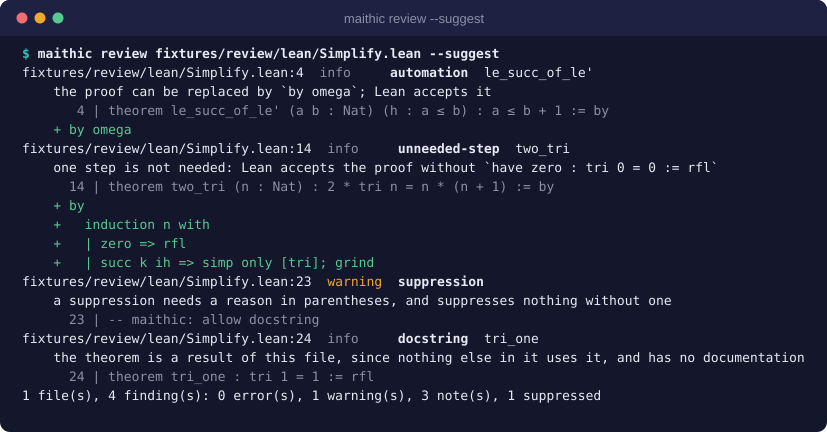
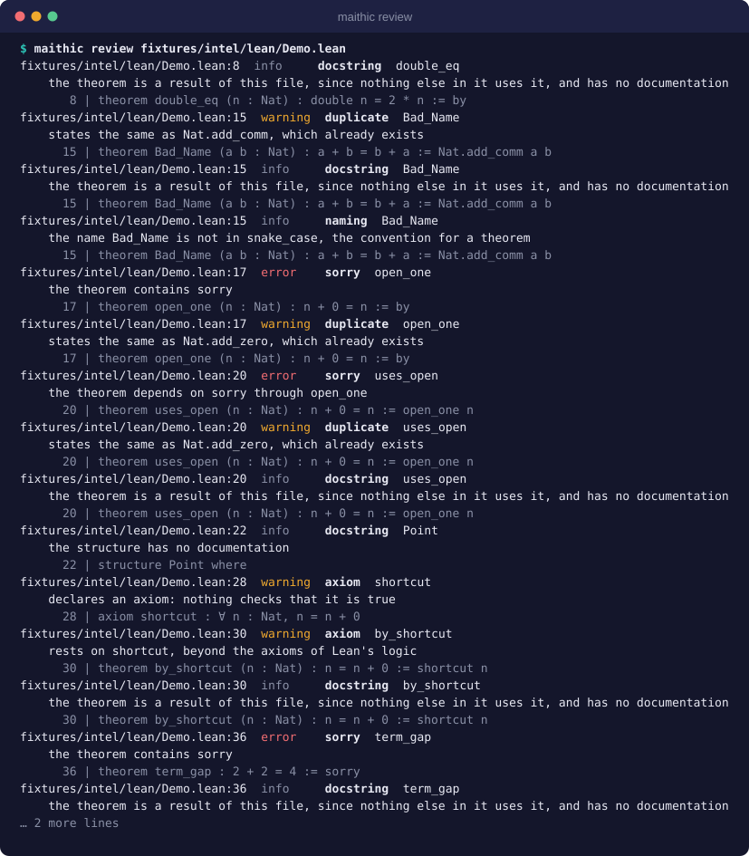
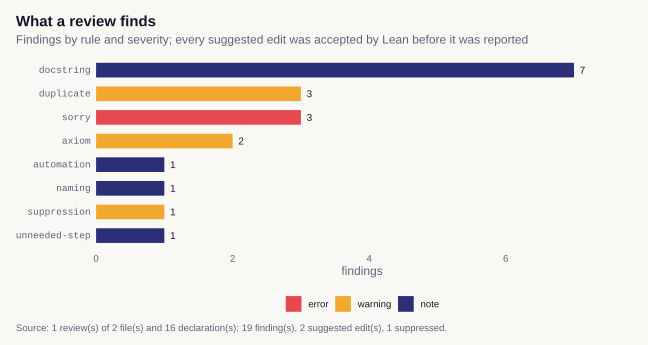

# Reviewing Lean code

`maithic review` reads Lean files the way a careful reviewer would, and then does what a reviewer cannot: it
asks Lean. Every finding that claims something about the code is checked against the environment the kernel
built, and every edit it suggests has been compiled before it is shown.

<p align="center">
  
</p>

## What it looks for

| Rule | Finds | Severity | Comes from |
|---|---|---|---|
| `sorry` | A proof that contains `sorry`, or rests on one through a lemma it uses. | error | Lean |
| `axiom` | A declaration that rests on an axiom beyond Lean's logic. | warning | Lean |
| `duplicate` | A theorem that states what another theorem already states, in the file or anywhere in what it imports, up to the names of its variables. | warning | Lean |
| `docstring` | A public definition or type, or a theorem that nothing else in the file uses, without documentation. | note | Lean |
| `naming` | A name out of convention: `snake_case` for theorems, `lowerCamelCase` for definitions, `UpperCamelCase` for types. | note | Lean |
| `automation` | A proof that one call of `rfl`, `simp`, `omega`, `decide`, `grind` or `simp_all` replaces. | note | a suggestion Lean accepted |
| `unneeded-step` | A step of a proof that can be deleted. | note | a suggestion Lean accepted |
| `suppression` | A suppression comment without a reason, or one that names a rule that does not exist. | warning | the policy |
| `statement`, `proof`, `definition` | What a model has to say about readability and intent, with `--ai`. | note | a model |

The first five are read from what Lean elaborated. `uses_open` below contains no `sorry` and is still not
proved, and the review says through which lemma:

<p align="center">
  
</p>

A finding points at the line on which the name of the declaration stands. The exit status is 7 when a finding
is an error and 0 otherwise, so a review can gate a merge on unfinished work alone, or on more under a
stricter policy.

## Suggestions that were compiled

With `--suggest`, the review tries to make proofs simpler:

- it replaces the whole proof by one call of automation, and
- it deletes steps, one at a time.

Each candidate is elaborated by Lean in the place of the original proof, and it is reported only when Lean
accepts it without an error and without a warning. A suggestion that is shown can be pasted in.

```
fixtures/review/lean/Simplify.lean:14  info     unneeded-step  two_tri
    one step is not needed: Lean accepts the proof without `have zero : tri 0 = 0 := rfl`
      14 | theorem two_tri (n : Nat) : 2 * tri n = n * (n + 1) := by
    + by
    +   induction n with
    +   | zero => rfl
    +   | succ k ih => simp only [tri]; grind
```

## A model may add, never remove

With `--ai`, the configured model reads each file and may add findings under the rules `statement`, `proof`
and `definition`. It is given the source inside a marked block, and anything in the source that looks like an
instruction is data to it. Its findings are notes, they are marked as coming from a model, and it cannot
remove or lower a finding that Lean produced. Without `--ai`, and in every test and demonstration of this
repository, no model is asked.

## Policy

A policy switches rules on and off and gives each a severity. It starts from a profile:

| Profile | What it does |
|---|---|
| `default` | Every rule at the severity in the table above. |
| `strict` | Axioms and duplicates are errors; missing documentation and names out of convention are warnings. |
| `minimal` | Unfinished work, axioms and faulty suppressions only. |

`--profile NAME` chooses one. A file changes it further: `maithic-review.toml` in the current directory, or the
file given with `--review-config`.

```toml
[review]
profile = "strict"

[review.rules]
naming = false

[review.severity]
duplicate = "warning"
```

A rule or a severity that does not exist is an error, not something to be skipped over in silence.

## Suppressing a finding where it stands

```lean
-- maithic: allow docstring (an example of a suppression with its reason)
theorem tri_zero : tri 0 = 0 := rfl
```

A comment above a declaration, above its documentation if it has any, holds back the named rules for that
declaration. It needs a reason in parentheses. Without one it suppresses nothing and is reported itself, and
the summary of a review always says how many findings were held back.

## Reports

`--format terminal` (the default) prints findings with the line of source and suggested edits in colour;
`--format markdown` writes a table for a pull request; `--format json` writes a report that follows
[`schemas/review/report.schema.json`](../../schemas/review/report.schema.json). `--out FILE` writes the report
to a file.

## Reviews over time, in R

```r
library(maithicstats)

runs <- read_review_runs(c(parser = "reports/parser.json", solver = "reports/solver.json"))
runs$runs[c("repository", "files", "errors", "warnings", "notes", "suggestions", "outcome")]
finding_counts(runs, c("rule", "severity", "repository"))
writeLines(review_report_table(runs))
```

Each report is checked against its own summary when it is read. `finding_counts` counts by any of rule,
severity, repository, origin, file and run.

<p align="center">
  
</p>
