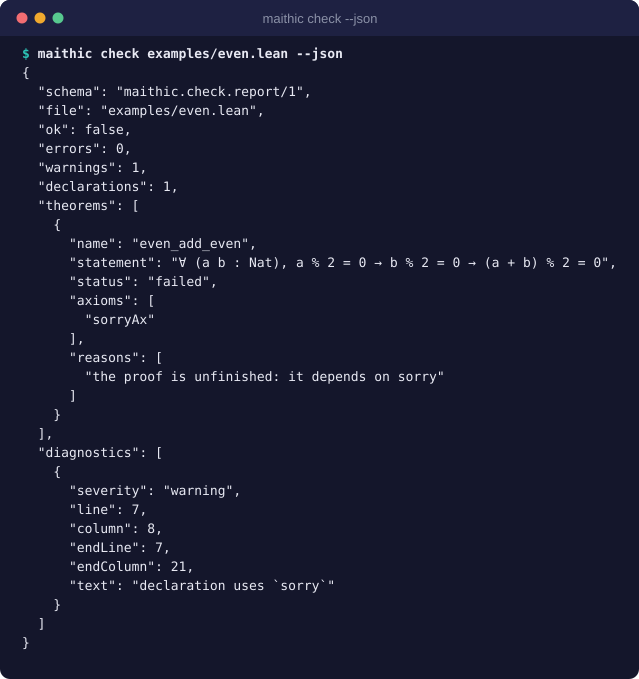
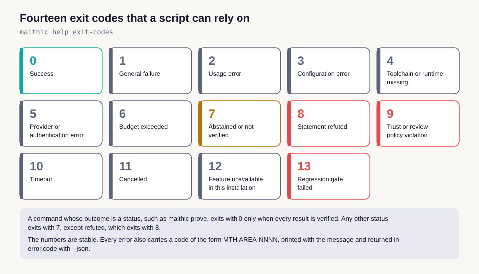
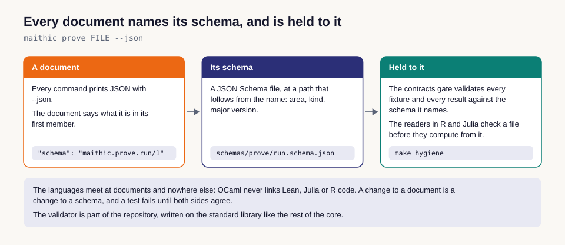

# Using Maithic from a script

Every `maithic` command that reports something can print its report as one JSON document, and every command
ends with an exit status that says what happened. Those two things are the whole interface for a script, a
continuous-integration job or a program in another language: run the command, look at the status, read the
document. The readers in the Julia and R packages of this repository do the reading for the two languages that
Maithic itself uses.

<p align="center">
  
</p>

## What a script can rely on

- **One document.** With `--json` a command writes exactly one JSON document to standard output and nothing
  else. Commands that take `--out FILE` write the same document to the file and keep the text for people on
  the screen.
- **A named schema.** The document names its schema in its `schema` member, such as `maithic.prove.run/1`, and
  the schema is a file under [`schemas/`](../../schemas). [The schemas reference](../reference/schemas.md) lists
  every one with the command that writes it. A change that an existing reader would misread gets a new major
  version, so a reader that checks the name is never handed something else.
- **A stable exit status.** [`docs/reference/exit-codes.md`](../reference/exit-codes.md) has the table. 0 means
  that the command succeeded *and* that the answer is the good one; 7 means that something is not verified;
  8 means that a statement was refuted; 13 means that the regression gate failed.
- **Typed errors.** An error has a code of the form `MTH-AREA-NNNN`, listed in
  [`docs/reference/errors.md`](../reference/errors.md). With `--json` the error is a document too.
- **No key, no network, by default in tests.** With `MAITHIC_GATEWAY_MODE=replay` every model call is answered
  from the recorded exchanges under `fixtures/cassettes`, so a script can be tested without a key. The examples
  below were run that way.

<p align="center">
  
</p>

## From the shell

```console
$ maithic prove examples/triangle.lean --json > run.json
$ echo $?
0
$ maithic check examples/gap.lean --json > report.json
$ echo $?
7
```

The first command proved the theorem of the file, so its status is 0. The second found two theorems whose
proofs are unfinished, so its status is 7, and the document says which. In a shell script or a job of a
workflow that is all it takes to stop on an unverified theorem:

```sh
maithic check lean/Maithic/Algo/Sort/Insertion.lean --project lean --json > report.json || exit 1
```

An error is reported in the same two ways. Without `--json` it is a line on standard error:

```console
$ maithic check examples/nothing.lean
error: MTH-CLI-0002: cannot read examples/nothing.lean: examples/nothing.lean: No such file or directory
$ echo $?
2
```

With `--json` it is a document on standard output, with the same code and the status the command ends with:

```json
{
  "error": {
    "code": "MTH-CLI-0002",
    "message": "cannot read examples/nothing.lean: examples/nothing.lean: No such file or directory",
    "exit": 2
  }
}
```

## From Julia

`MaithicCore` reads and writes JSON without any package from outside the standard library, and
`expect_schema` returns a document only if it is of the expected kind.

```julia
using MaithicCore

run = expect_schema(read_json(read("run.json", String)), "maithic.prove.run/1")
for result in run["results"]
    rejected = count(attempt -> !attempt["accepted"], result["attempts"])
    println(result["theorem"], ": ", result["status"], ", proposed by the ", result["proposer"],
            " after ", rejected, " rejected candidates")
    println("  axioms: ", join(result["recheck"]["axioms"], ", "))
    println("  checked again by Lean ", result["recheck"]["lean"], ": ", result["recheck"]["passed"])
end
println(run["summary"]["verified"], " of ", run["summary"]["total"], " verified")

expect_schema(run, "maithic.check.report/1")    # the wrong kind of document is an error, not a surprise
```

Saved as `read.jl` next to `run.json`, and run with
`julia --project=julia/MaithicCore read.jl` (the path of the package is relative to the root of the
repository), it prints:

```text
tri_formula: verified, proposed by the model after 20 rejected candidates
  axioms: propext, Classical.choice, Quot.sound
  checked again by Lean 4.36.0: true
1 of 1 verified
```

and then stops at the last line, as it should:

```text
ArgumentError: the document has schema "maithic.prove.run/1"; "maithic.check.report/1" is expected
```

The other Julia packages have readers for their own documents: `MaithicOracle.read_goal` and
`read_certificate`, `MaithicGraphs.read_graph`, `MaithicData` for datasets. Each package has a page with an
example: [`julia/`](../../julia).

## From R

`maithicstats` has a reader for every kind of result file. A reader checks the schema, the statuses and the
totals of a file before it returns anything, and returns plain data frames.

```r
library(maithicstats)

runs <- read_prove_runs("run.json")
print(runs$results[, c("theorem", "status", "proposer", "rounds", "attempts", "recheck_passed")], row.names = FALSE)
print(table(proposer = runs$attempts$proposer, accepted = runs$attempts$accepted))

reports <- read_check_reports("report.json")
print(reports$theorems[, c("file", "name", "status")], row.names = FALSE)
```

After `make build-r`, which installs the two packages into `r/.library`, and with `R_LIBS` set to that
directory, it prints:

```text
     theorem   status proposer rounds attempts recheck_passed
 tri_formula verified    model      2       21           TRUE
           accepted
proposer    FALSE TRUE
  model         2    1
  portfolio    18    0
              file     name status
 examples/gap.lean no_point failed
 examples/gap.lean    wrong failed
```

From here the statistics are one call away: `prover_success(runs)` gives the rate with its interval, and
`maithicviz` draws it. [The statistics guide](statistics.md) goes on from this point.

## From any other language

Nothing above is special to Julia or R. A program in any language can start `maithic` as a child process,
read standard output as JSON and look at the exit status. The schemas are JSON Schema 2020-12 files, so a
validator of that language can check a document, and a generator can make types from them.

<p align="center">
  
</p>

Three habits make such a program last:

1. Check the `schema` member before reading anything else, and refuse a major version you do not know.
2. Decide by the exit status and by the `status` of each result, never by the text for people, which may be
   reworded.
3. Ignore members you do not know. A new optional member does not change the major version.

## In continuous integration

A job needs no key to run the checks that do not call a model: `maithic check`, `maithic review`,
`maithic corpus verify`, `maithic blueprint check` and `maithic bench gate` all decide by Lean and by files.
[The guide to the regression gate](regression-gate.md) shows the last one, which ends with status 13 when a
theorem that used to be proved no longer is. For the commands that do call a model, a job either holds a key
as a secret or runs in replay mode against recorded exchanges, as the tests of this repository do.
