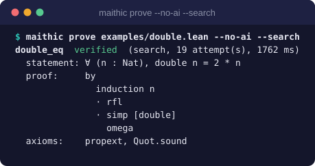
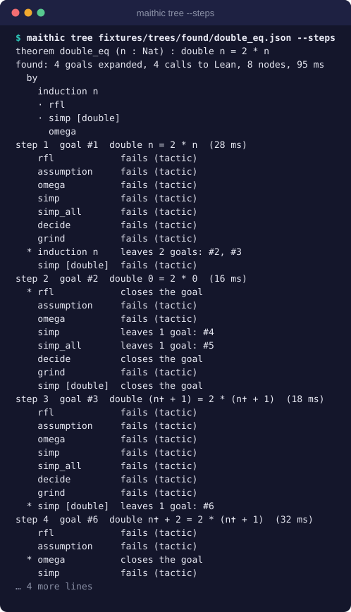
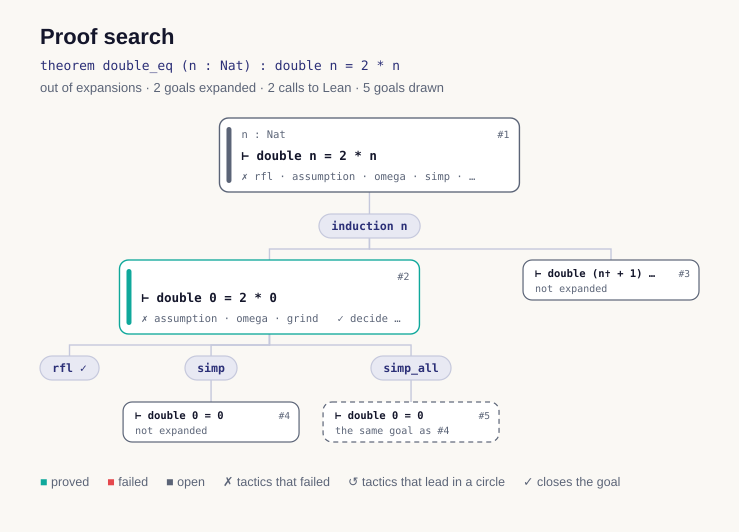

# Searching for a proof one tactic at a time

The automation portfolio proposes whole proofs: `by omega`, `by simp`, and so on. Many theorems need a little
structure first, an induction or a case split, after which automation finishes each part. The step-wise search
finds that structure with no model:

```console
$ maithic prove examples/double.lean --no-ai
double_eq  failed  (-, 18 attempt(s), 876 ms)
  statement: theorem double_eq (n : Nat) : double n = 2 * n
  reason:    no proof was found in 18 attempt(s)
  note:      the model was not asked (prove.use_ai is false)

$ maithic prove examples/double.lean --no-ai --search
double_eq  verified  (search, 19 attempt(s), 1292 ms)
  statement: ∀ (n : Nat), double n = 2 * n
  proof:     by
               induction n
               · rfl
               · simp [double]
                 omega
  axioms:    propext, Quot.sound
```

The same switch proves [`examples/triangle.lean`](../../examples/triangle.lean), the theorem that the model
demonstration uses, without asking a model.

<p align="center">
  
</p>

<p align="center">
  
</p>

## How it works

The search runs on the proof states of the [Bridge](../reference/bridge-protocol.md#proof-states). A node is one
goal. Expanding a node runs a handful of tactics on that goal alone, in one round trip to Lean, and every tactic
has one of three outcomes:

- it **fails**, and the error is kept on the edge;
- it **leaves goals**: none, which closes the goal, or several, each of which becomes a node of its own;
- it leads **in a circle**: the goal it leaves is the goal itself, or one further up. Such an edge is blocked.
  A tactic that changes nothing is the simplest case.

A node is proved when one of its tactics has every goal it left proved; this is an AND/OR search, with goals as
the AND and tactics as the OR. When the first goal is proved, the tactics on the way form the script, with a
bullet for each goal wherever a tactic left several.

A goal reached in two places is searched once: the second arrival waits for the first. Its proof is shared.
Its failure is shared only when the failure holds everywhere. A goal can fail in one place merely because its
tactics lead back to goals above it, and the same goal elsewhere may still be provable; in that case the second
arrival is searched on its own. The test suite checks the consequence on thousands of random problem spaces:
with no limits, every strategy finds a proof exactly when one exists.

## Strategies and budgets

| Strategy | Order of expansion |
|---|---|
| best-first (the default) | the goal whose path from the root is the most probable, by the priors of the tactics |
| breadth-first | level by level, with a cap on the nodes of a level |
| depth-first | the newest goal first, with a depth limit and a limit on the tactics followed per goal |

All three are deterministic: the same inputs give the same tree, node for node. A search stops at its budget of
expansions, time, calls to Lean or model tokens, checked before every expansion; `prove.search_expansions` sets
the first, and sixty is the default. The `prove` command searches best-first; the other two strategies are
there for code that calls the search, and for comparison in tests.

## Where the tactics come from

Without a model, the proposer reads the shape of the goal:

- closing automation on every goal: `rfl`, `assumption`, `omega`, `simp`, `simp_all`, `decide`, `grind`;
- `intros` for an implication or a universal statement, `constructor` for a conjunction or an equivalence,
  `left` and `right` for a disjunction;
- `cases h` for a hypothesis that is a conjunction, a disjunction or an existential, and `induction x` for a
  variable that is a natural number or a list;
- `simp [f]` for the first names in the target that may be definitions of the file.

That is a small vocabulary, and it sets the limit of what the search proves today: statements that fall to an
induction or a case split followed by automation. It does not find lemmas, generalise a statement before an
induction, or choose terms for `exists`. The machinery around the vocabulary is complete, and any proposer,
including a model that suggests one tactic at a time, plugs into the same search; that proposer is the next
step on the [roadmap](../../ROADMAP.md).

## Looking at a search

`--search-trees DIR` writes two files for every theorem that was searched: the record of the search,
`DIR/NAME.json`, and a picture of it, `DIR/NAME.svg`. The picture above is the one for `double_eq`.

```console
$ maithic prove examples/double.lean --no-ai --search --search-trees trees
$ maithic tree trees/double_eq.json --steps
theorem double_eq (n : Nat) : double n = 2 * n
found: 4 goals expanded, 4 calls to Lean, 8 nodes, 105 ms
  by
    induction n
    · rfl
    · simp [double]
      omega
step 1  goal #1  double n = 2 * n  (31 ms)
    rfl            fails (tactic)
    assumption     fails (tactic)
    omega          fails (tactic)
    simp           fails (tactic)
    simp_all       fails (tactic)
    decide         fails (tactic)
    grind          fails (tactic)
  * induction n    leaves 2 goals: #2, #3
    simp [double]  fails (tactic)
step 2  goal #2  double 0 = 2 * 0  (25 ms)
  * rfl            closes the goal
    assumption     fails (tactic)
    omega          fails (tactic)
    simp           leaves 1 goal: #4
    simp_all       leaves 1 goal: #5
    decide         closes the goal
    grind          fails (tactic)
    simp [double]  closes the goal
step 3  goal #3  double (n✝ + 1) = 2 * (n✝ + 1)  (19 ms)
    ...
  * simp [double]  leaves 1 goal: #6
step 4  goal #6  double n✝ + 2 = 2 * (n✝ + 1)  (30 ms)
    rfl            fails (tactic)
    assumption     fails (tactic)
  * omega          closes the goal
    ...
```

The whole record, as the command prints it:

<p align="center">
  
</p>

A step is one expansion: the tactics of the proposer, run on one goal in one round trip to Lean. The star marks
the tactic that proved the goal. `maithic tree` needs neither Lean nor the file the search was about; with
`--svg OUT` it draws the picture again, and with `--json` it prints the record.

How to read the picture:

- A card is a goal the search worked on: its hypotheses, what is to be shown, and under it the tactics that
  failed (✗), the tactics that led in a circle (↺), and tactics that closed the goal besides the one of the
  proof (✓). The colour of the card is the status of the goal: proved, failed or open.
- A label under a card is a tactic that left goals, with a line to each of them. The tactics of the proof that
  was found are filled in the colour of proved goals, so the proof reads from the top down.
- A small box is a goal that was never expanded, or a goal with a dashed outline that was met before and is
  searched where it was met first.

A search that stops at its budget leaves a record too. This is the same theorem with a budget of two expansions,
`--search-expansions 2`: the goal for zero is proved, the goal for `n + 1` was never reached, and the theorem
stays unproved.

<p align="center">
  
</p>

The record is one JSON document, [`maithic.prove.search/1`](../../schemas/prove/search.schema.json): every node
with its goal, hypotheses, status and the tactics tried on it, each with its prior and with the goals it left,
the error class of its failure, or the node it led back to; the expansions in order with their durations; how
the search ended, what it cost, and the proof. The picture depends on the record alone and not on the timings,
so equal searches give equal pictures, byte for byte. Two recorded searches and their pictures are kept under
[`fixtures/trees/`](../../fixtures/trees), and the tests draw them again and compare.

## What the search cannot do to the result

A proof state that reports "no goals" is not evidence. The script the search returns is a proposal like any
other. It passes the screen, is elaborated by Lean as a whole declaration, is judged by the trust policy and is
re-checked in a fresh process before the word *verified* is printed; see
[the design decision](../adr/0006-proof-states-are-not-evidence.md). Every state the search made in the Bridge is
released when it ends.

## In code

```ocaml
let found =
  Lean_search.prove_statement bridge ~env
    ~proposer:(Lean_search.vocabulary [ ("constructor", 0.5); ("exact hp", 0.5); ("exact hq", 0.5) ])
    "theorem pair (p q : Prop) (hp : p) (hq : q) : p ∧ q"
(* found.proof = Some "by\n  constructor\n  · exact hp\n  · exact hq" *)
```

[`Search_kernel`](../../ocaml/lib/prover/search/search_kernel.mli) knows nothing about Lean: it is given the
goals and a function that expands a node, and it is tested on problem spaces written as tables.
[`Lean_search`](../../ocaml/lib/prover/search/lean_search.mli) is the expansion over the Bridge.
