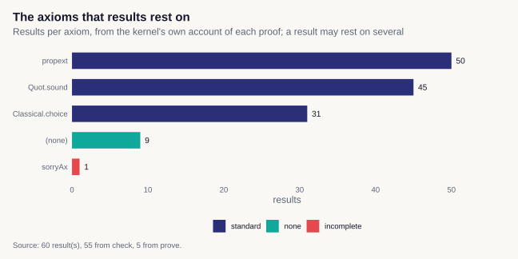

# Statistics and figures

The `maithic` command writes what happened; two R packages turn that into numbers with honest uncertainty and
into figures. `maithicstats` reads result files and summarises them. `maithicviz` draws the summaries in one
visual style. Every figure in this repository is drawn by these functions from files in the repository.

```r
library(maithicstats)
library(maithicviz)

runs <- read_prove_runs(Sys.glob("fixtures/runs/prove-*.json"))
prover_success(runs, by = "provider")     # proved / total, with 95% Wilson intervals
prover_time(runs)                         # the whole attempt, the part in Lean, the re-check
prover_failures(runs)                     # outcomes, and why candidates were rejected
writeLines(prover_report_table(runs))     # the same as Markdown, for a report
```

Each import function checks a file against what it states about itself, its schema, its statuses and its
totals, before any number is computed. A file that does not add up is an error, not a slightly wrong table.

## What can be summarised

| Area | Read with | Summaries | Figures |
|---|---|---|---|
| Benchmark runs | `read_bench_run` | `success_by`, `paired_comparison`, `comparison_table` | `plot_success_by_group`, `plot_time_per_problem`, `plot_attempts` |
| The prover | `read_prove_runs` | `prover_success`, `prover_time`, `prover_tokens`, `prover_steps`, `prover_failures` | `plot_prover_success`, `plot_prover_time`, `plot_prover_failures` |
| The ledger | `read_check_reports`, `ledger_records` | `trust_distribution`, `axiom_census`, `recheck_agreement`, `recheck_time`, `policy_decisions` | `plot_trust_distribution`, `plot_axiom_census` |
| Gateway usage | `read_usage` | `usage_cost`, `token_breakdown`, `call_latency`, `provider_errors`, `daily_spend` | `plot_usage_tokens`, `plot_call_latency` |
| Retrieval | `read_query_set`, `read_rankings` | `recall_at_k`, `mean_reciprocal_rank`, `ndcg_at_k`, `engine_comparison`, `query_latency` | `plot_recall_curve`, `plot_query_latency` |
| The code graph | `read_intel_snapshot` | `top_depended` | `plot_top_depended` |
| Datasets | `read_corpus` | `proof_length_summary`, `proof_length_distribution`, `tactic_frequency` | `plot_proof_lengths`, `plot_tactic_frequency` |
| Reviews | `read_review_runs` | `finding_counts` | `plot_review_findings` |
| Tactic models | `read_guide_runs` | `model_accuracy`, `accuracy_difference`, `learning_curves`, `curve_summary` | `plot_model_accuracy`, `plot_learning_curves` |
| Repairs | `read_mend_runs` | `repair_success` | `plot_repair_stages` |
| Formalizations | `read_formalize_runs` | `compile_rate`, `check_summary` | `plot_candidate_fates` |
| Council sessions | `read_council_sessions` | `role_contributions` | `plot_council_session` |
| Blueprints | `read_blueprint_snapshots` | `status_composition`, `status_changes` | `plot_blueprint_progress` |
| Network verification | `read_nnv_jobs` | `verification_summary` | |
| Algorithm costs | `read_algo_costs` | `fit_growth`, `best_growth`, `growth_table` | `plot_growth` |

Most areas have a `*_report_table` function that returns Markdown lines, and `markdown_table` makes such a
table from any data frame. Every reader checks the schema that a file names before it reads anything else.

## The ledger of this repository

<p align="center">
  
</p>

The chart is the axiom census of the check reports and prove runs under `fixtures/runs`: the insertion-sort
library, the statements written from oracle certificates, and the demonstration proofs. The one result resting
on `sorryAx` is `examples/triangle.lean` as it ships, with its proof still to be found; it is there to show
what a result that is not verified looks like.

## Uncertainty

- A share of successes comes with a Wilson interval (`wilson_interval`), which behaves at 0 and 1 and with few
  observations, where the textbook interval does not.
- A mean of per-query or per-problem values comes with a bootstrap interval (`bootstrap_interval`), seeded, so
  that the same data gives the same interval.
- Two configurations on the same problems are compared with an exact McNemar test on the problems where they
  differ (`paired_comparison`).

## Cost

Maithic ships no prices: they change often and differ by contract. `usage_cost`, `prover_tokens` and
`daily_spend` take a price table of yours, per million tokens, and refuse to guess for a model that is not in
it.

```r
prices <- data.frame(provider = "example", model = "example-model",
                     input_per_mtok = 1, output_per_mtok = 4)       # the numbers of your own contract
usage_cost(read_usage("run.json"), prices, by = "pillar")
```

## Honest labels

A figure or a table made from runs states the gateway mode of those runs: numbers from replayed answers must not
be read as numbers from live models, and calls served from cassettes say nothing about a provider's speed. The
recorded runs in this repository are all in replay mode, from cassettes written by hand, and every figure made
from them says so in its caption.

## Redrawing the figures

```sh
make run-fixtures   # record the demonstrations again, as result files
make figures        # re-run the benchmark and redraw every figure made from data
```
