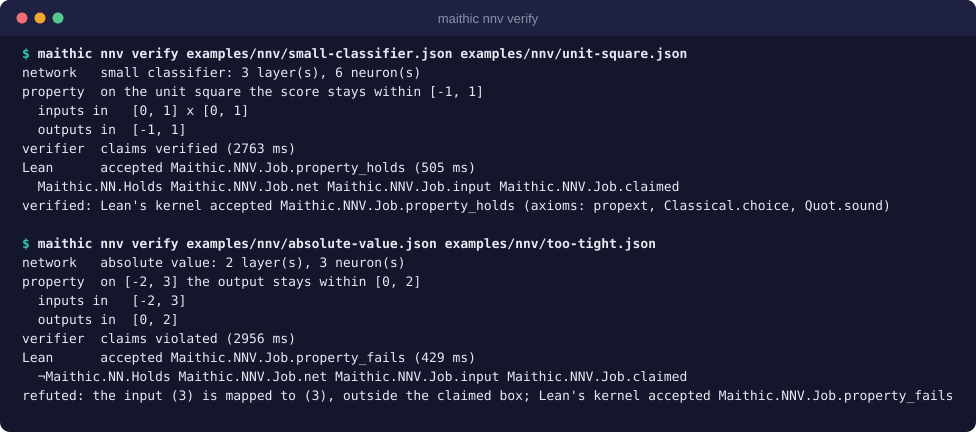

# Verifying a neural network, with the kernel as judge

A verifier for neural networks is a numerical program, and numerical programs have bugs and rounding. A
verdict of "the property holds" from such a program is a claim. `maithic nnv verify` lets a verifier make
the claim and has Lean's kernel check it against the exact network, so that what you are told rests on the
kernel and on a checker that is proved sound, and on nothing the verifier computed in floating point.

<p align="center">
  
</p>

<p align="center">
  
</p>

## A network and a property

Both are JSON with exact numbers, written as text: an integer, a fraction such as `-7/2`, or a decimal.
[`examples/nnv/absolute-value.json`](../../examples/nnv/absolute-value.json) is a ReLU network of two layers
that computes `|x|`:

```json
{
  "schema": "maithic.nnv.network/1",
  "name": "absolute value",
  "layers": [
    { "activation": "relu", "neurons": [ { "weights": ["1"], "bias": "0" }, { "weights": ["-1"], "bias": "0" } ] },
    { "activation": "identity", "neurons": [ { "weights": ["1", "1"], "bias": "0" } ] }
  ]
}
```

A property is an input box and the box the outputs are claimed to lie in:

```json
{ "schema": "maithic.nnv.property/1", "name": "on [-2, 3] the output stays within [0, 2]",
  "input": [["-2", "3"]], "output": [["0", "2"]] }
```

## Three answers, two of them checked

```console
$ maithic nnv verify examples/nnv/small-classifier.json examples/nnv/unit-square.json
$ maithic nnv verify examples/nnv/absolute-value.json examples/nnv/too-tight.json
```

The verifier, the Julia package `MaithicNNV`, propagates intervals through the network with outward rounding
and answers one of three ways.

| The verifier says | What it hands over | What Lean is asked to prove |
|---|---|---|
| verified | A box for every layer. | `Holds net input claimed`, by running the certificate checker in the kernel. |
| violated | A point of the input box. | `¬ Holds net input claimed`, by evaluating the exact network at that point. |
| unknown | The reason. | Nothing: there is no claim. |

The theorem is written with the network's exact rational weights and proved by `decide +kernel`: the kernel
itself runs `checkProperty`, a function proved sound in
[`Maithic.NN.Cert.Property`](../../lean/Maithic/NN/Cert/Property.lean) by `checkProperty_sound`. No compiled
evaluation is trusted and no axiom beyond the standard three is used. If the verifier's boxes are wrong, by
a bug or by rounding the wrong way, the checker returns false, the theorem does not typecheck, and the job
is reported as *failed*: a claim that Lean did not accept settles nothing.

The status is `verified` or `refuted` only when the kernel accepted the theorem within the trust policy; the
exit status is 0 for verified, 8 for refuted and 7 otherwise. `--write FILE.lean` keeps the theorem, which
`maithic check FILE.lean --project lean` checks again at any time, and `--out FILE` writes the job as JSON
(schema `maithic.nnv.job/1`). `--max-corners N` bounds how many corners of the input box the verifier tries
as counterexamples.

## What this does and does not show

The check is exact and complete for the claim that is made: these weights, this input box, this output box.
It says nothing about a network after retraining, about inputs outside the box, or about whether the box is
the property you care about. Interval bounds are also coarse: on a deep network they grow until the
verifier answers *unknown* for a property that is true. The method scales to the small networks of the
examples; it is a demonstration of how to make a numerical verdict checkable, and the same certificate
format would carry the tighter bounds of a stronger verifier.

<p align="center">
  
</p>

Jobs are read in R by `maithicstats::read_nnv_jobs()`, and `verification_summary()` gives the share of each
status with its interval and the median time of the verifier and of the kernel.
