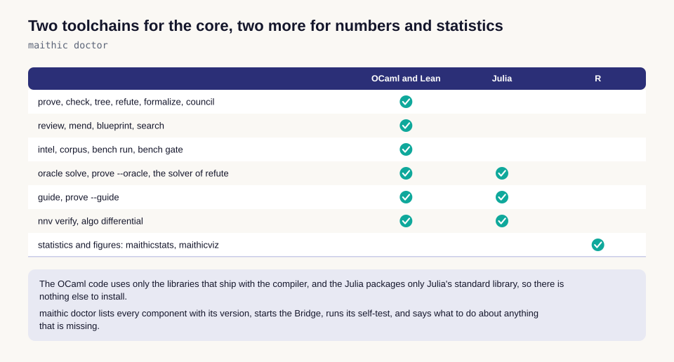

# Installing

Maithic is built from source. The core needs two toolchains; the numeric and statistics packages need two more.

<p align="center">
  
</p>

| Toolchain | Built and tested with | Lowest version declared | Needed for |
|---|---|---|---|
| OCaml with dune | OCaml 5.5, dune 3.25 | OCaml 5.3, dune 3.16 | the `maithic` command and the developer tool |
| Lean 4 | 4.36.0, the version in [`lean-toolchain`](../lean-toolchain), installed by elan | exactly that version | the Bridge and the Lean libraries |
| Julia | 1.13 | 1.11 | the eight packages under [`julia/`](../julia). The commands `maithic oracle`, `maithic prove --oracle` and the solver of `maithic refute` run the oracle engines with it; `maithic guide` and `maithic prove --guide` run the tactic model with it; `maithic nnv verify` runs the network verifier and `maithic algo differential` the reference implementations with it |
| R | 4.5, with `jsonlite`, `testthat`, `ggplot2` and `svglite` | 4.4 | `maithicstats`, `maithicviz` |

The workflow builds and tests the versions of the second column on every change. The third column is the lower
bound that each package declares (`ocaml/dune-project`, the `Project.toml` of each Julia package, the
`DESCRIPTION` of each R package); the versions between the two are expected to work and are not run by the
workflow. Lean has one version: the Bridge and the libraries are built with the toolchain that the file names.

The OCaml code uses only the libraries that ship with the compiler, so there is nothing to install besides the
compiler and dune. Live model calls use the `curl` command.

## Steps

1. Install OCaml and dune, for example with [opam](https://opam.ocaml.org): `opam switch create 5.5.0` and
   `opam install dune`.
2. Install [elan](https://lean-lang.org/install/). The right Lean version is downloaded on first use.
3. Build:

   ```sh
   make build-ocaml build-lean
   ```

4. Check the installation:

   ```sh
   ocaml/_build/default/bin/maithic/main.exe doctor
   ```

   `doctor` lists each component with its version, starts the Bridge, runs its self-test and tells you what to
   do about anything that is missing. It exits with status 4 if a required component is missing.

For Julia and R, `make build-julia build-r` loads and installs the packages, and `make test` runs every suite.
The Julia packages depend only on the standard library and on each other, by path, so the Makefile runs Julia's
package manager offline (`JULIA_PKG_OFFLINE=true`) and no registry is contacted.

## Where the command looks for the Bridge

In order: the path in `MAITHIC_BRIDGE` or the setting `bridge.command`; a build under `lean/.lake/build/bin/`
at or above the current directory; `maithic-bridge` on `PATH`.

## Working in your own Lean project

Point `bridge.project` (or `--project DIR`) at a Lake project. The Bridge then runs through `lake env` in that
project and can import its modules. The project must pin the same Lean version as the Bridge; if it does not,
the command says so and stops.
