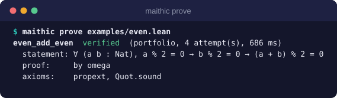

# Quick start

This page proves one theorem three ways. Build first; see [install.md](install.md).

```sh
alias maithic="$PWD/ocaml/_build/default/bin/maithic/main.exe"
```

## 1. With no model

```sh
maithic prove examples/even.lean --verbose
```

<p align="center">
  
</p>

`--verbose` lists every attempt. The prover tries a fixed portfolio of Lean's own automation, cheapest first:
`rfl`, `trivial`, `simp`, `omega`, `decide`, `simp_all`, `grind`, then the same after introducing hypotheses, then
a few structured scripts. Here `omega` succeeds on the fourth attempt.

The line `axioms: propext, Quot.sound` is the audit: these are the axioms the accepted proof rests on. The status
is `verified` because the kernel accepted the proof, the axioms are allowed by the trust policy and a fresh
process re-checked the finished text.

`maithic prove examples/even.lean --write` puts the proof into the file.

## 2. With a model, replayed

```sh
maithic prove examples/triangle.lean --mode replay --verbose
```

The portfolio fails here: the statement needs induction. The model is asked for proofs; in replay mode the
answers come from `fixtures/cassettes/`. The first answers fail, their errors are sent back, and the second round
contains a proof that Lean accepts. Replay mode never opens a network connection, and a request with no cassette
is an error, not a silent fallback.

The same theorem can be proved with no model at all. `--search` makes the prover take the proof apart, one
tactic at a time, when the portfolio has failed:

```sh
maithic prove examples/triangle.lean --no-ai --search
```

[The guide to the search](guides/search.md) shows what it does and how to look at it afterwards.

## 3. With your own key

```sh
export OPENAI_API_KEY=...
maithic prove examples/triangle.lean --provider openai
```

`maithic auth status` shows which keys are configured, without printing them. `maithic auth check` makes one
small call to confirm that a key works.

## Checking a whole file

```sh
maithic check lean/Maithic/Algo/Sort/Insertion.lean --project lean
```

`check` elaborates the file from its imports and prints one line per theorem with its status and its axioms. A
theorem that contains `sorry`, or that rests on an axiom outside the policy, is `failed`, and the exit status is 7.

## Beyond proving

The same command states, refutes, repairs and reviews. Each of these runs with no key; the ones that ask a
model take its answers from the cassettes:

```sh
maithic formalize "Show that the square of a negative integer is positive." --candidates 4
maithic refute examples/conjectures.lean
maithic council examples/council.lean
maithic mend repair fixtures/mend/lean/Upgrade.lean --renames fixtures/mend/renames.toml
maithic review fixtures/review/lean --suggest
maithic blueprint status examples/blueprint/triangles.md --lean examples/blueprint/triangles.lean
maithic search sorting keeps the elements --from fixtures/intel/extractions
maithic algo synth examples/algo/run-lengths.toml
maithic bench gate bench/results/basics-portfolio.json
```

`export MAITHIC_GATEWAY_MODE=replay` first, or add `--mode replay` to each. The guides under
[`guides/`](guides) take them one at a time: [stating a problem](guides/formalizing.md),
[refuting](guides/refuting-statements.md), [the council](guides/council.md),
[repair](guides/repairing-proofs.md), [review](guides/review.md), [blueprints](guides/blueprints.md),
[finding declarations](guides/finding-declarations.md), [the algorithm laboratory](guides/algorithm-lab.md)
and [the regression gate](guides/regression-gate.md). With Julia installed,
`maithic nnv verify examples/nnv/small-classifier.json examples/nnv/unit-square.json` has Lean's kernel check
a property of a neural network ([guide](guides/verifying-networks.md)), and `maithic algo differential` tests
the compiled verified algorithms against independent implementations.

## Machine-readable output

Every command accepts `--json`. `maithic prove FILE --json` prints a manifest with the statement as Lean prints
it, the proof, the axioms, the decision of the trust policy, the outcome of the re-check and every attempt with
its error.
