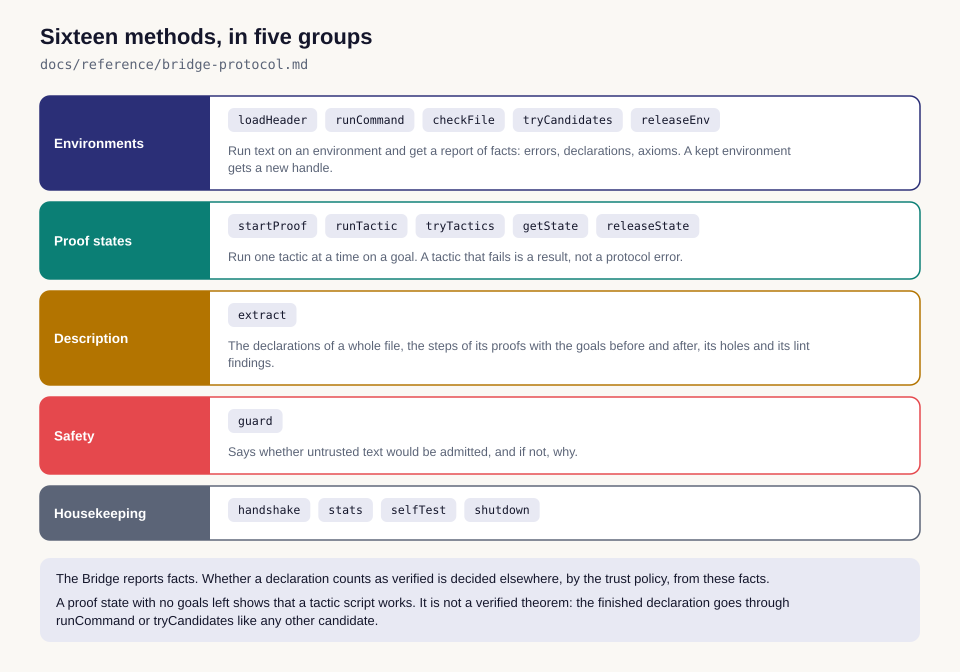

# The Bridge protocol

`maithic-bridge` is the Lean-side process. It speaks JSON-RPC 2.0, one message per line, on standard input and
output, and writes nothing else to standard output. Protocol version: 1.

One session, message by message:

<p align="center">
  
</p>

```json
{"jsonrpc":"2.0","id":7,"method":"runCommand","params":{"env":1,"source":"theorem t : 1 + 1 = 2 := rfl"}}
```

The server keeps every environment and every proof state it has built in tables and hands out numeric
handles, drawn from one counter. Both are immutable: running commands on an environment, or a tactic on a proof
state, never changes it; it produces a derived one.

## Methods

| Method | Parameters | Result |
|---|---|---|
| `handshake` | none | `bridge`, `protocol`, `lean`, `methods` |
| `loadHeader` | `imports`: module names | `env`, `cached` |
| `runCommand` | `env`, `source`; optional `names`, `keep`, limits | `report`; `env` when kept |
| `checkFile` | `source` with its own imports; optional `names`, `keep`, limits | `report`; `env` when kept |
| `extract` | `source` with its own imports; optional `module`, `trace`, `duplicates`, `lint`, `rules`, `convention`, limits | an extraction: `report`, `module`, `imports`, `moduleDocs`, `declarations`, `steps`, `holes`, `findings` |
| `tryCandidates` | `env`, `candidates`: list of `{source, untrusted}`; optional `names`, `stopOnFirst`, limits | `results` |
| `releaseEnv` | `env` | `released` |
| `guard` | `candidate` | `admitted`, `rejection` |
| `startProof` | `env`, and `statement` or `source`; optional limits | `report`, `states` |
| `runTactic` | `state`, `tactic`; optional `goal`, limits | a tactic outcome |
| `tryTactics` | `state`, `tactics`; optional `goal`, `stopOnSolved`, limits | `results`: tactic outcomes |
| `getState` | `state` | `state`, `env`, `depth`, `goals`, `solved`; `parent` when derived |
| `releaseState` | `state` | `released` |
| `stats` | none | counters of the session |
| `selfTest` | none | `healthy`, `checks` |
| `shutdown` | none | `bye`; the server exits |

<p align="center">
  
</p>

Limits are `maxHeartbeats`, in thousands, and `maxRecDepth`; zero or absent keeps Lean's default.

## Reports

```json
{"ok": true, "errors": 0, "warnings": 0, "elapsedMs": 4,
 "diagnostics": [{"severity": "info", "line": 1, "column": 0, "endLine": 1, "endColumn": 5, "text": "2"}],
 "decls": [{"name": "t", "found": true, "kind": "theorem", "type": "1 + 1 = 2", "axioms": [], "usesSorry": false}]}
```

Lines are one-based, columns zero-based in code points. When `names` is empty the report covers every
declaration added by the request. The Bridge reports facts; whether a declaration counts as verified is decided
by the trust policy from these facts.

A candidate of `tryCandidates` whose `untrusted` part fails the guard is not elaborated: its result has
`admitted: false` and the reason.

## Extraction

`extract` elaborates a whole file and describes it, and keeps nothing: no handle is returned. A file with
errors is described as far as it elaborated.

- `declarations`: every declaration the file wrote, in its order, with its kind, its type as Lean prints it, its
  documentation, where it begins (`line`, documentation included) and where its name stands (`nameLine`), the
  constants its type and its value refer to, the axioms it rests on, whether it rests on `sorry`, and for a
  theorem the text of its proof.
- `steps`, with `trace`: the tactics of every proof as written, each with the goals before and after it, its
  depth, and the number of tactics it holds. Only syntax that is a tactic is a step.
- `holes`: every `sorry`, with the goals that were open there.
- `findings`, with `lint`: what the lint rules found. `rules` names the rules to run; `convention` gives the
  naming convention for `theorems`, `definitions` and `types`, each one of `snake_case`, `lowerCamelCase`,
  `UpperCamelCase` and `any`. A convention that does not exist is refused.
- with `duplicates`, every theorem lists the theorems elsewhere in the environment that state the same thing.

Loading the imports of a file takes memory that Lean does not give back, so a client that extracts many files
starts one Bridge for each; the commands of Maithic do. The answer follows
[`schemas/bridge/extraction.schema.json`](../../schemas/bridge/extraction.schema.json).

The Bridge puts the compiled modules of its own package on Lean's search path, after those of the project it
runs in. A file can therefore import the Maithic libraries, the statement tests among them, whatever project it
belongs to, as long as the Bridge runs from its build.

## Proof states

`startProof` elaborates declarations whose proofs say `sorry` in tactic position and stores one proof state for
each such position, in source order. Give `source` with the text as it stands, or `statement` with a declaration
up to its `:=`, which the server completes with `by sorry`. Each state comes with the line and column of its
`sorry` and with its goals:

```json
{"state": 4, "line": 3, "column": 4,
 "goals": [{"id": "_uniq.30", "tag": "left", "target": "p", "pretty": "case left\np q : Prop\nhp : p\nhq : q\n⊢ p",
            "hypotheses": [{"name": "p", "type": "Prop"}, {"name": "q", "type": "Prop"},
                           {"name": "hp", "type": "p"}, {"name": "hq", "type": "q"}]}]}
```

A goal identifier stays the same for as long as the goal is open. A hypothesis bound by `let` has a `value`.
Names are the ones Lean shows, so a hypothesis the proof cannot name appears as `n✝`.

`runTactic` runs tactic text, one tactic or a sequence, on a state. With `goal`, the tactic sees only the goal
at that position. The outcome is a new state or a failure, and a failure is a result, not a protocol error:

```json
{"ok": true, "state": 6, "goals": [], "solved": true, "diagnostics": []}
{"ok": false, "kind": "tactic", "error": "Type mismatch\n  hq\nhas type\n  q\nbut is expected to have type\n  p", "diagnostics": []}
```

`kind` is `guard` when the text was refused before parsing, `parse` when it is not a tactic, and `tactic` when
Lean raised an error or the step budget ran out. `tryTactics` runs several tactics on the same state in one
round trip and returns their outcomes in order; with `stopOnSolved` it stops after the first that closes every
goal.

A state whose goals are all closed shows that a tactic script works. It is not a verified theorem: the finished
declaration goes through `runCommand` or `tryCandidates` like any other candidate. The reasons are in
[`docs/adr/0006-proof-states-are-not-evidence.md`](../adr/0006-proof-states-are-not-evidence.md).

## Errors

| JSON-RPC code | Maithic code | Meaning |
|---:|---|---|
| -32700 | `MTH-BRG-0001` | The request is not valid JSON. |
| -32600 | `MTH-BRG-0002` | The envelope is not a JSON-RPC 2.0 request. |
| -32601 | `MTH-BRG-0003` | Unknown method. |
| -32602 | `MTH-BRG-0004` | Missing or malformed parameter. |
| -32603 | `MTH-BRG-0005` | Internal error. |
| -32000 | `MTH-BRG-0101` | The imports could not be loaded. |
| -32001 | `MTH-BRG-0102` | Unknown environment handle. |
| -32002 | `MTH-BRG-0103` | The store of environments or of proof states is full. |
| -32003 | `MTH-BRG-0104` | Unknown proof state handle. |

The Maithic code is in `error.data.code`.

## Fixtures

`fixtures/bridge/sessions/` holds scripted sessions: requests with the part of the response each must produce.
They are run three ways: inside the Lean test executable, against the built server over its pipes, and, through
transcripts recorded by `make transcripts`, against a stub that lets the OCaml client be tested without Lean.
