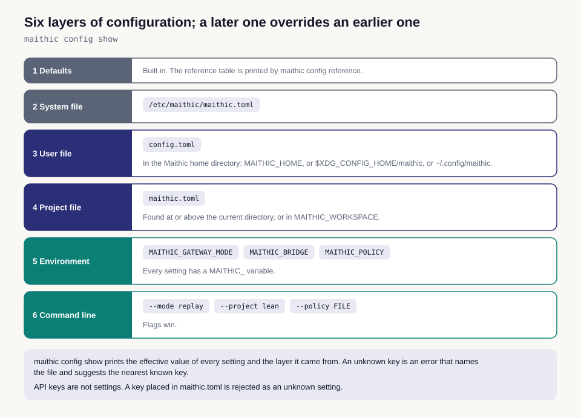

# Configuration

Settings come from six layers. A later layer overrides an earlier one:

  

1. built-in defaults;
2. the system file `/etc/maithic/maithic.toml`;
3. the user file `config.toml` in the Maithic home directory (`MAITHIC_HOME`, or `$XDG_CONFIG_HOME/maithic`, or
   `~/.config/maithic`);
4. the project file `maithic.toml`, found at or above the current directory, or in `MAITHIC_WORKSPACE`;
5. `MAITHIC_*` environment variables;
6. command-line flags.

`maithic config show` prints the effective value of every setting and the layer it came from.

An unknown key is an error that names the file and suggests the nearest known key. A value of the wrong type or
outside an enumeration is an error that names the setting and what is allowed. Relative paths are resolved
against the directory of the project file.

API keys are not settings. They are read from the provider's environment variable or from `credentials.toml` in
the Maithic home directory, and a key placed in `maithic.toml` is rejected as an unknown setting.

## Settings

The table below is generated by `maithic config reference` from the declarations that validate the configuration,
and is kept in [`configuration-table.md`](configuration-table.md).

A sample project file is in [`maithic.toml.example`](../../maithic.toml.example).
