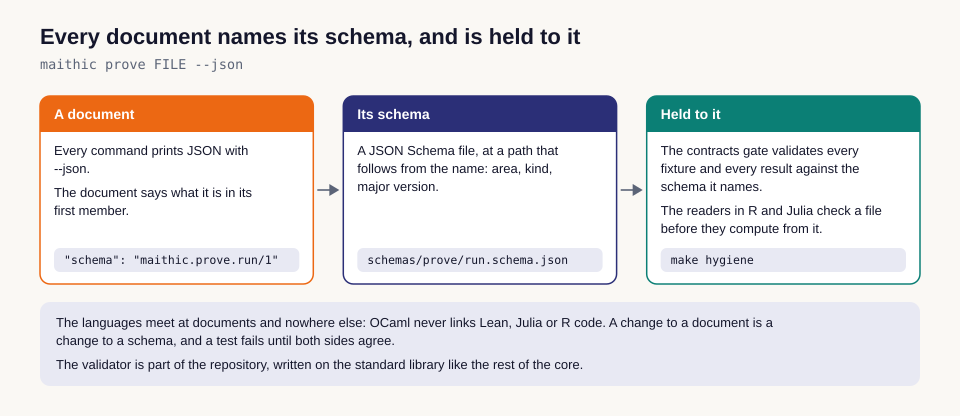

# Schemas

Every document that one part of Maithic writes for another names its schema in a `schema` member, and the
schema is a JSON Schema file under [`schemas/`](../../schemas). The name `maithic.<area>.<kind>/<major>` maps to
`schemas/<area>/<kind>.schema.json`; from the second major version on the file is `<kind>.v<major>.schema.json`.

| Schema | Written by | Read by | What it is |
|---|---|---|---|
| [`maithic.prove.run/1`](../../schemas/prove/run.schema.json) | `maithic prove --json` | `maithicstats::read_prove_runs` | Every theorem with its outcome, each candidate tried, the policy decision, the re-check, and the gateway account. |
| [`maithic.check.report/1`](../../schemas/check/report.schema.json) | `maithic check --json` | `maithicstats::read_check_reports` | The status and axioms of every theorem of a file. |
| [`maithic.bench.run/1`](../../schemas/bench/run.schema.json) | `maithic bench run --out` | `maithicstats::read_bench_run` | One record per benchmark problem. |
| [`maithic.bench.manifest/1`](../../schemas/bench/manifest.schema.json) | `maithic-bench manifest` (Lean) | `maithic bench` | The problems of the suites, from the Lean package. |
| [`maithic.gateway.cassette/1`](../../schemas/gateway/cassette.schema.json) | the gateway in record mode, `make cassettes` | the gateway in replay mode | One stored exchange with a provider. |
| [`maithic.gateway.exchange/1`](../../schemas/gateway/exchange.schema.json) | by hand | the adapter tests | One documented provider response and what the adapter must make of it. |
| [`maithic.oracle.goal/1`](../../schemas/oracle/goal.schema.json) | callers of the oracles | `MaithicOracle.read_goal` | A goal in the exchange format. |
| [`maithic.oracle.certificate/1`](../../schemas/oracle/certificate.schema.json) | `MaithicOracle.certificate_document` | `MaithicOracle.read_certificate`, checkers | A certificate of one of thirteen kinds. |
| [`maithic.oracle.outcome/1`](../../schemas/oracle/outcome.schema.json) | `MaithicOracle.outcome_document`, `bin/solve.jl` | the `maithic` command, callers of the oracles | Proved, refuted or unknown; for the command, with the statement, the replay and the scripts that Lean checks. |
| [`maithic.prove.search/1`](../../schemas/prove/search.schema.json) | `maithic prove --search-trees` | `maithic tree`, the picture of a search | A step-wise search: every goal with the tactics tried on it, the expansions in order with their durations, the cost and the proof. |
| [`maithic.oracle.result/1`](../../schemas/oracle/result.schema.json) | `maithic oracle solve --json` | callers of the command | One question to an oracle with its answer, the name of the certificate by content, and the scripts for Lean. |
| [`maithic.refute.report/1`](../../schemas/refute/report.schema.json) | `maithic refute --json`, `--out` | callers of the command | For every statement its verdict, the counterexample, the refutation as Lean accepted it, and every step of the search. |
| [`maithic.bridge.extraction/1`](../../schemas/bridge/extraction.schema.json) | the Bridge, `maithic intel extract` | the graph, the datasets, the review | What Lean reports about a file: declarations with their places, types, dependencies and axioms, and on request tactic steps, gaps and lint findings. |
| [`maithic.intel.graph/1`](../../schemas/intel/graph.schema.json) | `maithic intel scan` | the `intel` commands, `MaithicGraphs.read_graph`, `maithicstats::read_intel_snapshot` | Declarations, modules, namespaces and files, and the edges between them. |
| [`maithic.intel.health/1`](../../schemas/intel/health.schema.json) | `maithic intel scan` | `maithic intel health`, `maithicstats::read_intel_snapshot` | Declarations by kind, unfinished proofs with their open goals, and the axioms in use. |
| [`maithic.intel.metrics/1`](../../schemas/intel/metrics.schema.json) | `MaithicGraphs`, `bin/metrics.jl` | `maithicstats::read_intel_snapshot` | Degrees, PageRank and betweenness of every scanned declaration, and the components of the graph. |
| [`maithic.corpus.theorem/1`](../../schemas/corpus/theorem.schema.json), [`step`](../../schemas/corpus/step.schema.json), [`premise`](../../schemas/corpus/premise.schema.json), [`pair`](../../schemas/corpus/pair.schema.json) | `maithic corpus harvest` | `maithic corpus verify`, `MaithicData.load_dataset`, `maithicstats::read_corpus` | The records of a dataset, one schema for each kind. |
| [`maithic.corpus.manifest/1`](../../schemas/corpus/manifest.schema.json) | `maithic corpus harvest` | the same readers | The name, version and sources of a dataset, its counts, and every shard with its hash. |
| [`maithic.corpus.harvest/1`](../../schemas/corpus/harvest.schema.json) | `maithic corpus harvest` | people, and callers of the command | What happened to each file of a harvest. |
| [`maithic.review.report/1`](../../schemas/review/report.schema.json) | `maithic review --format json` | `maithicstats::read_review_runs` | The findings of a review after the policy was applied, with suggested edits and the count of suppressed findings. |
| [`maithic.guide.model/1`](../../schemas/guide/model.schema.json), [`run`](../../schemas/guide/run.schema.json) | `maithic guide train`, `MaithicGuide` | the guidance service, `maithic guide info`, `maithicstats::read_guide_runs` | A tactic model with its vocabulary, templates and weights; and the record of a training run with its curves and its accuracy on held-out proofs. |
| [`maithic.guide.ranking/1`](../../schemas/guide/ranking.schema.json) | `maithic guide rank --json` | callers of the command | The tactics for one goal with the model's probabilities, the preference of the search and the two combined. |
| [`maithic.mend.scan/1`](../../schemas/mend/scan.schema.json) | `maithic mend scan --json`, `--out` | callers of the command | The breakages of files by declaration, each with its class and what Lean said. |
| [`maithic.mend.report/1`](../../schemas/mend/report.schema.json) | `maithic mend repair --json`, `--out` | `maithicstats::read_mend_runs` | Every breakage with the stage that repaired it, the proof before and after, and what Lean still reports at the end. |
| [`maithic.mend.minimization/1`](../../schemas/mend/minimization.schema.json) | `maithic mend minimize --json`, `--out` | callers of the command | Every proof with its size before and after and what was removed. |
| [`maithic.formalize.run/1`](../../schemas/formalize/run.schema.json) | `maithic formalize --json`, `--out` | `maithicstats::read_formalize_runs` | A problem with its intake record, every candidate statement with each attempt to compile it, the checks that were made, and the statement that was chosen. |
| [`maithic.council.session/1`](../../schemas/council/session.schema.json) | `maithic council --json`, `--out` | `maithicstats::read_council_sessions` | A session: the turns, the blackboard with the evidence behind every status, the transcript, the answer and the budget. |
| [`maithic.blueprint.graph/1`](../../schemas/blueprint/graph.schema.json) | `maithic blueprint graph --format json` | callers of the command | The nodes of a blueprint and the edges between them, each edge marked as needed by a statement or by a proof only. |
| [`maithic.blueprint.status/1`](../../schemas/blueprint/status.schema.json) | `maithic blueprint status --json`, `--out` | `maithicstats::read_blueprint_snapshots` | A snapshot: every node with its status, what it waits for and what waits for it, the frontier and the counts. |
| [`maithic.search.results/1`](../../schemas/search/results.schema.json) | `maithic search --json` | callers of the command | The hits of a query, each with its score and the retrievers that found it. |
| [`maithic.bench.baseline/1`](../../schemas/bench/baseline.schema.json) | `maithic bench gate --update` | `maithic bench gate` | What a suite achieved when the baseline was stored: for each problem its status, the candidates tried and the time. |
| [`maithic.bench.gate/1`](../../schemas/bench/gate.schema.json) | `maithic bench gate --json`, `--out` | callers of the command | The verdict for each suite, with the thresholds, the problems lost and gained and the reasons for a failure. |
| [`maithic.nnv.network/1`](../../schemas/nnv/network.schema.json), [`property/1`](../../schemas/nnv/property.schema.json) | by hand | `maithic nnv verify`, `MaithicNNV` | A ReLU network with exact weights, and an input box with the box its outputs are claimed to lie in. |
| [`maithic.nnv.verdict/1`](../../schemas/nnv/verdict.schema.json) | `MaithicNNV`, `bin/verify.jl` | `maithic nnv verify` | What the verifier claims, with the boxes or the counterexample that Lean can check. |
| [`maithic.nnv.job/1`](../../schemas/nnv/job.schema.json) | `maithic nnv verify --json`, `--out` | `maithicstats::read_nnv_jobs` | One verification: the claim, and what Lean's kernel said about the theorem that states it. |
| [`maithic.algolab.synthesis/1`](../../schemas/algolab/synthesis.schema.json) | `maithic algo synth --json`, `--out` | callers of the command | A task, every implementation that was looked at with Lean's errors and the results of the examples, and the one accepted. |
| [`maithic.algolab.differential/1`](../../schemas/algolab/differential.schema.json) | `maithic algo differential --json`, `--out` | callers of the command | The cases and mismatches of a differential test, for each algorithm, with every answer that was not accepted. |
| [`maithic.oracle.proofs/1`](../../schemas/oracle/proofs.schema.json) | by hand | the Lean tests of the proof checkers | Clausal proofs with the verdict the checker must give on each. |
| [`maithic.nnv.certificate/1`](../../schemas/nnv/certificate.schema.json) | `MaithicNNV.certificate_document` | checkers | Bounds of a ReLU network, layer by layer. |
| [`maithic.search.queryset/1`](../../schemas/search/queryset.schema.json) | by hand | `maithicstats::read_query_set` | Queries with their relevant declarations. |
| [`maithic.search.rankings/1`](../../schemas/search/rankings.schema.json) | retrieval engines | `maithicstats::read_rankings` | What an engine returned for each query. |
| [`maithic.bridge.session/1`](../../schemas/bridge/session.schema.json) | by hand | the Lean and OCaml tests | A scripted session of the Bridge. |

The wire types of the Bridge have schemas as well, used on its recorded answers:
[`response`](../../schemas/bridge/response.schema.json), [`report`](../../schemas/bridge/report.schema.json),
[`goal`](../../schemas/bridge/goal.schema.json) and
[`tactic-outcome`](../../schemas/bridge/tactic-outcome.schema.json). Shared definitions, such as the result
statuses and the text form of exact numbers, are in [`common.schema.json`](../../schemas/common.schema.json).

## The contracts check

`maithic-dev contracts`, part of `make hygiene`, holds the repository to its schemas:

  

- every schema file is linted: unknown keywords, references that do not resolve and patterns that do not parse
  are mistakes in the schema, and each schema needs a title and a description;
- every JSON document in the repository that names a Maithic schema is validated against it, and a document
  that names a schema with no file is an error;
- every response in the recorded Bridge transcripts is validated, with the reports, goals and tactic outcomes
  inside it.

The integration tests do the same to what the built command writes, for runs that succeed and runs that fail.
A member added to an output without a change to its schema fails the build.

## The validator

[`Json_schema`](../../ocaml/lib/schema/json_schema.mli) implements the part of JSON Schema 2020-12 that these
schemas use and refuses the rest: `type`, `enum`, `const`, `properties`, `required`, `additionalProperties`,
`minProperties`, `items`, `prefixItems`, `minItems`, `maxItems`, `uniqueItems`, `minLength`, `maxLength`,
`pattern`, the numeric bounds, `allOf`, `anyOf`, `oneOf`, `not`, `if`/`then`/`else`, and `$ref` within a file
and across files. Patterns are the common subset of regular expressions, matched by a small engine of the
module's own, so that validation behaves the same wherever the program runs.

## Changing a schema

A change that every existing reader survives, such as a new optional member, keeps the major version: edit the
schema and regenerate the fixtures that the change touches (`make julia-fixtures`, `make run-fixtures`,
`make transcripts`). A change that an existing reader would misread needs a new major version, with its own
file, and readers that say which versions they accept.
