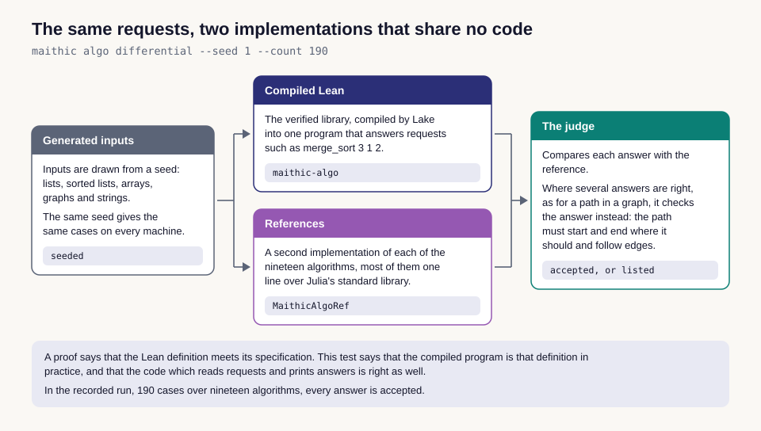

# MaithicAlgoRef

Independent implementations of the algorithms that the Lean library proves correct, and the tests that hold the
compiled Lean program against them. A proof says what a definition computes. It does not say that the compiled
program is that definition, or that the specification is the one that was meant, and this package looks from
outside: the same generated inputs go to both sides, and every answer that differs is reported.

<p align="center">
  
</p>

## What it provides

- `reference`, `reference_names`: nineteen algorithms, written again in Julia with no code shared with the Lean library.
- `random_list`, `random_sorted_list`, `random_array`, `random_graph`, `random_string`: inputs from a seed.
- `run_differential`, `Report`, `Mismatch`, `process_transport`, `reference_transport`: the runner, with a judge that compares answers and, where several are right, checks the answer instead.
- `cost_table`, `cost_csv`, `proven_bound`, `within_bounds`: the comparisons that the Lean program counts, beside the bounds that Lean proves.

## An example

Run from the root of the repository:

```julia
using MaithicAlgoRef

println(reference("insertion_sort", [3, 1, 2, 1]), "  ", reference("binary_search", 2, [1, 2, 3]))
println(length(reference_names()), " algorithms have a reference")

# The references against themselves: the transport that needs no Lean.
report = run_differential(reference_transport(); seed = 0, count = 190)
println(report.cases, " cases, ", length(report.mismatches), " answers that differ")

println("comparisons are counted for: ", join(cost_names(), ", "))
println("proved bound for insertion sort on 8 elements: ", proven_bound("insertion_sort", 8))
```

It prints:

```text
[1, 1, 2, 3]  true
19 algorithms have a reference
190 cases, 0 answers that differ
comparisons are counted for: linear_search, binary_search, insertion_sort, merge_sort
proved bound for insertion sort on 8 elements: 28
```

## Where Maithic uses it

`maithic algo differential` runs `bin/differential.jl` against the program `maithic-algo`, which Lake compiles
from the verified library, and `bin/costs.jl` writes [`fixtures/algolab/costs.csv`](../../fixtures/algolab/costs.csv),
from which R draws the measured growth beside the proved bounds.
[`docs/guides/algorithm-lab.md`](../../docs/guides/algorithm-lab.md) walks through all of it.

## Tests

```sh
julia --startup-file=no --project=julia/MaithicAlgoRef -e 'using Pkg; Pkg.test()'
```

`make test-julia` runs the tests of all eight packages. Two of them need the compiled Lean program and are skipped when it has not been built.

## Dependencies

The standard library of Julia 1.11 or later (built and tested with 1.13), and `MaithicCore`. Nothing is downloaded: the packages use each other by
path, and the Makefile runs the package manager offline.
