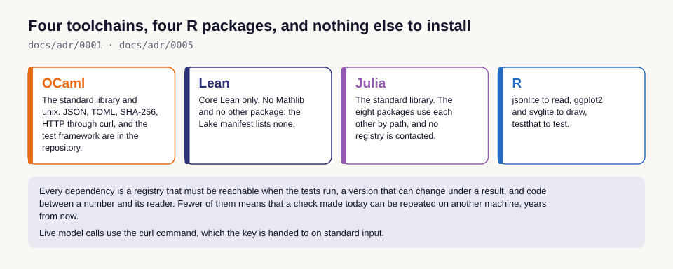

# MaithicCore

What the Julia packages of Maithic share. A certificate is only worth something if it says the same thing to
every program that reads it, so this package is about exactness and determinism: JSON that is written the same
way every time, numbers that never pass through floating point, and random streams that do not change between
versions of Julia.

It is also where the rule of the Julia side is kept: the standard library, and nothing else.

<p align="center">
  
</p>

## What it provides

- `read_json`, `write_json`: a JSON reader and writer with deterministic output, and a canonical form for hashing.
- `exact`, `exact_text`, `parse_exact`: the lossless text form of integers and rationals, such as `"3"` and `"-7/2"`, that every certificate uses.
- `parse_expression`, `parse_relation`, `expression_text`, `relation_text`, `variables`: the small arithmetic language of the oracle exchange format, with printers for plain text and for Lean and evaluation over any number type.
- `document`, `schema_of`, `expect_schema`, `engine_record`: the envelope that names the schema of a document.
- `SplitMix`, `next_u64!`, `uniform!`, `integer!`: SplitMix64, the generator that the Lean command `#maithic_test` uses too, so that a seed gives the same stream of numbers in both languages.

## An example

Run from the root of the repository:

```julia
using MaithicCore

doc = read_json("""{"b": [1, 2.5, "x"], "a": null}""")
println(write_json(doc))                      # the same text for the same document, always
println(write_json(doc; canonical = true))    # with the keys in order, for hashing

println(parse_exact("-7/2"), "  ", exact_text(3 // 4), "  ", exact_text(big(10)^20))

r = parse_relation("2*x + 3*y <= 6")
println(variables(r), "  ", relation_text(r))

rng = SplitMix(42)                            # the same stream on every machine and Julia version
println([integer!(rng, 1:6) for _ in 1:8])
```

It prints:

```text
{"b":[1,2.5,"x"],"a":null}
{"a":null,"b":[1,2.5,"x"]}
-7//2  3/4  100000000000000000000
["x", "y"]  2 * x + 3 * y <= 6
[2, 2, 1, 1, 5, 1, 2, 3]
```

## Where Maithic uses it

Every other Julia package builds on it: the oracles write their certificates with it, the network verifier its
boxes, the tactic model its weights, and the differential tests draw their inputs from its random streams.

## Tests

```sh
julia --startup-file=no --project=julia/MaithicCore -e 'using Pkg; Pkg.test()'
```

`make test-julia` runs the tests of all eight packages. This package has 14 groups of tests.

## Dependencies

The standard library of Julia 1.11 or later (built and tested with 1.13). Nothing is downloaded: the packages use each other by
path, and the Makefile runs the package manager offline.
