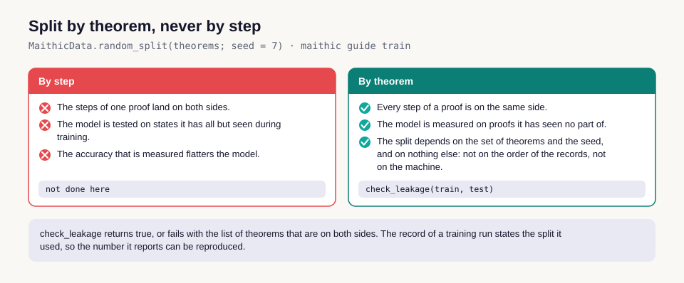

# MaithicData

Processing of the datasets that `maithic corpus harvest` writes. A dataset is a manifest and shards of JSON
lines. This package loads the records into typed tables, removes records that say the same thing twice, splits a
dataset into training, validation and test parts by theorem, and checks that no theorem ended up in two parts.

The split is by theorem, and this is why:

<p align="center">
  
</p>

## What it provides

- `load_dataset`, `load_records`: theorem, step, premise and pair records as typed tables, each shard checked against the hash in the manifest.
- `deduplicate`, `duplicates`: records that say the same thing twice.
- `random_split`, `part_of`, `split_counts`, `split_manifest`: a split by theorem, from a seed, the same on every machine.
- `leakage`, `check_leakage`: the theorems that two parts share, which should be none.

## An example

Run from the root of the repository:

```julia
using MaithicData

data = load_dataset("fixtures/corpus/demo")
println(data.name, ": ", length(data.theorems), " theorems, ", length(data.steps), " steps, ", length(data.pairs), " pairs")

split = random_split(data.theorems; seed = 1)
println(split_counts(split))

train = [p for p in data.pairs if part_of(split, p) == :train]
test = [p for p in data.pairs if part_of(split, p) == :test]
println(length(train), " training pairs, ", length(test), " test pairs, theorems in both: ", leakage(train, test))
```

It prints:

```text
demo: 28 theorems, 139 steps, 88 pairs
Dict(:test => 3, :train => 22, :validation => 3)
56 training pairs, 7 test pairs, theorems in both: Tuple{String, String}[]
```

## Where Maithic uses it

`MaithicGuide` loads and splits its training data with it. The dataset of the example,
[`fixtures/corpus/demo`](../../fixtures/corpus/demo), is written by `make lean-fixtures` from the demonstration
sources. [`docs/guides/datasets.md`](../../docs/guides/datasets.md) describes the records.

## Tests

```sh
julia --startup-file=no --project=julia/MaithicData -e 'using Pkg; Pkg.test()'
```

`make test-julia` runs the tests of all eight packages.

## Dependencies

The standard library of Julia 1.11 or later (built and tested with 1.13), and `MaithicCore`. Nothing is downloaded: the packages use each other by
path, and the Makefile runs the package manager offline.
