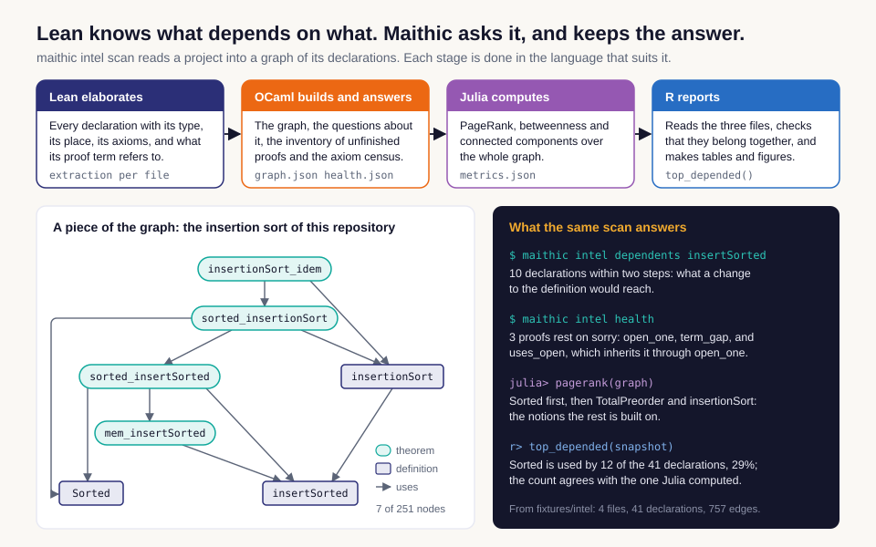

# MaithicGraphs

Measures on the graph of a Lean code base. `maithic intel scan` writes a code graph: declarations, and which
declaration uses which. This package computes what the shape of that graph says about the code: how many
declarations use each one, which ones everything rests on, which ones lie on the ways between others, and how
the code falls into pieces that do not refer to each other.

<p align="center">
  
</p>

## What it provides

- `read_graph`, `load_graph`: the declarations and the uses edges of a graph of the schema `maithic.intel.graph/1`.
- `in_degree`, `out_degree`: who uses what, counted.
- `pagerank`, `betweenness`: what everything rests on, and what lies between.
- `weak_components`, `component_sizes`: the pieces of the code.
- `metrics`, `top`: every measure as one document of the schema `maithic.intel.metrics/1`, and the leaders of any measure.

## An example

Run from the root of the repository:

```julia
using MaithicGraphs

graph = read_graph("fixtures/intel/graph.json")
println(node_count(graph), " declarations, ", edge_count(graph), " uses")

for (name, users) in top(graph, in_degree(graph), 3; internal_only = true)
    println(rpad(name, 28), users, " declarations use it")
end
for (name, rank) in top(graph, pagerank(graph), 3; internal_only = true)
    println(rpad(name, 28), "PageRank ", round(rank; digits = 4))
end
println("pieces that do not refer to each other: ", component_sizes(graph))
```

It prints:

```text
251 declarations, 757 uses
Maithic.Algo.Sorted         12 declarations use it
Maithic.Algo.insertSorted   6 declarations use it
Maithic.Algo.insertionSort  6 declarations use it
Maithic.Algo.Sorted         PageRank 0.0077
Maithic.Algo.TotalPreorder  PageRank 0.0053
Maithic.Algo.insertionSort  PageRank 0.0052
pieces that do not refer to each other: [250, 1]
```

## Where Maithic uses it

`make lean-fixtures` runs `bin/metrics.jl` on the graph of the demonstration sources and writes
[`fixtures/intel/metrics.json`](../../fixtures/intel/metrics.json); the R package `maithicstats` reads it with the
graph and checks that the two are of the same scan.
[`docs/guides/code-intelligence.md`](../../docs/guides/code-intelligence.md) has the commands and the graph.

## Tests

```sh
julia --startup-file=no --project=julia/MaithicGraphs -e 'using Pkg; Pkg.test()'
```

`make test-julia` runs the tests of all eight packages.

## Dependencies

The standard library of Julia 1.11 or later (built and tested with 1.13), and `MaithicCore`. Nothing is downloaded: the packages use each other by
path, and the Makefile runs the package manager offline.
