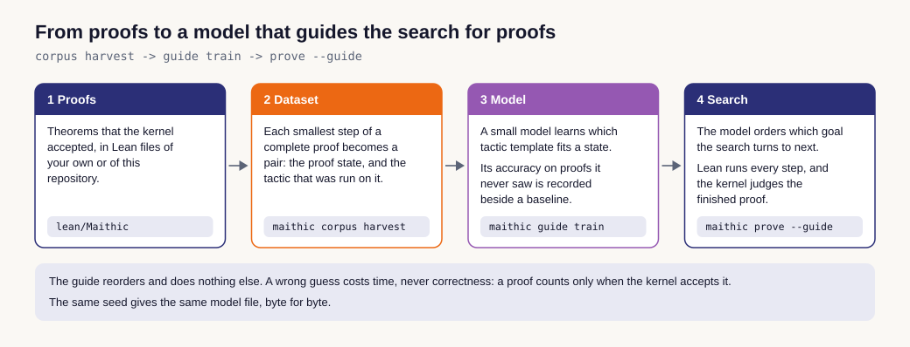

# MaithicGuide

A small model that orders tactics. It is trained on pairs of a proof state and the tactic that was run on it,
traced from proofs that the kernel accepted, and it answers one question: on this goal, which tactics are worth
trying first? It reorders the candidates of the step-wise search and does nothing else. Lean still runs every
step, and a proof still counts only when the kernel accepts it.

<p align="center">
  
</p>

## What it provides

- A lexer and a vocabulary for proof states (`lex`, `build_vocabulary`, `encode`), with the conclusion of the goal read first.
- Tactic templates (`template`, `build_templates`): `simp [foo, bar]` and `simp [baz]` are the same answer, `simp [_]`.
- The model (`GuideModel`, `Embedding`, `Attention`, `Head`): embeddings, an optional attention layer, pooling and a linear head, with gradients written by hand and checked against finite differences.
- Training (`TrainConfig`, `train`, `load_examples`): a split by theorem, early stopping on the validation part, and a record of every epoch.
- Evaluation (`evaluate`, `topk_accuracy`, `baseline`): accuracy on proofs no part of which was seen, beside a baseline that knows no goal.
- What the search asks for (`tactic_priors`, `state_value`, `top_templates`), and a service that answers over standard input and output (`serve`).
- `save_model`, `load_model`: a model is one JSON document, read back bit for bit.

## An example

Run from the root of the repository:

```julia
using MaithicGuide

model = load_model("fixtures/guide/library/model.json")
goal = "n : Nat\n⊢ double n = 2 * n"

candidates = ["rfl", "omega", "simp [double]", "induction n"]
priors = tactic_priors(model, goal, candidates)
for (tactic, prior) in sort(collect(zip(candidates, priors)); by = last, rev = true)
    println(rpad(tactic, 16), round(100 * prior; digits = 1), "%")
end
println("value: ", round(100 * state_value(model, goal); digits = 1), "%")
```

It prints:

```text
rfl             43.2%
simp [double]   39.4%
induction n     11.9%
omega           5.5%
value: 39.7%
```

## Where Maithic uses it

`maithic guide train` runs `bin/train.jl`, `maithic guide info` and `rank` read a model, and
`maithic prove --guide MODEL` starts `bin/serve.jl` beside the search. If the service stops answering, the search
goes on in its own order and the record says so. The model the repository keeps is
[`fixtures/guide/library/model.json`](../../fixtures/guide/library/model.json); twenty recorded training runs are
under [`fixtures/guide/runs`](../../fixtures/guide/runs), written by `bin/compare.jl`.
[`docs/guides/guided-search.md`](../../docs/guides/guided-search.md) has the training, the options and the
numbers.

## Tests

```sh
julia --startup-file=no --project=julia/MaithicGuide -e 'using Pkg; Pkg.test()'
```

`make test-julia` runs the tests of all eight packages. They train a model from the demonstration dataset and check that the same seed gives the same bytes.

## Dependencies

The standard library of Julia 1.11 or later (built and tested with 1.13), `MaithicCore` and `MaithicData`. Nothing is downloaded: the packages use each other by
path, and the Makefile runs the package manager offline.
