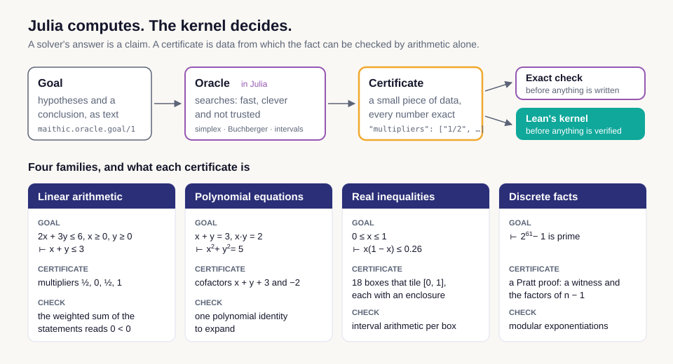

# MaithicOracle

Solvers that answer with evidence. An oracle searches for the answer to an arithmetic goal by whatever means are
fast, and returns a *certificate*: a small piece of data, with every number exact, from which the fact can be
checked by arithmetic alone. An oracle answers *proved* with a certificate, *refuted* with an exact point where
the goal fails, or *unknown* with the reason. It never answers with a bare yes.

<p align="center">
  
</p>

## What it provides

- Linear arithmetic over the rationals and the integers: exact simplex, Farkas multipliers, cuts for integer goals (`simplex`, `feasibility`, `linear_form`).
- Polynomial equations: Buchberger's algorithm, with the cofactors of the goal as the certificate (`prove_polynomial`).
- Real inequalities on a box: interval arithmetic with outward rounding, with the boxes and their enclosures as the certificate.
- Discrete facts: primality with Pratt certificates (`prove_prime`), factorizations, modular inverses, orders, Bézout coefficients and witnesses.
- `solve`, `read_goal`, `outcome_document`: one entry point for goal documents of the schema `maithic.oracle.goal/1`.
- `check`, `claim`, `certificate_json`, `read_certificate`, `lean_check`: every certificate can be checked again exactly, stated as text, written, read back, and written as a Lean statement.

## An example

Run from the root of the repository:

```julia
using MaithicOracle

outcome = prove_polynomial(["x + y = 3", "x * y = 2"], "x^2 + y^2 = 5")
println(claim(outcome.certificate))
println(kind(outcome.certificate), "  checked exactly: ", check(outcome.certificate))
print(lean_check(outcome.certificate; name = "sum_of_squares"))

println(prove_polynomial(String[], "(x + y)^2 = x^2 + y^2"))    # a false goal gets a point, not a shrug

goal = read("fixtures/oracle/goals/linear-integer-gap.json", String)
answer = solve(read_goal(goal))
println(typeof(answer), ": ", claim(answer.certificate))

mersenne = prove_prime(big(2)^61 - 1)
println(typeof(mersenne), "  checked exactly: ", check(mersenne))
```

It prints:

```text
∀ x y : ℚ, x + y = 3 → x * y = 2 → x ^ 2 + y ^ 2 = 5
polynomial.combination  checked exactly: true
theorem sum_of_squares (x y : Rat) : (x ^ 2 + y ^ 2 - 5 : Rat) = (x + y + 3) * (x + y - 3) + -2 * (x * y - 2) := by grind
Refuted(x = 1, y = 1)
Proved: ∀ x y : ℤ, 2 * x + 4 * y < 7 → x + 2 * y ≥ 4 → False
PrimeCertificate  checked exactly: true
```

## Where Maithic uses it

`maithic oracle solve`, `maithic prove --oracle` and the solver of `maithic refute` run `bin/solve.jl`. The goals
and certificates under [`fixtures/oracle`](../../fixtures/oracle) are written by this package's tests, and the
Lean statements it writes are in [`fixtures/oracle/lean/Checks.lean`](../../fixtures/oracle/lean/Checks.lean),
which `maithic check` verifies on every run of `make e2e`. A certificate of linear integer arithmetic comes back
as a call of the tactic `maithic_linear_int`, whose checker is proved sound in Lean; the other kinds are checked
exactly here and are not reported as verified. [`docs/concepts/oracles.md`](../../docs/concepts/oracles.md) has the
whole picture and [`docs/reference/oracle-format.md`](../../docs/reference/oracle-format.md) the formats.

## Tests

```sh
julia --startup-file=no --project=julia/MaithicOracle -e 'using Pkg; Pkg.test()'
```

`make test-julia` runs the tests of all eight packages. They include every goal of the fixtures, each answered and each certificate checked.

## Dependencies

The standard library of Julia 1.11 or later (built and tested with 1.13), and `MaithicCore`. Nothing is downloaded: the packages use each other by
path, and the Makefile runs the package manager offline.
