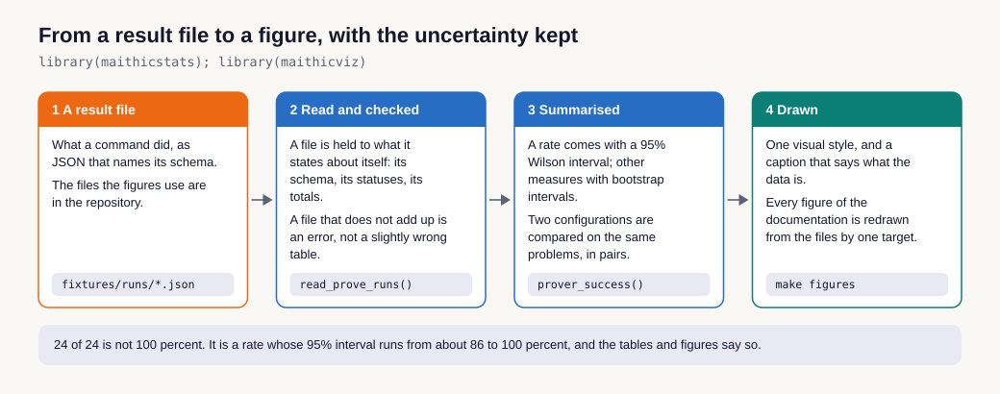

# maithicstats

Statistics for the result files that the `maithic` command writes. Every reader checks a file before any number
is computed from it: its schema, its statuses and its totals. A file that does not add up is an error, not a
slightly wrong table. Every estimate comes with its uncertainty, and a small sample gets the wide interval it
deserves.

<p align="center">
  
</p>

## What it provides

- Intervals: `wilson_interval` for rates, `bootstrap_interval` for any other measure, from a seed.
- Comparisons of two configurations on the same problems: `paired_comparison`, `mcnemar_exact`, `comparison_table`.
- Readers for every kind of result file, each with its summaries and a Markdown table: benchmark runs, prove runs and check reports, the trust ledger, gateway usage, retrieval evaluation, code graphs, datasets, reviews, tactic models, repairs, formalizations, council sessions, blueprints, network jobs, measured costs of algorithms and the capability register.
- Growth: `fit_growth`, `best_growth`, `growth_table` fit the usual orders of growth to measured costs and say which fits best.

## An example

Run from the root of the repository:

```r
library(maithicstats)

run <- read_bench_run("bench/results/basics-portfolio.json")
by_tag <- success_by(run$problems, "tag")
print(by_tag[, c("group", "n", "solved", "rate", "lower", "upper")], digits = 3, row.names = FALSE)

# 24 of 24 is a rate with an interval, not a certainty.
print(wilson_interval(24, 24), digits = 3)

queries <- read_query_set("fixtures/search/queries.json")
lexical <- read_rankings("fixtures/search/rankings-lexical.json")
print(recall_at_k(queries, lexical, k = c(1, 10))[, c("k", "recall", "lower", "upper")], digits = 3, row.names = FALSE)
```

It prints:

```text
  group n solved rate lower upper
 decide 2      2    1 0.342     1
    int 3      3    1 0.439     1
   list 4      4    1 0.510     1
  logic 7      7    1 0.646     1
    nat 8      8    1 0.676     1
  successes  n estimate lower upper
1        24 24        1 0.862     1
  k recall lower upper
  1  0.781 0.625 0.906
 10  0.969 0.906 1.000
```

## Where Maithic uses it

The figures of the README and the guides are computed with it and drawn by `maithicviz`, from files that are in
the repository. [`docs/guides/statistics.md`](../../docs/guides/statistics.md) describes both packages.

## Tests

```sh
make build-r test-r
```

The tests are tagged with the capabilities they cover and run with warnings as failures.

## Dependencies

R 4.4 or later (built and tested with 4.5) with `jsonlite`. The tests use `testthat`.
