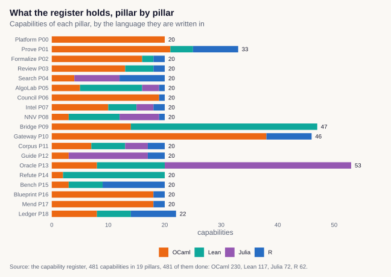

# maithicviz

The figures of Maithic, in one visual style. Each function takes what a reader of `maithicstats` returns and
gives a ggplot object; each `render_*` function reads files and writes the figures made from them as SVG. No
mark of a figure covers another: a rate is a dot on the line of its interval with nothing under it, bars that
carry their numbers have no grid behind them, and what would not fit beside a mark is written in a row of its own.

## What it provides

- `theme_maithic`, `maithic_colors`, `status_colors`: the theme and the colours of the brand.
- Figures for every part: benchmark runs, the prover and the ledger, retrieval, the code graph and the library, datasets, reviews, tactic models, repairs, formalizations, council sessions, blueprints, measured growth and the capability register.
- `save_figure`: SVG at a fixed size, with text that names fonts every system has and carries its measured length, so that a reader with other fonts sees the same layout; the same data gives the same file.
- `render_all`, `render_reports`, `render_insights`, `render_library`, `render_register`, `render_search`, `render_guide`, `render_mend`, `render_council`, `render_formalize`, `render_blueprint`, `render_growth`: the figures of the documentation, redrawn from the files of the repository by `make figures`.

## An example

Run from the root of the repository:

```r
library(maithicviz)

status <- maithicstats::read_register_status("registry/status.json")
plot <- plot_register(status)
print(inherits(plot, "ggplot"))
print(plot$labels$title)

out <- file.path(tempdir(), "figures")
path <- save_figure(plot, file.path(out, "register.svg"), height = 6.4)
print(basename(path))
print(unname(maithic_colors()[c("teal", "gold", "indigo")]))
```

It prints:

```text
[1] TRUE
[1] "What the register holds, pillar by pillar"
[1] "register.svg"
[1] "#0FA89B" "#F0A92E" "#2B2F77"
```

## Where Maithic uses it

`make figures` redraws every figure under [`assets/readme`](../../assets/readme) from the result files of the
repository. This is one of them, the capability register by pillar and language:

<p align="center">
  
</p>

## Tests

```sh
make build-r test-r
```

The tests build each figure and check its marks against the numbers they are drawn from.

## Dependencies

R 4.4 or later (built and tested with 4.5) with `ggplot2`, `svglite` and the package `maithicstats`. The tests use `testthat`.
